<div align="center">


## One chat for multiple AI coding CLIs

**Switch between Claude Code, opencode and Codex in the same conversation — without starting over.**

Teleharness is an open-source, self-hosted web UI for AI coding agents. It runs the real CLIs on your machine,
with their native agents, skills, MCP servers, hooks and project context, and lets you hand a chat from one CLI
to another when a subscription hits its usage limit.

**Multi-CLI chat** · **cross-CLI context handoff** · **subscription usage** · **mobile-first UI** · **persistent memory** · **self-hosted**

[](https://github.com/al3x4kov/teleharness/releases/latest)
[](https://github.com/al3x4kov/teleharness/actions/workflows/ci.yml)
[](LICENSE)
[](https://nodejs.org)
[](#platform-support)

[Switch CLIs](#switch-cli-mid-conversation) •
[Try the demo](#try-it-in-30-seconds) •
[Tour](#a-quick-tour) •
[Features](#features) •
[Quick start](#quick-start) •
[Architecture](#architecture) •
[Configuration](#configuration) •
[Contributing](CONTRIBUTING.md) •
[Русский](README.ru.md)


</div>

---

## Switch CLI mid-conversation

Start a task with Claude Code, then continue it with opencode on GLM or any other model opencode supports, or with
Codex — in any direction.

- **From the chat menu, at any time:** *Continue in…* → engine and model.
- **When a subscription runs out:** the usage-limit notice offers *Continue in &lt;model&gt;* — one tap.
- **What carries over:** the project folder, one shared feed with a handoff mark, the turns the new CLI missed
  (sent with its first prompt) and, if a knowledge-base folder is set, the full chat journal.
- **Automatically, if you want:** turn on *Continue automatically on a usage limit* in Settings → Model & agents and
  list up to three backup models; the server hands the chat over and asks the new CLI to go on, even with your phone
  locked. Off by default.
- **What doesn't:** the previous CLI's private session state.

<p align="center">
  
  
  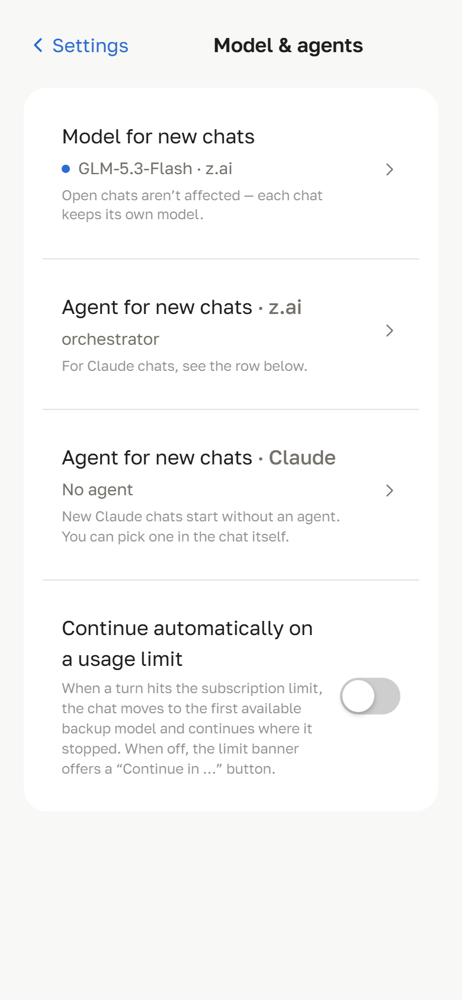
</p>

Details, limits and FAQ: [docs/cross-cli-handoff.md](docs/cross-cli-handoff.md).

## Pipelines that survive restarts (Temporal)

Turn a routine into a pipe: Claude reviews the diff, you approve it from your phone, Codex writes the release notes and
the file lands in the run folder. Each step runs on your CLI subscription as a turn of your own chat, so you can open
its conversation later. Runs keep going while the portal is closed or the server restarts.

<p align="center">
  
</p>

<p align="center">
  
  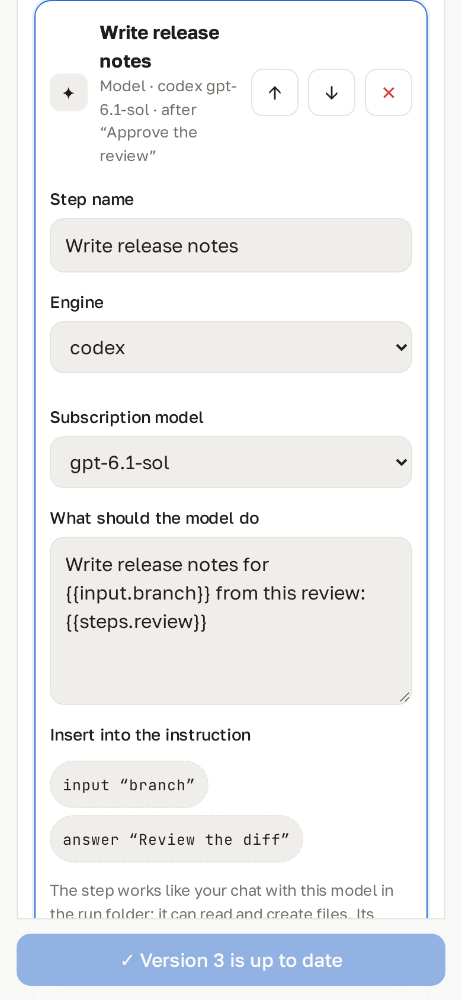
  
  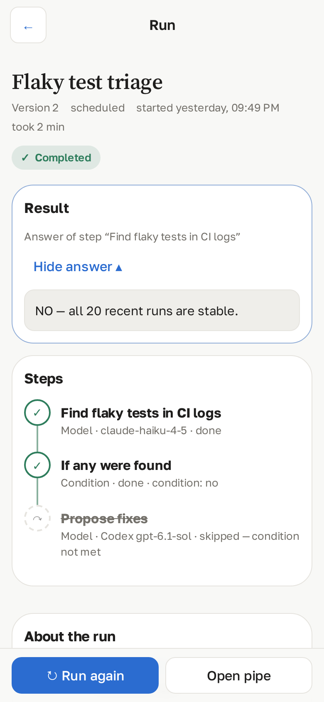
</p>

Steps: *Model* (Claude or Codex), *Human decision*, *Timer*, *Join*, *Condition*, *Artifact*; run inputs as
`{{input.name}}`, earlier answers as `{{steps.id}}`; schedules with a preview of the next runs. Optional, Linux and
macOS — see [docs/temporal.md](docs/temporal.md). Try it without any setup in `npm run demo`.

## Why Teleharness

Chat apps give you a model. Agent CLIs give you much more — tools, file access, subagents, skills,
MCP servers, hooks, project memory — but they live in a terminal on your desk.

Teleharness puts a mobile-first web UI in front of those CLIs, so the full harness is one tap away:

- **CLIs, not models.** Each chat runs through `opencode serve`, the `claude` CLI or the `codex` CLI. Whatever you
  have configured there — agents, skills, plugins, MCP — works from your phone.
- **Many providers through one portal.** opencode talks to Z.ai GLM, OpenAI, Google Gemini, Anthropic,
  OpenRouter, local models and more; Claude Code brings your Claude subscription, Codex your ChatGPT
  subscription. Pick the engine and model per chat.
- **A task survives a usage limit.** When a subscription runs out mid-task, hand the chat over to another
  engine or model: same folder, one feed, and the new engine receives the turns it missed.
- **Memory that outlives a chat.** An Obsidian vault works as an active cache: agents get a snapshot
  of your notes at the start of a chat and leave a digest after each turn.
- **Your machine, your data.** Files, tools and history stay on your server. Providers only see the
  prompts and tool results needed for inference.
- **You stay in control.** Per chat, choose whether the agent asks before edits and commands; approve or deny
  right in the chat or from a push notification.
- **Share it safely.** Multiple users with their own folders, quotas and system prompts; on Windows
  their commands run in an AppContainer sandbox.

## Try it in 30 seconds

No engines, no API keys — the UI on synthetic chats:

```bash
git clone https://github.com/al3x4kov/teleharness.git
cd teleharness
npm ci
npm run demo     # → http://127.0.0.1:4171/teleharness/
```

## A quick tour

All screenshots are taken from `npm run demo` — what you see is what you get.

<table>
<tr>
<td width="25%">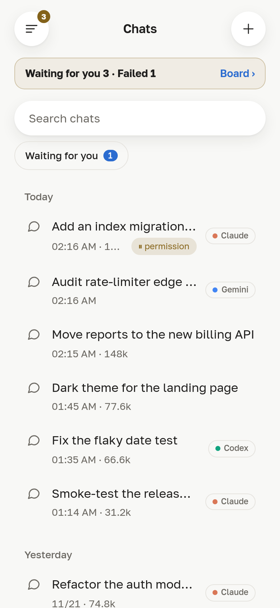</td>
<td width="25%">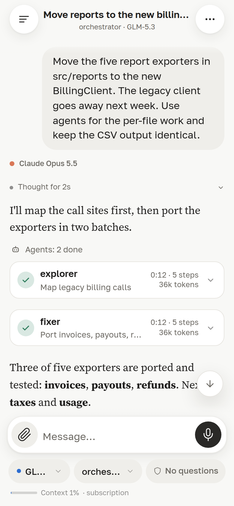</td>
<td width="25%">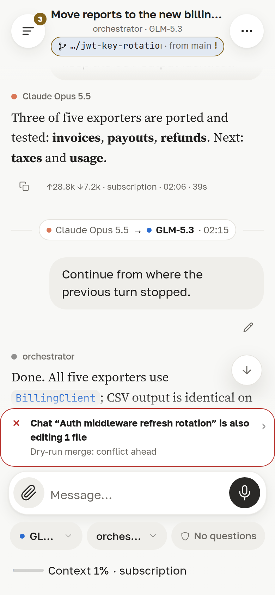</td>
<td width="25%"></td>
</tr>
<tr>
<td valign="top"><b>Chats</b><br>Every chat is bound to an engine, a model and an agent. Claude Code chats are marked.</td>
<td valign="top"><b>Subagents</b><br>When an agent delegates, each run is a card: who, what for, how long, how many steps and tokens.</td>
<td valign="top"><b>Inside a run</b><br>Open a card to see the subagent's steps and its answer, or jump to its own chat.</td>
<td valign="top"><b>Relay</b><br>Hit a usage limit? The same chat continues on another engine — one feed, with a handoff mark.</td>
</tr>
<tr>
<td width="25%"></td>
<td width="25%"></td>
<td width="25%"></td>
<td width="25%">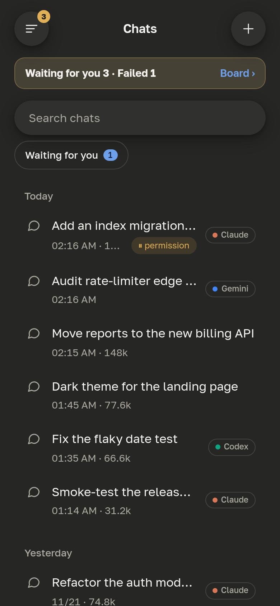</td>
</tr>
<tr>
<td valign="top"><b>Pick where to continue</b><br>From the chat menu at any time, or straight from the limit notice. The folder stays the same.</td>
<td valign="top"><b>Subscriptions</b><br>Usage and remaining quota per connected provider, where it reports them through an official API.</td>
<td valign="top"><b>Steps and files</b><br>Reasoning, tool calls with output, and result files as cards with preview and download.</td>
<td valign="top"><b>Light and dark</b><br>Follows the system theme or your choice; built for one-handed use on a phone.</td>
</tr>
</table>

<p align="center">
  
</p>
<p align="center"><sub>The same UI on a desktop: Claude Opus did the first half, GLM-5.3 picked the task up after the handoff.</sub></p>

<p align="center">
  
</p>
<p align="center"><sub>A Claude Code chat in the dark theme.</sub></p>

<p align="center">
  
</p>

<p align="center">
  
</p>

## Features

| | | |
|---|---|---|
| 💬 | **Three engines, one UI** | opencode (any provider), Claude Code and Codex CLI side by side; a chat stays bound to its engine, model and agent. Codex chats are admin-only for now, on every OS — Codex needs its own sandbox before other users get it (in Temporal pipelines every user can use Codex, text-only).<br> 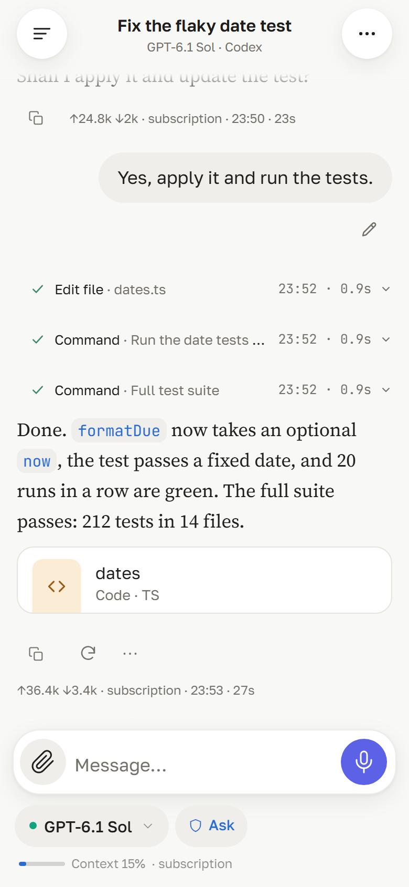 |
| 🛡️ | **Permission mode per chat** | *Ask* — the agent asks before file edits and commands, you approve or deny in the chat (Claude through a permission bridge, Codex natively); *Edits without asking*; *No questions* (admin only).<br>  |
| ⏸️ | **Waiting for you** | A chat list filter with a count of chats where an agent waits for your decision, plus a push notification when it starts waiting.<br>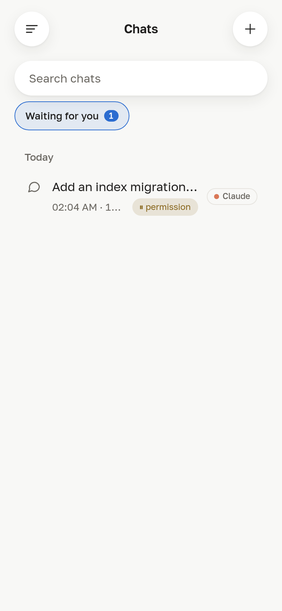 |
| 📈 | **Context and cost** | A meter above the composer: how full the model's context window is (with a warning past 80 %) and what the chat has cost — or that it runs on a subscription.<br>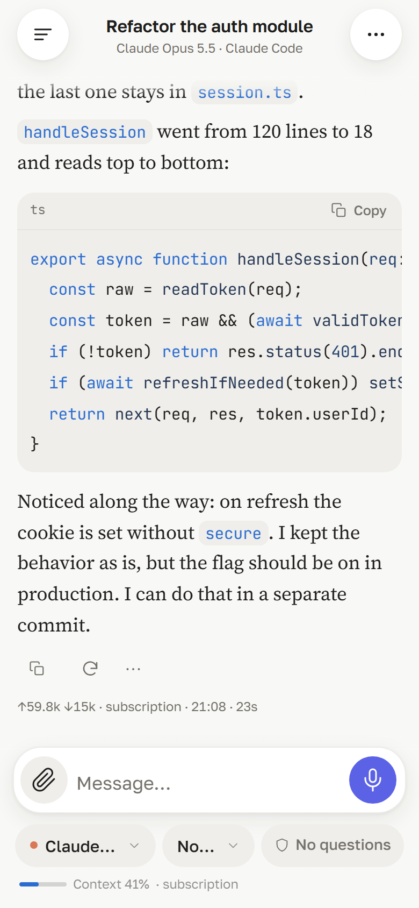  |
| 🧠 | **Agent steps** | Live turn progress: reasoning, tool calls with output, subagent cards with their own steps, background tasks. Undo a turn and its file edits. |
| 🧾 | **Turn changes and Git** | An answer that edited files gets a *Changes · N files* row: open it for a per-file diff — what this turn changed, or the file now against the last commit (one column on a phone, two panes on a desktop). The Git screen of the chat folder shows the branch, ahead/behind and changed files: tick the files to commit, let the chat's own model suggest the message in a separate short request (it never lands in the chat history), commit, and push — push is for the admin only. Other users work with git in their own folders, without push or branch switching. Settings → Git holds the commit author, the message language and the default selection. |
| 🌙 | **Background subagents keep working** | Claude Code answers right away while subagents it started in the background keep running after the answer. A band above the composer shows who is still working; a new message waits in the queue, and Claude picks up their results and answers again when they finish. |
| 🔁 | **Temporal pipelines** *(optional)* | Multi-step scenarios that survive restarts: Claude or Codex steps that work in the pipe's own folder (files included), your decision between steps, timers, conditions, saved artifacts, run inputs passed as `{{input.name}}` and earlier answers as `{{steps.id}}`. Runs show their status without extra taps, a *Waiting for you* block and a badge in the menu, a result block with the final answer, the run's files and each step's conversation; pause, cancel, terminate with a reason; schedules with a preview of the next runs. Runs on your CLI subscriptions, never a paid API. Linux and macOS; off by default — see [docs/temporal.md](docs/temporal.md).<br> |
| 🔀 | **Relay between engines** | Hit a usage limit mid-task? Continue the same chat on another engine or model: same folder, one feed, and the new engine gets the turns it missed. Optionally automatic, with your own order of backup models. |
| 📊 | **Subscriptions** | Usage and remaining quota per connected provider, where the provider reports it through an official API. |
| 📡 | **Reliable streaming** | One SSE hub for every engine with replay, stall detection and loop protection — survives flaky mobile networks. |
| 📎 | **Files** | Attach files and images, get result files as cards, browse allowed folders. A folder per chat. |
| 🗂️ | **Obsidian as active cache** | Vault snapshot in context, turn digests and a per-chat journal written back, an isolated zone per user. |
| 🎙️ | **Voice** | Local speech-to-text and text-to-speech (Python worker, CPU only) and a hands-free voice mode. |
| 🔔 | **Push notifications** | Get notified when a long turn is done or an agent needs your decision (Web Push, VAPID). |
| 📲 | **Phone pairing by QR** | Settings → Connect a phone shows a one-time QR code (valid 10 minutes); scan it and the phone is signed in to your account — no token typing. Needs `TELEHARNESS_PUBLIC_URL`.<br>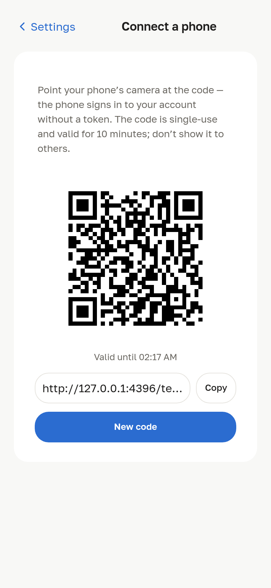 |
| 👥 | **Multi-user** | Admin and users with own folders, system prompts, MCP sets, upload and voice quotas, rate limits. |
| 📱 | **Mobile-first** | Built for iOS Safari: keyboard-aware layout, safe areas, light and dark themes, English and Russian UI. |
| 🪶 | **Zero runtime dependencies** | The backend is plain Node.js stdlib. |

## Quick start

### Requirements

| | Version | For |
|---|---|---|
| [Node.js](https://nodejs.org) | ≥ 22 | the portal |
| [opencode](https://opencode.ai) | 2.x (tested with 2.2.6) | the opencode engine |
| [Claude Code](https://docs.anthropic.com/en/docs/claude-code) | 2.x | the Claude engine |
| [Codex CLI](https://github.com/openai/codex) | 0.169+ | optional, the Codex engine (admin only) |
| Python | 3.11+ | optional, voice |

You need at least one engine.

### One command

```bash
npx github:al3x4kov/teleharness            # → http://127.0.0.1:4180/teleharness/
```

It checks Node, keeps its data in `~/.teleharness`, builds the UI on the first run, tells you which engines it
found (and how to install the missing ones) and prints the admin token. Options: `--port N`, `--host 0.0.0.0`
(reachable from your LAN), `--rebuild`. opencode serve is not started for you — the installer prints the command.

### Install and run

<details open>
<summary><b>macOS / Linux</b></summary>

```bash
git clone --branch v1.21.0 https://github.com/al3x4kov/teleharness.git
cd teleharness
npm ci && npm run build

cp .env.example .env               # every value is optional

# engines (you need at least one)
opencode auth login                # add the providers you want
claude setup-token                 # Claude engine: put the token into .env as CLAUDE_CODE_OAUTH_TOKEN

./ops/opencode/serve-v2.sh &       # opencode 2.x on 127.0.0.1:4196, password in ~/.teleharness/oc2-password
./ops/web-v2.sh                    # → http://127.0.0.1:4170/teleharness/
```
</details>

<details>
<summary><b>Windows (PowerShell)</b></summary>

```powershell
git clone --branch v1.21.0 https://github.com/al3x4kov/teleharness.git
cd teleharness
npm ci; npm run build

Copy-Item .env.example .env        # every value is optional

opencode auth login
claude setup-token

# opencode 2.x with HTTP Basic auth; the portal gets the same password
$env:OPENCODE_SERVER_PASSWORD = [guid]::NewGuid().ToString('N')
Start-Process opencode -ArgumentList 'serve','--hostname','127.0.0.1','--port','4196'

$env:TELEHARNESS_OC_API = 'v2'; $env:TELEHARNESS_UPSTREAM = 'http://127.0.0.1:4196'; $env:TELEHARNESS_OC_PASSWORD = $env:OPENCODE_SERVER_PASSWORD
node server.js                     # → http://127.0.0.1:4170/teleharness/
```
</details>

Step-by-step for a Mac, including launchd services and phone access: [`docs/macos.md`](docs/macos.md).

On first start the portal creates an admin and writes the login token to `data/admin-token.txt`
(or uses `TELEHARNESS_ADMIN_TOKEN`). To reach it from your phone, put it behind TLS — the bundled edge server
(`ops/portal-server.js`) or any reverse proxy (Caddy, nginx, Tailscale Serve).

> [!NOTE]
> The portal is served under `/teleharness/`; every setting is a `TELEHARNESS_*` environment variable
> (see [`.env.example`](.env.example)).

### Platform support

| | macOS | Linux | Windows |
|---|:---:|:---:|:---:|
| Portal, opencode and Claude engines, files, push | ✅ | ✅ | ✅ |
| Codex engine (chats) | admin only | admin only | admin only |
| Temporal pipelines (optional) | ✅ | ✅ | — |
| Codex in Temporal pipelines | ✅ (text-only for regular users) | ✅ (text-only for regular users) | — |
| Obsidian cache, voice | ✅ | ✅ | ✅ |
| Shell commands for non-admin users | — | ✅ with the optional per-user runner¹ | ✅ (AppContainer sandbox) |

On macOS (and on Linux without the runner) shell access for regular users is refused (fail-closed); admins are not
affected. ¹ On Linux, users' shell commands can run through a per-user runner (`/usr/local/libexec/teleharness-tenant-run`,
see `ops/sandbox/linux`); without it they stay refused.
User isolation is moving to one container per user with the full agent runtime — the same on every host OS —
so the Windows sandbox is intentionally not ported to other systems.

## Architecture

<p align="center">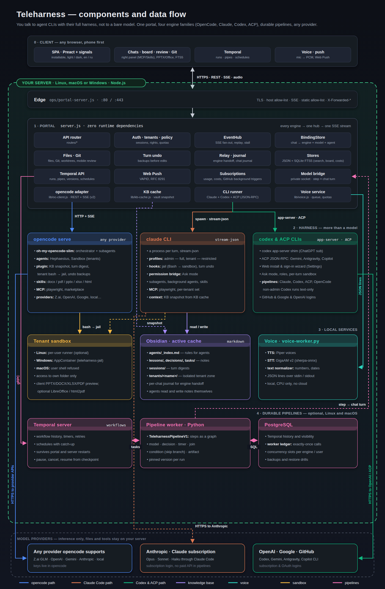</p>

- **Portal** (`server.js`) — API, auth and users, the event hub, chat-to-engine binding, the handoff between
  engines. One adapter per engine: a client for `opencode serve` (1.x and 2.x) and a runner that starts
  `claude` (or the Codex shim over `codex app-server`) per turn.
- **Harness** — everything around the CLI: agents and orchestration (oh-my-opencode-slim), the
  knowledge-base and sandbox plugin for opencode (`ops/opencode/plugin-v2` for 2.x, `vault-cache.ts` for 1.x),
  Claude Code hooks, skills, MCP servers. This decides what an agent can do and
  what it knows.
- **Obsidian** — long-term memory for agents, one zone per user; also holds the per-chat journal an engine
  reads after a handoff.
- **Voice** — a separate local Python process (Piper TTS, GigaAM STT).
- **Sandbox** — Windows AppContainer for other users' commands.

More: [`docs/architecture.md`](docs/architecture.md) (in Russian), requirements in [`openspec/specs/`](openspec/specs/).

## Configuration

Everything is configured with environment variables; the schema with types, defaults and validation is
[`lib/config.js`](lib/config.js), the template is [`.env.example`](.env.example).

| Variable | Default | |
|---|---|---|
| `PORT` | `4170` | portal port |
| `TELEHARNESS_UPSTREAM` | `http://127.0.0.1:4096` | `opencode serve` address (the default is the opencode 1.x legacy port; with 2.x use `:4196`) |
| `TELEHARNESS_OC_API` | `v1` | `v2` for opencode 2.x (`ops/web-v2.sh` sets it) |
| `TELEHARNESS_OC_PASSWORD` | — | HTTP Basic password of `opencode serve` 2.x |
| `CLAUDE_CODE_OAUTH_TOKEN` | — | Claude subscription token (`claude setup-token`) |
| `TELEHARNESS_ADMIN_TOKEN` | generated | admin login token |
| `TELEHARNESS_PUBLIC_URL` | — | public https address of the portal root (`https://host/teleharness/`) for the phone pairing QR code; empty — no QR |
| `TELEHARNESS_CODEX` | on | `off` hides the Codex engine even when `codex` is installed and signed in |
| `TELEHARNESS_CODEX_BIN` | `codex` from npm global or `PATH` | path to the codex binary or its `bin/codex.js` |
| `TELEHARNESS_DATA_DIR` | `./data` | users, sessions, logs |
| `TELEHARNESS_FILE_ROOTS` | home folder | folders available in the file browser |
| `TELEHARNESS_KB_ROOT` | `off` | Obsidian vault folder for agents, e.g. `~/Obsidian/agents` |
| `TELEHARNESS_TENANT_HOME` | `~/.teleharness-tenants` | users' folders |
| `TELEHARNESS_VOICE_PYTHON`, `TELEHARNESS_VOICE_MODELS` | `~/.teleharness/voice/…` | local voice worker |

### Agent configs

[`config/`](config/) holds the author's Claude Code and opencode setup as a working example —
agents, prompts, the vault-cache plugin, document skills. Install with `./config/install.sh`
(macOS/Linux) or `./config/install.ps1` (Windows); secrets are taken from the environment.
The configs contain absolute paths — review them before use.

Third-party skills are not bundled; install them from their sources:
[agent-skills](https://github.com/addyosmani/agent-skills) (`/plugin marketplace add addyosmani/agent-skills`),
[OpenSpec](https://github.com/Fission-AI/OpenSpec) (`npm i -g @fission-ai/openspec`).

## Development

```bash
npm test                 # unit, UI components (happy-dom), server and edge tests
npm run build            # esbuild → public/app.js, public/app.css
npm run demo             # mock mode on fixtures-demo/
```

| Path | |
|---|---|
| `server.js`, `lib/`, `routes/` | backend |
| `src/` → `public/` | frontend (Preact + signals) |
| `shared/` | code shared by server and client |
| `ops/` | launch scripts, opencode plugins, edge server, sandbox, voice worker, document rendering |
| `config/` | Claude Code and opencode configs |
| `tests/`, `fixtures/`, `fixtures-demo/` | tests and synthetic fixtures |
| `openspec/specs/`, `docs/` | requirements, architecture, ADRs |

See [CONTRIBUTING.md](CONTRIBUTING.md). Changes are listed in [CHANGELOG.md](CHANGELOG.md).

## Built with

[opencode](https://opencode.ai) · [Claude Code](https://docs.anthropic.com/en/docs/claude-code) · [Codex CLI](https://github.com/openai/codex) ·
[oh-my-opencode-slim](https://www.npmjs.com/package/oh-my-opencode-slim) · [Preact](https://preactjs.com) ·
[esbuild](https://esbuild.github.io) · [marked](https://marked.js.org) · [DOMPurify](https://github.com/cure53/DOMPurify) ·
[highlight.js](https://highlightjs.org) · [Piper](https://github.com/rhasspy/piper) · [sherpa-onnx](https://github.com/k2-fsa/sherpa-onnx)

## License

[MIT](LICENSE). Bundled third-party files keep their licenses: `openspec-*` / `opsx-*` skills and
commands — MIT ([OpenSpec](https://github.com/Fission-AI/OpenSpec)), the `dogfood` skill — Apache-2.0.
