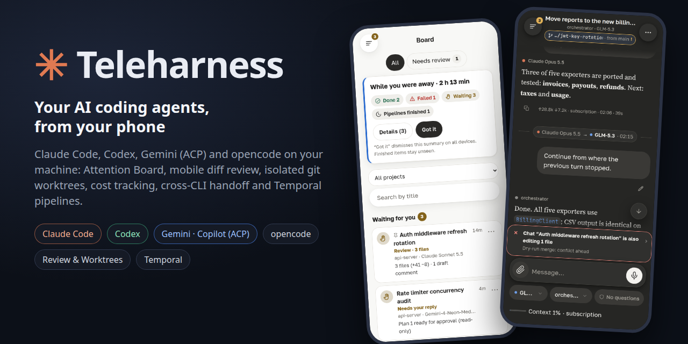

<div align="center">



## Self-hosted web UI for Claude Code, Codex, Gemini (ACP), and opencode

**Run your local coding CLIs from one browser tab using the subscriptions you already pay for. Review diffs in isolated git worktrees, hand off a chat to another CLI when a usage limit hits, or chain agents into Temporal pipelines. Works on desktop and as an optional mobile PWA.**

**Chat** · **Attention Board** · **Diff Review & Worktrees** · **Cross-CLI Relay** · **Temporal Pipelines** · **Self-Hosted**

[](https://www.npmjs.com/package/teleharness)
[](https://github.com/al3x4kov/teleharness/releases/latest)
[](https://github.com/al3x4kov/teleharness/actions/workflows/ci.yml)
[](LICENSE)
[](https://nodejs.org)
[](#platform-support)

[Try in 10s](#try-it-in-10-seconds) •
[Comparison](#how-teleharness-compares) •
[Features](#what-it-does) •
[Visual tour](docs/tour.md) •
[Quick start](#quick-start) •
[Security](#security-model) •
[Architecture](#architecture) •
[Configuration](#configuration) •
[Русский](README.ru.md)


</div>

---

## Try it in 10 seconds

Runs on synthetic demo chats in a temporary directory. No agent CLIs, no API keys, nothing written to your home folder.

**1. Node.js ≥ 22:**
```bash
npx teleharness --demo
# → http://127.0.0.1:4180/teleharness/  (token: demo-demo-demo-demo)
```

**2. Docker Compose:**
```bash
git clone https://github.com/al3x4kov/teleharness.git && cd teleharness
docker compose up
# → http://127.0.0.1:4180/teleharness/  (token: demo-demo-demo-demo)
```

**3. Free-tier cloud sandbox (read-only demo via [`render.yaml`](render.yaml)):**

[](https://render.com/deploy?repo=https://github.com/al3x4kov/teleharness)

---

## How Teleharness compares

Teleharness launches the **real local CLIs** installed on your machine (keeping their skills, MCP servers, hooks, and project files) instead of proxying requests through a metered API.

| Capability | Teleharness | Claude Code Web | OpenCode Web | Cursor | Vibe Kanban |
|---|:---:|:---:|:---:|:---:|:---:|
| Uses existing CLI subscriptions (no extra API billing) | **Yes** | Claude only | BYO API / OAuth | Own plan | Yes |
| Claude Code + Codex + Gemini/ACP + opencode in one UI | **Yes (4 families)** | No | opencode only | IDE models | Partial |
| Hand off chat to another CLI on quota limit (manual & Auto-Relay) | **Yes** | No | No | No | No |
| Attention Board + inline Diff Review + Plan-First | **Yes** | Partial | Partial | IDE | Partial |
| Isolated Git Worktrees with overlap & dry-run conflict checks | **Yes** | No | No | Background | Yes |
| Multi-agent pipelines that survive restarts (Temporal) | **Yes** | No | No | No | No |
| Self-hosted, zero backend deps, optional mobile PWA | **Yes** | Cloud | Local | Desktop | Local |

---

## What it does

- **Four CLI families in one window:** Claude Code, Codex, Gemini/Copilot (ACP), and opencode run side by side with live tool steps, subagent cards, an MCP/Skills/Plan side panel, SQLite FTS5 search, Office/PPTX preview, Obsidian vault cache, and optional local CPU voice.
- **Attention Board, diff review, and Plan-First:** all sessions and runs are grouped into *Waiting*, *Working*, *Done*, and *Failed* with a side preview pane, inline diff comments by line range, and read-only plan approval before files are edited.
- **Git worktrees and cost accounting:** parallel chats work in separate git worktrees with file-overlap warnings and dry-run conflict checks. Cost tracking compares API-equivalent token spend against your flat subscriptions.
- **Cross-CLI Relay (manual and automatic):** when a Claude or Codex quota limit hits mid-task, continue the same thread in the same folder on another CLI or fallback model. ([Details](docs/cross-cli-handoff.md))
- **Temporal pipelines and GitHub background agents (optional):** chain Claude, Codex, Gemini (ACP), opencode, allowlisted shell commands, and human approval gates into workflows that survive restarts, resume from any step, and trigger from GitHub issues or failed CI. ([Details](docs/temporal.md))

Full screen-by-screen walkthrough and feature table: **[Visual Tour (`docs/tour.md`)](docs/tour.md)**.

---

## Quick start

> [!TIP]
> Step-by-step setup for Linux, macOS, and Windows (all 4 engines, Worktrees, Obsidian cache, Temporal, GitHub triggers, HTTPS + QR PWA, autostart): **[`docs/installation.md`](docs/installation.md)** ([по-русски](docs/installation.ru.md)).

### Requirements

| | Version | For |
|---|---|---|
| [Node.js](https://nodejs.org) | ≥ 22.5 (22 LTS / 24 LTS) | portal server & built-in SQLite FTS5 search/costs/board |
| [Git](https://git-scm.com) | ≥ 2.20 | Git screen, diff review, isolated Worktrees |
| [opencode](https://opencode.ai) | 2.x (tested with 2.2.6) | opencode engine |
| [Claude Code](https://docs.anthropic.com/en/docs/claude-code) | 2.x | Claude engine |
| [Codex CLI](https://github.com/openai/codex) | 0.169+ | optional, Codex engine |
| ACP CLI (`gemini` / `copilot` / custom) | latest | optional, configured in Settings → ACP Agents |
| Python | 3.11+ | optional, local CPU voice & Temporal pipeline worker |

You only need **at least one** engine installed (or none for `--demo`).

### One command

```bash
npx teleharness                                # → http://127.0.0.1:4180/teleharness/
```

Checks Node, stores state in `~/.teleharness`, serves the prebuilt UI bundle (or rebuilds on demand), detects installed CLIs, and prints the admin login token. Flags: `--demo`, `--port N`, `--host 0.0.0.0`, `--rebuild`.

### From source

<details open>
<summary><b>macOS / Linux</b></summary>

```bash
git clone --branch v2.13.2 https://github.com/al3x4kov/teleharness.git
cd teleharness
npm ci && npm run build

cp .env.example .env               # every value is optional

opencode auth login                # opencode
claude setup-token                 # put token into .env as CLAUDE_CODE_OAUTH_TOKEN

./ops/opencode/serve-v2.sh &       # opencode 2.x on 127.0.0.1:4196
./ops/web-v2.sh                    # → http://127.0.0.1:4170/teleharness/
```
</details>

<details>
<summary><b>Windows (PowerShell)</b></summary>

```powershell
git clone --branch v2.13.2 https://github.com/al3x4kov/teleharness.git
cd teleharness
npm ci; npm run build

Copy-Item .env.example .env        # every value is optional

opencode auth login
claude setup-token

$env:OPENCODE_SERVER_PASSWORD = [guid]::NewGuid().ToString('N')
Start-Process opencode -ArgumentList 'serve','--hostname','127.0.0.1','--port','4196'

$env:TELEHARNESS_OC_API = 'v2'; $env:TELEHARNESS_UPSTREAM = 'http://127.0.0.1:4196'; $env:TELEHARNESS_OC_PASSWORD = $env:OPENCODE_SERVER_PASSWORD
node server.js                     # → http://127.0.0.1:4170/teleharness/
```
</details>

<details>
<summary><b>Docker (self-hosted profile)</b></summary>

```bash
git clone https://github.com/al3x4kov/teleharness.git && cd teleharness
docker compose --profile selfhosted up -d teleharness
docker compose --profile selfhosted logs teleharness | grep -i "admin token"
# → http://127.0.0.1:4170/teleharness/
```

State persists in the `teleharness-data` volume (`/data`); mount local repos to `/workspace` and pass `TELEHARNESS_UPSTREAM` / `TELEHARNESS_OC_PASSWORD` for OpenCode 2.x on the host. Full Docker notes (Linux vs macOS/Windows host access, local CLIs): [`docs/installation.md#docker`](docs/installation.md#docker-demo--self-hosted).
</details>

> [!NOTE]
> The portal is served under `/teleharness/`; all options are `TELEHARNESS_*` environment variables ([`.env.example`](.env.example)). macOS launchd notes: [`docs/macos.md`](docs/macos.md). Linux systemd unit: [`ops/linux/teleharness.service`](ops/linux/teleharness.service).

### Platform support

| | macOS | Linux | Windows |
|---|:---:|:---:|:---:|
| Portal, opencode, Claude, Codex, ACP, diff review, worktrees, push | yes | yes | yes |
| Temporal pipelines & GitHub Background Agents (optional) | yes | yes | — |
| Obsidian active cache, local CPU voice | yes | yes | yes |
| Multi-user non-admin shell sandbox | disabled (fail-closed) | optional per-user runner | AppContainer sandbox |

---

## Security model

- **Single-user on `localhost` / Tailscale:** Teleharness runs under your own OS user over your local CLIs. No tenant sandbox is needed, and all engines work the same on macOS, Linux, and Windows.
- **Multi-user / shared server:** non-admin accounts get isolated folders, quotas, and MCP sets; shell execution is fail-closed unless you configure the Linux per-user runner (`ops/sandbox/linux`) or Windows AppContainer. See [SECURITY.md](SECURITY.md).

---

## Architecture

<p align="center"></p>

- **Backend (`server.js`, `lib/`, `routes/`):** zero-dependency Node.js stdlib (`node:http`, SSE with replay, built-in `node:sqlite` FTS5, attention board, costs, Git/Worktrees) and one adapter per engine family (`lib/oc-client.js`, `claude` CLI runner, `codex-shim.mjs`, `lib/acp-chat.js`).
- **Frontend (`src/` → `public/`):** Preact + Signals bundled with esbuild, light/dark themes, EN/RU UI, optional mobile PWA.
- **Optional add-ons:** Obsidian vault cache, local Python CPU voice worker (Piper TTS / GigaAM STT), Temporal pipeline worker ([`docs/temporal.md`](docs/temporal.md)).

Layer diagram and search pipeline: [`docs/tour.md#architecture-diagrams`](docs/tour.md#architecture-diagrams). Architecture notes: [`docs/architecture.md`](docs/architecture.md), specs: [`openspec/specs/`](openspec/specs/).

---

## Configuration

Settings are schema-validated in [`lib/config.js`](lib/config.js); template in [`.env.example`](.env.example).

| Variable | Default | Purpose |
|---|---|---|
| `PORT` | `4170` (`4180` via CLI) | portal port |
| `TELEHARNESS_DEMO` | `0` | set `1` to run instant synthetic demo mode |
| `TELEHARNESS_UPSTREAM` | `http://127.0.0.1:4196` | `opencode serve` 2.x URL |
| `TELEHARNESS_OC_API` | `v1` | `v2` for opencode 2.x |
| `TELEHARNESS_OC_PASSWORD` | — | HTTP Basic password for opencode 2.x |
| `CLAUDE_CODE_OAUTH_TOKEN` | — | Claude subscription token (`claude setup-token`) |
| `TELEHARNESS_ADMIN_TOKEN` | generated | admin login token |
| `TELEHARNESS_PUBLIC_URL` | — | HTTPS URL for optional phone QR pairing |
| `TELEHARNESS_KB_ROOT` | `off` | Obsidian vault path for active cache |

Example agent configs (Claude Code + opencode): [`config/`](config/) (`./config/install.sh` / `./config/install.ps1`).

---

## Development

```bash
npm test                 # unit, UI components (happy-dom), server and edge tests
npm run build            # esbuild → public/app.js, public/app.css
npm run demo             # synthetic demo on fixtures-demo/
```

See [CONTRIBUTING.md](CONTRIBUTING.md) and [CHANGELOG.md](CHANGELOG.md).

## Built with

[opencode](https://opencode.ai) · [Claude Code](https://docs.anthropic.com/en/docs/claude-code) · [Codex CLI](https://github.com/openai/codex) · [Temporal](https://temporal.io) ·
[Preact](https://preactjs.com) · [esbuild](https://esbuild.github.io) · [marked](https://marked.js.org) · [DOMPurify](https://github.com/cure53/DOMPurify) · [highlight.js](https://highlightjs.org)

## License

[MIT](LICENSE). Bundled third-party files keep their licenses: `openspec-*` / `opsx-*` — MIT ([OpenSpec](https://github.com/Fission-AI/OpenSpec)), `dogfood` — Apache-2.0.
