<div align="center">


## Ваши AI-агенты для кода — с телефона

**Общайтесь с Claude Code, Codex, Gemini (ACP) и opencode в одном месте, проверяйте диффы и git worktrees с телефона,
передавайте задачу другому CLI, когда кончился лимит, и собирайте агентов в пайпы, которые переживают перезапуск.**

Teleharness — открытый self-hosted пульт для AI coding CLI. Он запускает настоящие CLI на вашей машине — с их
агентами, скиллами, MCP-серверами, хуками и контекстом проекта — и добавляет то, чего нет в терминале: Доску внимания,
мобильное ревью с «Сначала план», изолированные git worktrees, учёт расходов по ценам API, передачу чата между CLI и
надёжные пайпы из нескольких агентов на [Temporal](https://temporal.io). Всё это работает на подписках CLI, которые у
вас уже есть, а не на платном API.

**Чат** · **Поиск** · **Доска и ревью** · **Worktrees** · **Передача между CLI** · **Пайпы** · **на ваших подписках** · **на своём сервере**

[](https://github.com/al3x4kov/teleharness/releases/latest)
[](https://github.com/al3x4kov/teleharness/actions/workflows/ci.yml)
[](LICENSE)
[](https://nodejs.org)
[](#поддержка-платформ)

[Что умеет](#что-умеет) •
[Доска, ревью, worktrees и расходы](#доска-мобильное-ревью-worktrees-и-расходы) •
[Переключение CLI](#переключение-cli-посреди-разговора) •
[Пайпы](#пайпы-которые-переживают-перезапуск-temporal) •
[Демо](#попробовать-за-30-секунд) •
[Обзор](#обзор-по-экранам) •
[Возможности](#возможности) •
[Быстрый старт](#быстрый-старт) •
[Архитектура](#архитектура) •
[Конфигурация](#конфигурация) •
[English](README.md)

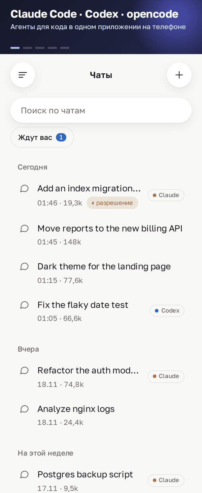

</div>

---

## Что умеет

<table>
<tr>
<td width="33%"></td>
<td width="33%"></td>
<td width="33%"></td>
</tr>
<tr>
<td valign="top"><b>Чат</b><br>Claude Code, Codex, Gemini и Copilot (ACP) и opencode рядом в мобильном интерфейсе: шаги в реальном времени, карточки субагентов, «Сначала план», диффы и git worktrees, файлы, голос, push. Подтверждайте правки и команды откуда угодно.</td>
<td valign="top"><b>Передача</b><br>Подписка кончилась посреди задачи? Тот же чат продолжается в другом CLI или модели — та же папка, одна лента, пропущенные ходы переносятся. Вручную или автоматически.</td>
<td valign="top"><b>Пайпы</b><br>Соберите агентов в многошаговые запуски на Temporal: Claude проверяет, вы одобряете с телефона, Codex пишет — с таймерами, условиями, расписаниями и артефактами. Запуски переживают перезапуск.</td>
</tr>
</table>

## Доска, мобильное ревью, worktrees и расходы

Ведите несколько агентных задач параллельно, не сидя в терминале:

- **Доска внимания (`#/board`)** — единый экран для всех чатов и запусков Temporal (*Ждёт вас*, *Работает*, *Готово*,
  *Упало*) со сводкой «Пока вас не было», быстрыми действиями и push-уведомлениями по категориям с тихими часами.
- **Мобильное ревью и «Сначала план» (`#/board/review`)** — тапните строку или диапазон в диффе, оставьте черновик
  комментария, верните структурированный фидбек агенту или примите и закоммитьте. Включите *Сначала план* — Claude,
  Codex, opencode или Gemini сначала составит план в режиме чтения и подождёт вашего одобрения, прежде чем править файлы.
- **Изолированные Git Worktrees (`#/worktrees`)** — отдельная рабочая копия и ветка на каждый чат или запуск пайпа,
  раннее предупреждение о пересечении файлов и конфликтах при пробном слиянии, слияние (squash / merge / fast-forward)
  после прогона тестов.
- **Расходы по ценам API (`#/settings/costs`)** — журнал каждого хода в SQLite по редактируемой таблице цен, сравнение
  с реальными подписками (Claude Max, ChatGPT Plus, Google Antigravity, GitHub Copilot CLI), расчёт экономии и
  окупаемости, мягкие месячные бюджеты и экспорт в CSV.
- **Агенты ACP (`#/settings/acp`)** — установка и вход в **Google Antigravity** (`Gemini 4 Neon`, `Gemini 3.8 Flash`)
  и **GitHub Copilot CLI** прямо из Настроек, с поддержкой ролей, картинок, «Сначала план», авто-передачи и автоматическим восстановлением после прерванных ходов.

<p align="center">
  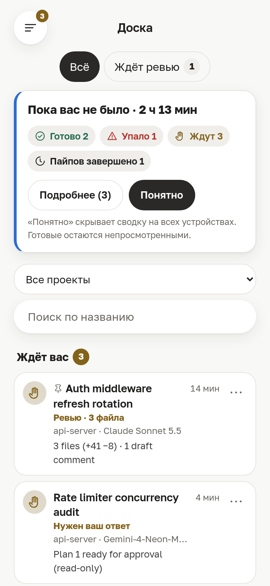
  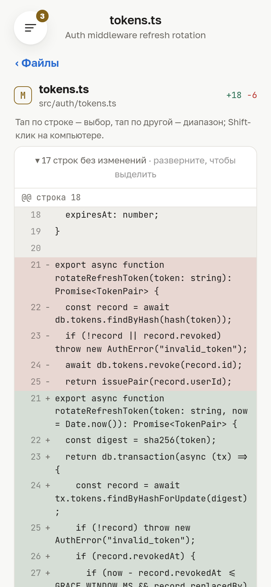
  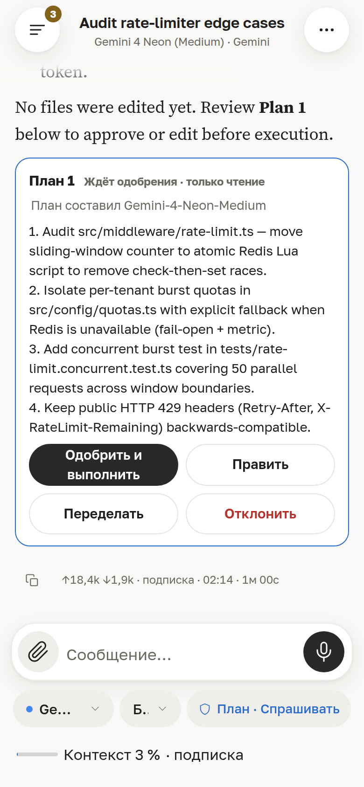
  
</p>

<p align="center">
  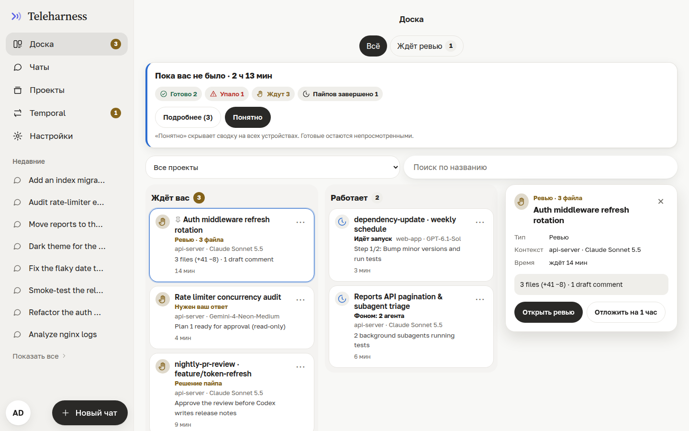
</p>
<p align="center"><sub>Доска внимания на десктопе: ревью, ждущие планы, активные пайпы и боковая панель предпросмотра (≥ 768 px) без автоматической отметки просмотренным.</sub></p>

<p align="center">
  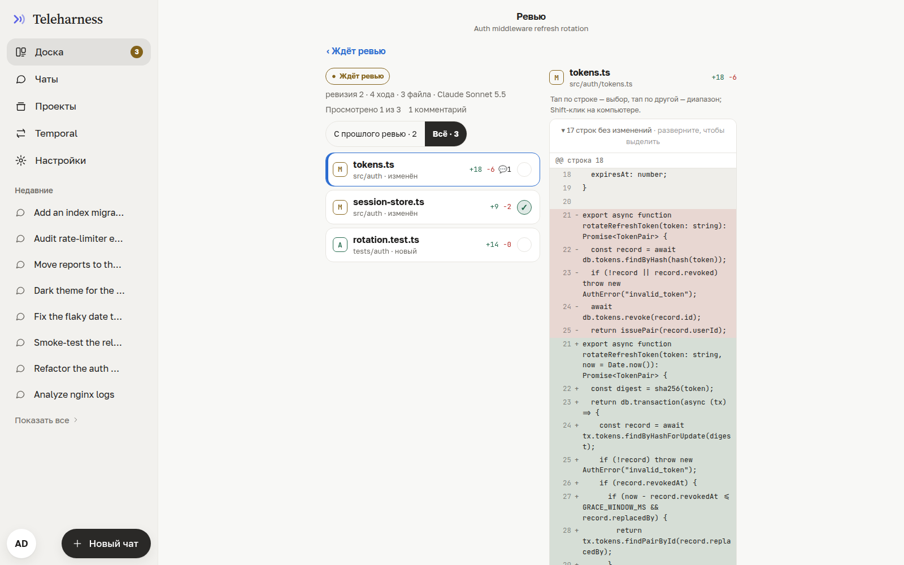
</p>

<p align="center">
  
</p>
<p align="center"><sub>Сравнение эквивалента по ценам API с реальными подписками, график по дням и разбивка по моделям.</sub></p>

## Переключение CLI посреди разговора

Начните задачу в Claude Code, а продолжите в Gemini (ACP), Codex или opencode на GLM и любой другой модели —
в любую сторону.

- **Из меню чата, в любой момент:** *Продолжить в…* → движок и модель.
- **Когда подписка закончилась:** плашка лимита предлагает *Продолжить в &lt;модель&gt;* — одно нажатие.
- **Что переносится:** папка проекта, одна лента с отметкой передачи, ходы, которых новый CLI не видел
  (уходят с первым запросом), и, если задана папка базы знаний, полный журнал чата.
- **Автоматически, если хотите:** включите *Продолжать автоматически при лимите* в Настройках → Модель и агенты и
  задайте до трёх запасных моделей — сервер сам передаст чат и попросит новый CLI продолжить, даже при закрытом
  телефоне. По умолчанию выключено.
- **Что нет:** внутреннее состояние сессии прежнего CLI.

<p align="center">
  
  
  
</p>

Подробности, ограничения и FAQ: [docs/cross-cli-handoff.md](docs/cross-cli-handoff.md#переключение-cli-в-одном-чате-relay).

## Пайпы, которые переживают перезапуск (Temporal)

Превратите рутину в пайп: Claude проверяет дифф, вы одобряете с телефона, Codex пишет заметки к релизу, а файл
сохраняется в папку запуска. Каждый шаг работает на вашей подписке CLI как ход вашего собственного чата — его разговор
можно открыть потом. Запуски продолжаются, даже когда портал закрыт или сервер перезапускается.

Почему Temporal: каждый шаг — надёжная активность, вызов модели записывается в журнал ровно один раз, шаг
*Решение человека* может ждать днями, не держа процесс, а слоты на движок и на пользователя не дают выйти за лимиты
подписок.

Запуск, который упал или был остановлен, не начинается с нуля: **«Продолжить с шага»** продолжает его с последнего
успешного шага — или с любого выбранного вами — на прежней или последней опубликованной версии пайпа. Выполненные
шаги переносятся как есть (с результатами и разговорами шагов), заново выполняется только остальное, папка запуска
и её файлы наследуются, а на экране запуска появляется плашка со ссылкой на исходный запуск.

<p align="center">
  
  
  
</p>
<p align="center"><sub>«Продолжить с шага»: выберите версию и начальный шаг, посмотрите, что переносится, и продолжите — плашка ведёт обратно к исходному запуску.</sub></p>

<p align="center">
  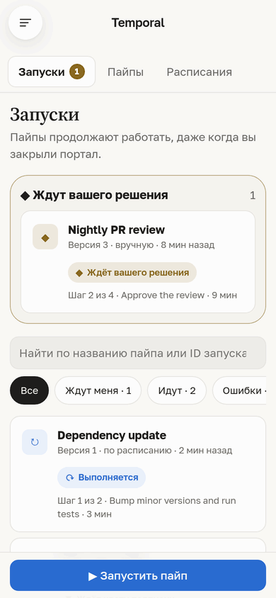
</p>

<p align="center">
  
  
  
  
</p>

Шаги: *Модель* (Claude, Codex, Gemini ACP или OpenCode — модели GLM подгружаются с подключённых провайдеров
opencode), *Решение человека* (с возвратом на доработку до 3 раз), *Открыть PR*
(отдельная рабочая копия → draft PR или правка в ветку при красном CI, с подтверждением при изменении `.github/workflows`),
*Таймер*, *Объединение*, *Условие*, *Артефакт*; входы запуска — `{{input.имя}}`, ответы прошлых шагов — `{{steps.id}}`;
расписания с предпросмотром ближайших запусков; и **Фоновые агенты GitHub** (webhook или опрос раз в 2 мин по меткам,
командам `/agent` и красному CI, с доверенными авторами, журналом за 14 дней и общим выключателем администратора).
Шаг модели выполняется как ход вашего собственного чата по подписке; когда у opencode кончается квота, запуск
встаёт в статус «Ждёт квоту подписки» вместо падения.
По желанию, Linux и macOS — см. [docs/temporal.md](docs/temporal.md). Попробовать без настройки — в `npm run demo`.

<p align="center">
  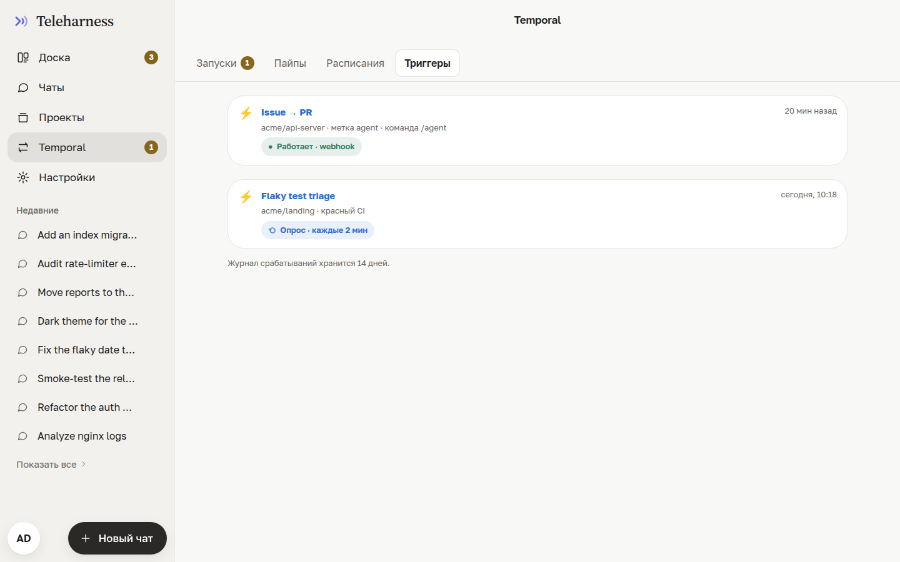
</p>
<p align="center"><sub>Фоновые агенты GitHub: запуск пайпов по меткам задач, командам в комментариях или красному CI с автоматическим draft PR.</sub></p>

<p align="center">
  
</p>
<p align="center"><sub>Список запусков: когда у подписки (в том числе OpenCode) кончается квота, шаг встаёт в статус <i>Ждёт квоту подписки</i> — запуск остаётся возобновляемым, а не падает.</sub></p>

## Зачем это

Чат-приложения дают доступ к модели. Агентные CLI дают гораздо больше — инструменты, доступ к файлам,
субагентов, скиллы, MCP, хуки, память проекта, — но живут в терминале на рабочем столе.

Teleharness ставит перед этими CLI мобильный веб-интерфейс, и вся обвязка оказывается под рукой, — а ещё
позволяет собирать их в пайпы:

- **CLI, а не модели.** Каждый чат идёт через `opencode serve`, `claude` CLI или `codex` CLI. Всё, что вы там настроили, —
  агенты, скиллы, плагины, MCP — работает с телефона.
- **Много провайдеров через один портал.** opencode работает с Z.ai GLM, OpenAI, Google Gemini, Anthropic,
  OpenRouter, локальными моделями и другими; Claude Code — с подпиской Claude, Codex — с подпиской ChatGPT.
  Движок и модель выбираются для каждого чата — пикер сам подгружает список моделей каждого подключённого
  провайдера opencode и обновляет его по кнопке.
- **Память дольше одного чата.** Хранилище Obsidian работает как активный кэш: в начале чата агент получает
  снапшот заметок, после каждого хода дописывает дайджест.
- **Агенты работают, пока вас нет.** Пайпы на Temporal выполняют многошаговые задачи на Claude, Codex, Gemini ACP и opencode,
  останавливаются за вашим одобрением и продолжаются после перезапуска — на подписках, без платного API.
- **Задача переживает лимит.** Подписка закончилась посреди задачи — передайте чат другому движку или модели:
  та же папка, одна лента, новый движок получает пропущенные ходы.
- **Ваша машина — ваши данные.** Файлы, инструменты и история остаются на вашем сервере. Провайдеры видят
  только то, что нужно для инференса.
- **Контроль за вами.** Для каждого чата решаете, спрашивает ли агент перед правками и командами; разрешить или
  отклонить можно прямо в чате или из push-уведомления.
- **Можно поделиться.** Несколько пользователей со своими папками, квотами и системным промптом;
  на Windows их команды выполняются в песочнице AppContainer.

## Попробовать за 30 секунд

Без движков и ключей — интерфейс на синтетических чатах:

```bash
git clone https://github.com/al3x4kov/teleharness.git
cd teleharness
npm ci
npm run demo     # → http://127.0.0.1:4171/teleharness/
```

Язык интерфейса выбирается по языку браузера, переключается в настройках.

## Обзор по экранам

Все снимки сделаны в `npm run demo` — ровно это вы и увидите.

<table>
<tr>
<td width="25%"></td>
<td width="25%"></td>
<td width="25%"></td>
<td width="25%"></td>
</tr>
<tr>
<td valign="top"><b>Чаты</b><br>Каждый чат закреплён за движком, моделью и агентом. Чаты Claude Code отмечены.</td>
<td valign="top"><b>Субагенты</b><br>Когда агент делегирует, каждый запуск — карточка: кто, зачем, сколько времени, шагов и токенов.</td>
<td valign="top"><b>Внутри запуска</b><br>Раскройте карточку — шаги субагента и его ответ; можно перейти в его собственный чат.</td>
<td valign="top"><b>Передача</b><br>Упёрлись в лимит? Тот же чат продолжается на другом движке — одна лента с отметкой передачи.</td>
</tr>
<tr>
<td width="25%"></td>
<td width="25%"></td>
<td width="25%">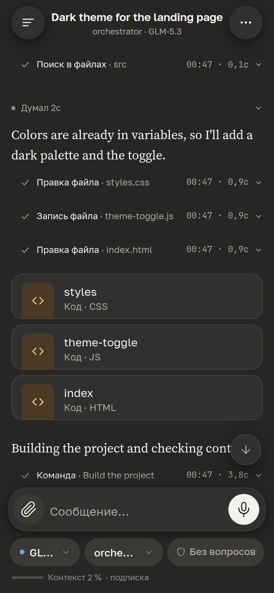</td>
<td width="25%"></td>
</tr>
<tr>
<td valign="top"><b>Куда продолжить</b><br>Из меню чата в любой момент или прямо с плашки лимита. Папка остаётся той же.</td>
<td valign="top"><b>Подписки</b><br>Расход и остаток по каждому подключённому провайдеру — там, где он отдаёт их официальным API.</td>
<td valign="top"><b>Шаги и файлы</b><br>Рассуждения, вызовы инструментов с выводом и файлы-результаты карточками с просмотром и скачиванием.</td>
<td valign="top"><b>Светлая и тёмная</b><br>По системной теме или вашему выбору; рассчитано на работу одной рукой с телефона.</td>
</tr>
</table>

<p align="center">
  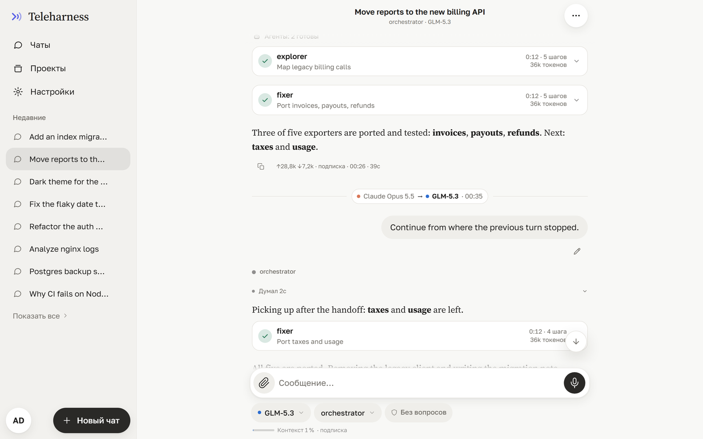
</p>
<p align="center"><sub>Тот же интерфейс на десктопе: первую половину сделал Claude Opus, после передачи задачу подхватил GLM-5.3.</sub></p>

<p align="center">
  
</p>
<p align="center"><sub>Чат Claude Code в тёмной теме.</sub></p>

<p align="center">
  
</p>

<p align="center">
  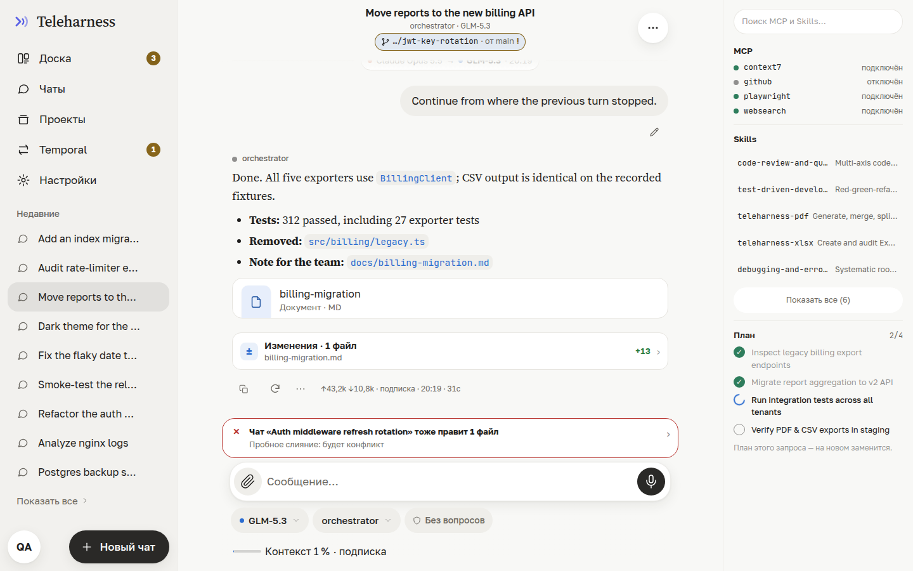
</p>
<p align="center"><sub>Правая панель на компьютере (&ge; 1024 px): статусы MCP, поиск по скиллам с просмотром SKILL.md в модальном окне и живой план текущего хода.</sub></p>

<p align="center">
  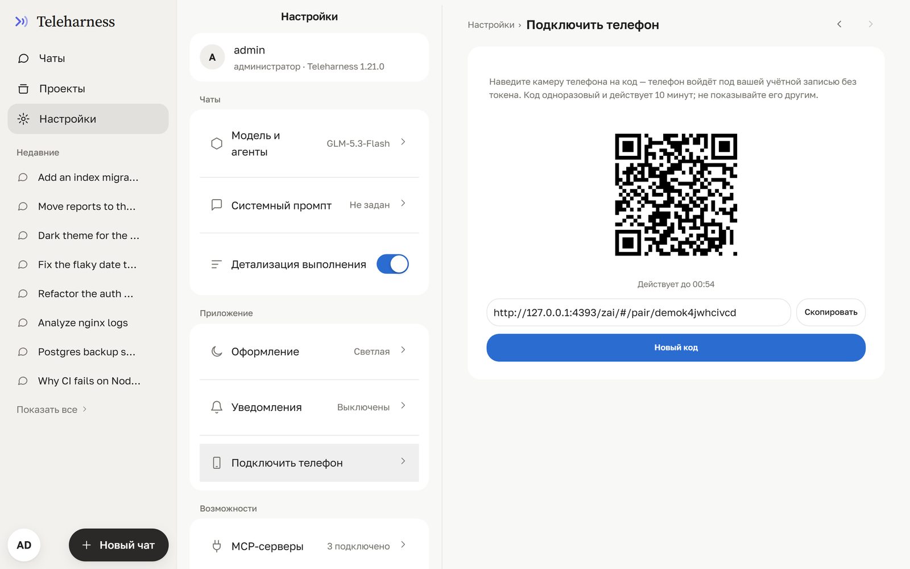
</p>

## Возможности

| | |
|---|---|
| **Четыре семейства движков, один интерфейс** | opencode (любой провайдер), Claude Code, Codex CLI и агенты ACP (Google Antigravity / Gemini и GitHub Copilot CLI) рядом; чат закрепляется за своим движком, моделью и агентом. Пикер группирует модели по подключённым провайдерам opencode (подписка, бесплатные, API) с кнопкой «Обновить список»; платные модели opencode с оплатой за токены скрыты от пользователей. Администратор может выдавать доступ к Claude, Codex и Gemini (ACP) каждому пользователю в Настройки → Пользователи (только в его папках и без shell).<br>  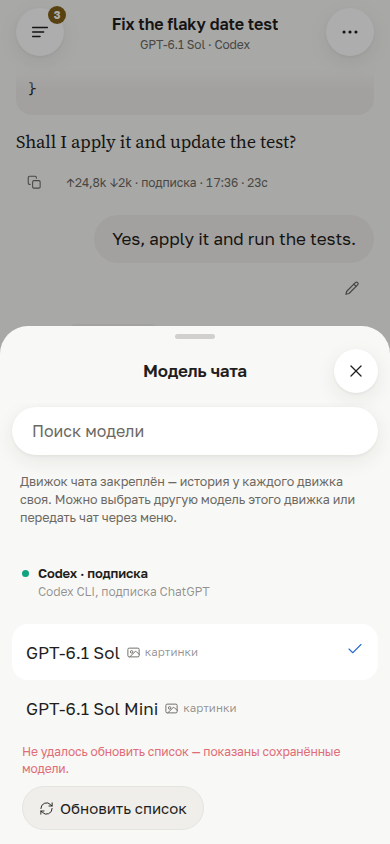  |
| **Доска внимания** | Единый экран для всех чатов и запусков Temporal: *Ждёт вас*, *Работает*, *Готово* и *Упало*, сводка «Пока вас не было», быстрые действия и push по категориям с тихими часами.<br> |
| **Поиск по сообщениям** | Полнотекстовый поиск по каждому вопросу и ответу во всех чатах: сниппеты с ролями «Вы:»/«Ответ:», подсветкой и счётчиком совпадений, переход сразу к сообщению (история догружается сама, затем подсветка), производный локальный SQLite FTS5 (trigram) индекс, изоляция тенантов и честная деградация к поиску по заголовкам, пока индекс строится.<br>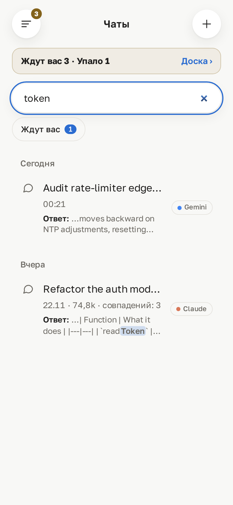 |
| **Адаптивные «Недавние»** | На десктопе (≥ 900 px) список «Недавние» в боковой панели заполняет её высоту вместо фиксированных восьми строк — больше чатов под рукой, до 100 (минимум 8; на телефонах и узких окнах остаётся 8), а подвал панели остаётся под списком и на низких окнах.<br>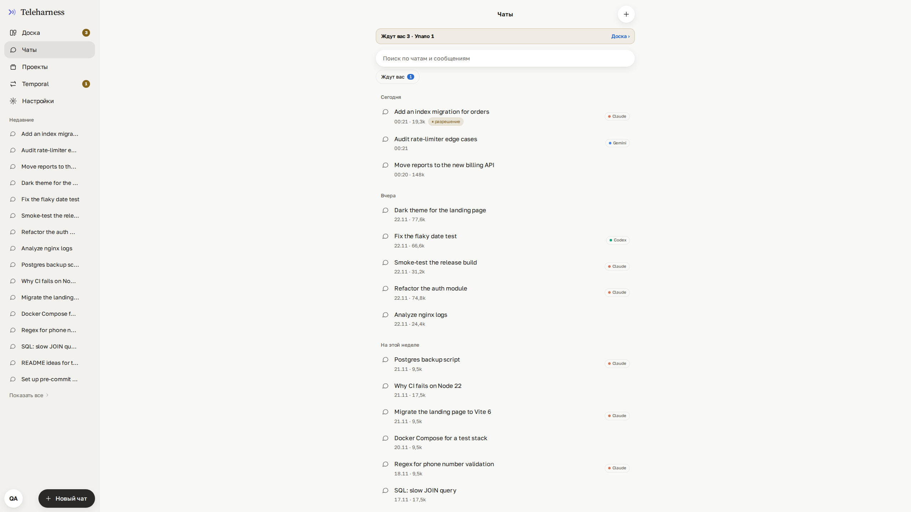  |
| **Правая панель на ПК: MCP, Skills и план хода** | На компьютере (≥ 1024 px) рядом с открытым чатом появляется фиксированная панель шириной 300 px: подключённые **MCP**-серверы, доступные **Skills** и живой **План** текущего хода (ACP, Claude Code и opencode). Поле поиска фильтрует MCP и Skills с показом счётчиков совпадений, а клик по любому скиллу открывает модальное окно с отрендеренным `SKILL.md` (обычные пользователи видят только разрешённые `teleharness-*` скиллы без путей к файлам).<br> 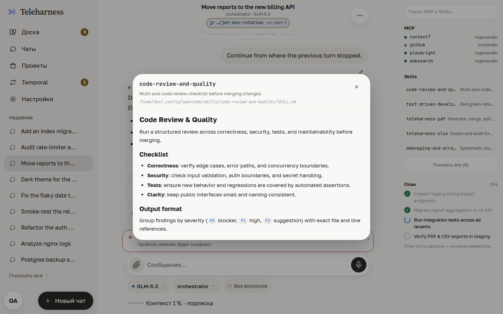 |
| **Мобильное ревью и «Сначала план»** | Очередь ревью по чатам и пайпам, удобный на телефоне дифф с выбором строк и черновиками комментариев, возврат агенту и принятие с коммитом. Режим *Сначала план* просит агента составить план в режиме чтения до правок.<br>  |
| **Изолированные Git Worktrees** | Своя рабочая копия и ветка на чат или пайп, раннее предупреждение о пересечении файлов и конфликтах при пробном слиянии, слияние squash/merge/ff с прогоном тестов и очистка забытых веток.<br>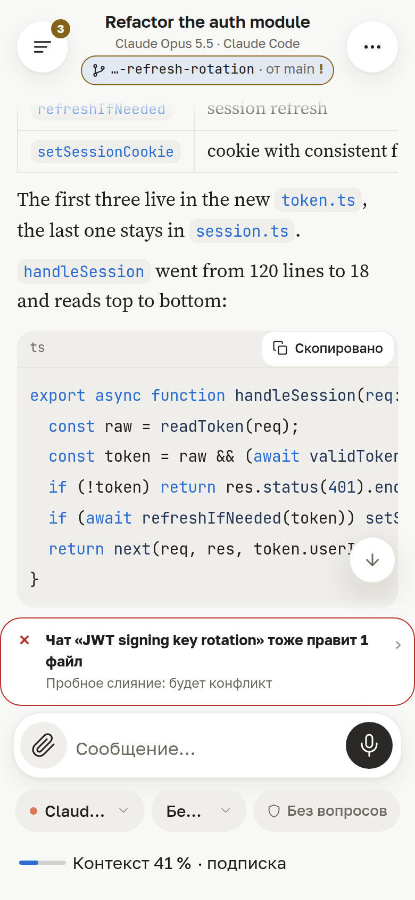  |
| **Расходы по ценам API** | Журнал ходов в SQLite по редактируемой таблице цен, реальные подписки (Claude Max, ChatGPT Plus, Google Antigravity, Copilot CLI) с экономией и окупаемостью, мягкие месячные бюджеты, сводки по чату/проекту/пайпу и экспорт в CSV.<br>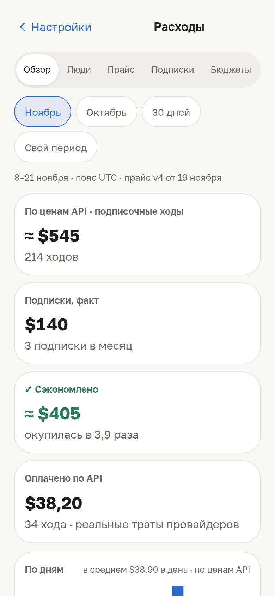 |
| **Режим прав для чата** | *Спрашивать* — агент спрашивает перед правками файлов и командами, вы разрешаете или отклоняете прямо в чате (Claude — через мост разрешений, Codex — нативно); *Правки без вопросов*; *Без вопросов* (только администратор).<br>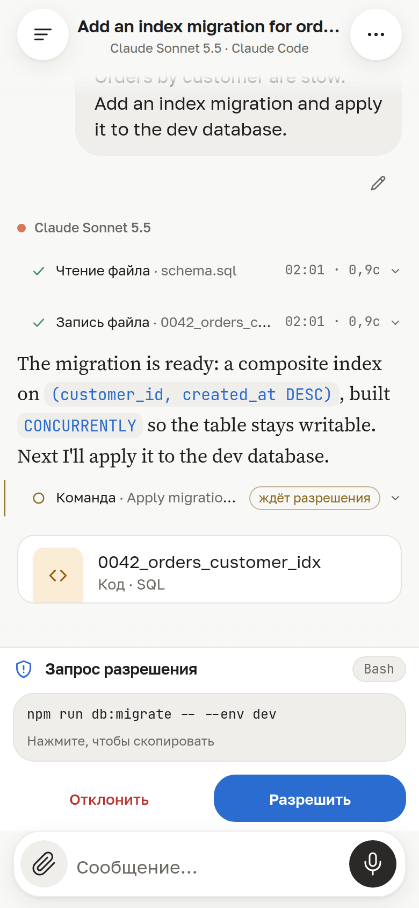  |
| **Ждут вас** | Фильтр списка чатов со счётчиком чатов, где агент ждёт вашего решения, и push-уведомление, когда он начинает ждать.<br> |
| **Контекст и расход** | Строка над полем ввода: насколько заполнено окно контекста модели (с предупреждением после 80 %) и сколько стоил чат — или что он идёт по подписке.<br> 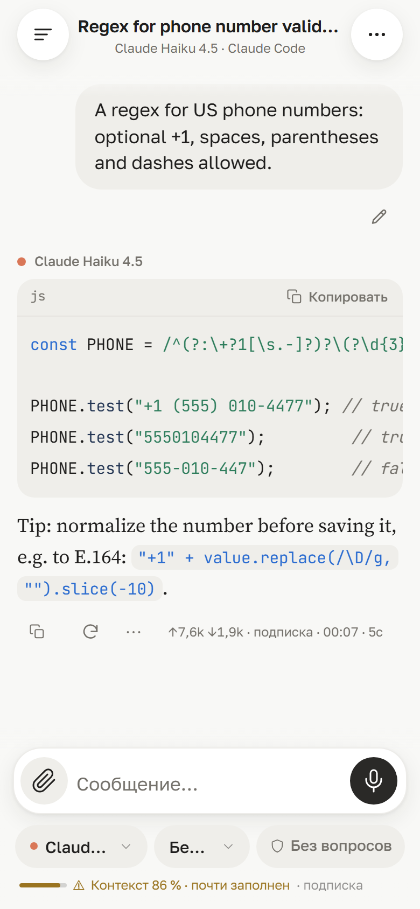 |
| **Шаги агента** | Ход в реальном времени: рассуждения, вызовы инструментов с выводом, фоновые задачи. Каждый запуск субагента — карточка с длительностью, числом шагов и токенами; в раскрытой карточке видны все шаги: подряд идущие однотипные сворачиваются в строку, которая раскрывается по тапу, а «Показать все шаги (N)» выводит их по одному. Отмена хода вместе с правками файлов.<br> |
| **Изменения хода и Git** | Под ответом, который правил файлы, — строка *Изменения · N файлов*: по ней открывается дифф по каждому файлу — что изменил этот ход или файл сейчас против последнего коммита (на телефоне одна колонка, на компьютере две панели). Экран Git папки чата показывает ветку, опережение и отставание и изменённые файлы: отметьте файлы для коммита, попросите модель этого чата предложить сообщение отдельным коротким запросом (в историю чата он не попадает), сделайте коммит и отправку — отправка только у администратора. Остальные пользователи работают с git в своих папках, без отправки и смены веток. В Настройках → Git — автор коммитов, язык сообщения и отметка файлов по умолчанию. |
| **Фоновые субагенты не прерываются** | Claude Code отвечает сразу, а субагенты, запущенные им в фоне, продолжают работать после ответа. Полоса над полем ввода показывает, кто ещё работает; новое сообщение ждёт в очереди, а когда они закончат, Claude забирает их результаты и отвечает снова. |
| **Пайпы Temporal и фоновые агенты GitHub** *(по желанию)* | Многошаговые сценарии, переживающие перезапуск: шаги Claude, Codex, Gemini (ACP) и OpenCode (GLM), решения человека с доработками (до 3 циклов), шаг *Открыть PR* в изолированной рабочей копии, таймеры, условия и артефакты. Завершённый или упавший запуск продолжается с последнего успешного шага — или с любого выбранного, — перенося выполненные шаги, папку запуска и разговоры шагов. Подключите fine-grained токен в Настройки → GitHub и запускайте пайпы автоматически по webhook или опросу (*Задача → PR*, *Починить CI*, *Ночное обновление*) с доверенными авторами, журналом событий и общим выключателем. Работает на подписках CLI, платный API не используется. Linux и macOS; по умолчанию выключено — см. [docs/temporal.md](docs/temporal.md).<br> 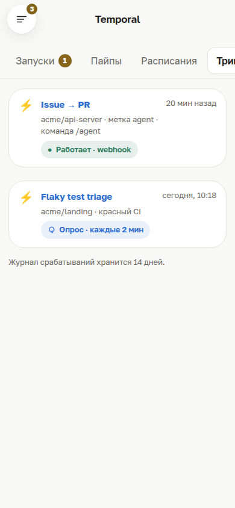  |
| **Передача между движками** | Упёрлись в лимит посреди задачи? Тот же чат продолжается на другом движке или модели: та же папка, одна лента, новый движок получает пропущенные ходы. По желанию — автоматически, со своим порядком запасных моделей. |
| **Подписки** | Расход и остаток по каждому подключённому провайдеру — там, где провайдер отдаёт их официальным API. |
| **Устойчивый стриминг** | Один SSE-хаб для всех движков с replay, детектором зависаний и защитой от зацикливания — переживает нестабильную мобильную сеть. |
| **Файлы** | Вложения и картинки — скрепкой, вставкой (Ctrl/⌘+V: снимок экрана получает имя с датой, длинный вставленный текст становится файлом .txt) или перетаскиванием в чат. Файлы-результаты приходят карточками; просмотр разрешённых папок. Своя папка на каждый чат.<br> 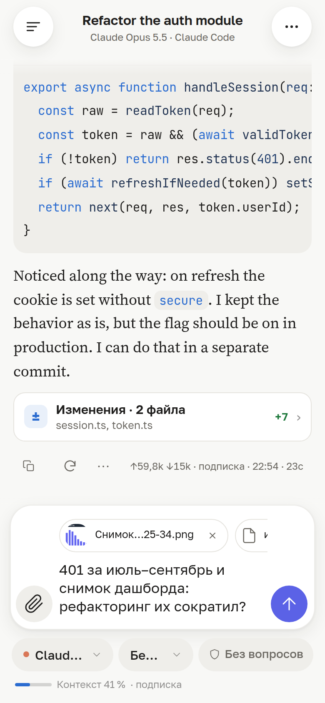 |
| **Obsidian как активный кэш** | Снапшот заметок в контексте, дайджесты ходов и журнал каждого чата обратно в хранилище, отдельная зона на пользователя. |
| **Голос** | Локальные распознавание и синтез речи (Python-воркер, только CPU) и голосовой режим. |
| **Push-уведомления** | Уведомление, когда долгий ход завершился или агенту нужно ваше решение (Web Push, VAPID). |
| **Телефон по QR-коду** | Настройки → Подключить телефон показывают одноразовый QR-код (действует 10 минут): навели камеру — телефон вошёл под вашей учётной записью без ввода токена. Нужен `TELEHARNESS_PUBLIC_URL`.<br>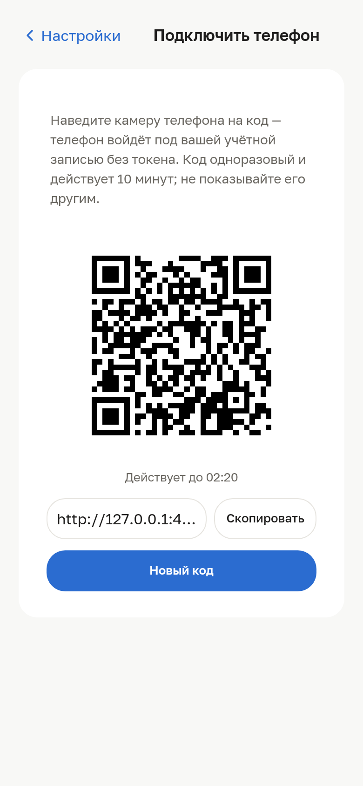 |
| **Несколько пользователей** | Админ и пользователи: свои папки, системный промпт, набор MCP, квоты, rate-limit. |
| **Настройки → О приложении** | Точная версия портала и каждого движка в одном месте — удобно, когда создаёте issue.<br>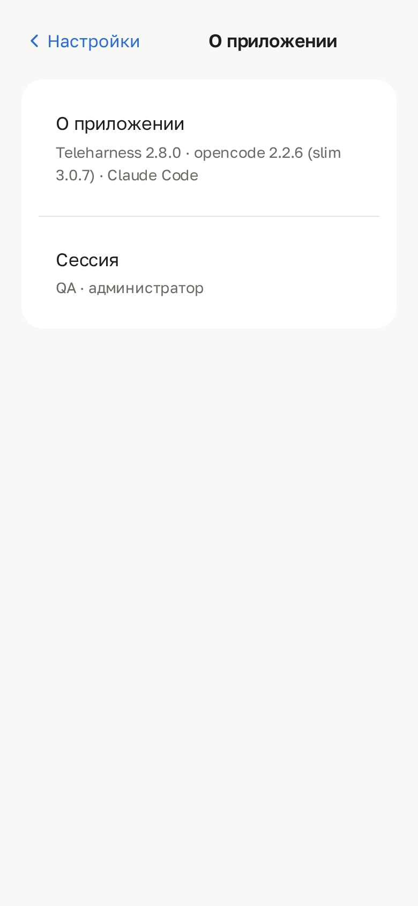 |
| **Mobile-first** | Сделано под iOS Safari: учёт клавиатуры, safe-area, светлая и тёмная темы, русский и английский интерфейс. |
| **Без runtime-зависимостей** | Бэкенд — чистый stdlib Node.js. |

## Быстрый старт

### Требования

| | Версия | Для чего |
|---|---|---|
| [Node.js](https://nodejs.org) | ≥ 22 | портал |
| [opencode](https://opencode.ai) | 2.x (проверено на 2.2.6) | движок opencode |
| [Claude Code](https://docs.anthropic.com/en/docs/claude-code) | 2.x | движок Claude |
| [Codex CLI](https://github.com/openai/codex) | 0.169+ | по желанию, движок Codex (админу по умолчанию; выдаётся пользователям) |
| Python | 3.11+ | по желанию, голос |

Нужен хотя бы один движок.

### Одной командой

```bash
npx github:al3x4kov/teleharness            # → http://127.0.0.1:4180/teleharness/
```

Команда проверит Node, сохранит данные в `~/.teleharness`, при первом запуске соберёт интерфейс, покажет, какие
движки найдены (и как поставить недостающие), и напечатает токен администратора. Параметры: `--port N`,
`--host 0.0.0.0` (доступ из локальной сети), `--rebuild`. opencode serve она не запускает — печатает команду.

### Установка и запуск

<details open>
<summary><b>macOS / Linux</b></summary>

```bash
git clone --branch v2.6.0 https://github.com/al3x4kov/teleharness.git
cd teleharness
npm ci && npm run build

cp .env.example .env               # все значения необязательны

# движки (нужен хотя бы один)
opencode auth login                # добавьте нужных провайдеров
claude setup-token                 # движок Claude: токен — в .env как CLAUDE_CODE_OAUTH_TOKEN

./ops/opencode/serve-v2.sh &       # opencode 2.x на 127.0.0.1:4196, пароль в ~/.teleharness/oc2-password
./ops/web-v2.sh                    # → http://127.0.0.1:4170/teleharness/
```
</details>

<details>
<summary><b>Windows (PowerShell)</b></summary>

```powershell
git clone --branch v2.6.0 https://github.com/al3x4kov/teleharness.git
cd teleharness
npm ci; npm run build

Copy-Item .env.example .env        # все значения необязательны

opencode auth login
claude setup-token

# opencode 2.x с HTTP Basic; портал получает тот же пароль
$env:OPENCODE_SERVER_PASSWORD = [guid]::NewGuid().ToString('N')
Start-Process opencode -ArgumentList 'serve','--hostname','127.0.0.1','--port','4196'

$env:TELEHARNESS_OC_API = 'v2'; $env:TELEHARNESS_UPSTREAM = 'http://127.0.0.1:4196'; $env:TELEHARNESS_OC_PASSWORD = $env:OPENCODE_SERVER_PASSWORD
node server.js                     # → http://127.0.0.1:4170/teleharness/
```
</details>

Пошагово для Mac, включая службы launchd и доступ с телефона: [`docs/macos.md`](docs/macos.md) (на английском). На Linux
запускайте портал службой systemd по образцу [`ops/linux/teleharness.service`](ops/linux/teleharness.service) — с ним один ход
агента, которому не хватило памяти, не останавливает весь портал.

При первом запуске портал создаёт администратора и пишет токен входа в `data/admin-token.txt`
(или берёт `TELEHARNESS_ADMIN_TOKEN`). Чтобы открыть портал с телефона, поставьте перед ним TLS — встроенный
edge-сервер (`ops/portal-server.js`) или любой reverse proxy (Caddy, nginx, Tailscale Serve).

> [!NOTE]
> Портал открывается по пути `/teleharness/`; все настройки — переменные окружения `TELEHARNESS_*`
> (см. [`.env.example`](.env.example)).

### Поддержка платформ

| | macOS | Linux | Windows |
|---|:---:|:---:|:---:|
| Портал, движки opencode и Claude, файлы, push | да | да | да |
| Движки Codex и ACP (чаты) | да (админ; выдача пользователю) | да (админ; выдача пользователю) | да (админ; выдача пользователю) |
| Пайпы Temporal (по желанию) | да | да | — |
| Codex в пайпах Temporal | да (у пользователей — только текст) | да (у пользователей — только текст) | — |
| Кэш Obsidian, голос | да | да | да |
| Команды оболочки для не-админов | — | да, с отдельным раннером на пользователя¹ | да (песочница AppContainer) |

На macOS (и на Linux без раннера) командная строка для обычных пользователей отключена (fail-closed); на админа это не
влияет. ¹ На Linux команды пользователей могут выполняться через раннер на пользователя (`/usr/local/libexec/teleharness-tenant-run`,
см. `ops/sandbox/linux`); без него они по-прежнему отключены.
Изоляция пользователей переезжает на контейнер на пользователя с полным агентным рантаймом — одинаково на любой ОС сервера,
поэтому песочница Windows на другие системы намеренно не переносится.

## Архитектура

<p align="center"></p>

- **Портал** (`server.js`) — API, авторизация и пользователи, хаб событий, привязка чата к движку, передача
  чата между движками. Для каждого движка свой адаптер: клиент `opencode serve` (1.x и 2.x) и раннер,
  запускающий `claude` (или посредника Codex поверх `codex app-server`) на каждый ход.
- **Harness** — всё, что окружает CLI: агенты и оркестрация (oh-my-opencode-slim), плагин базы знаний
  и песочницы для opencode (`ops/opencode/plugin-v2` для 2.x, `vault-cache.ts` для 1.x), хуки Claude Code,
  скиллы, MCP-серверы. Здесь решается, что агенту можно и что он знает.
- **Obsidian** — долгая память агентов, своя зона у каждого пользователя; здесь же журнал каждого чата,
  который движок читает после передачи.
- **Голос** — отдельный локальный Python-процесс (Piper TTS, GigaAM STT).
- **Песочница** — команды оболочки других пользователей: раннер на пользователя на Linux (по желанию),
  AppContainer на Windows, на macOS закрыто.
- **Пайпы Temporal** (по желанию, Linux и macOS) — сервер Temporal, исполнитель на Python и PostgreSQL
  (история, журнал «ровно один раз», слоты параллельности). Шаг модели — ход чата портала в папке пайпа
  через закрытый сокет. Подробнее — [`docs/temporal.md`](docs/temporal.md).

Послойная схема и путь запроса:

<p align="center"></p>

Поиск по чатам работает на производном индексе, который всегда может перестроиться:

<p align="center">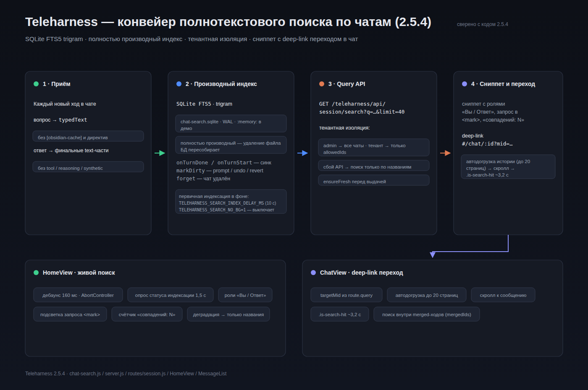</p>
<p align="center"><sub>Сообщения чистятся и попадают в локальный SQLite FTS5 (trigram) индекс, опрашиваются через API с изоляцией тенантов и превращаются в сниппеты со ссылками прямо в чат.</sub></p>

Подробнее — [`docs/architecture.md`](docs/architecture.md), требования — [`openspec/specs/`](openspec/specs/).

## Конфигурация

Все параметры задаются переменными окружения; схема с типами, значениями по умолчанию и валидацией —
[`lib/config.js`](lib/config.js), шаблон — [`.env.example`](.env.example).

| Переменная | По умолчанию | |
|---|---|---|
| `PORT` | `4170` | порт портала |
| `TELEHARNESS_UPSTREAM` | `http://127.0.0.1:4096` | адрес `opencode serve` (значение по умолчанию — исторический порт opencode 1.x; для 2.x — `:4196`) |
| `TELEHARNESS_OC_API` | `v1` | `v2` для opencode 2.x (его ставит `ops/web-v2.sh`) |
| `TELEHARNESS_OC_PASSWORD` | — | пароль HTTP Basic у `opencode serve` 2.x |
| `CLAUDE_CODE_OAUTH_TOKEN` | — | токен подписки Claude (`claude setup-token`) |
| `TELEHARNESS_ADMIN_TOKEN` | генерируется | токен входа администратора |
| `TELEHARNESS_PUBLIC_URL` | — | публичный https-адрес корня портала (`https://host/teleharness/`) для QR-кода подключения телефона; пусто — QR нет |
| `TELEHARNESS_CODEX` | вкл. | `off` скрывает движок Codex, даже если `codex` установлен и в нём выполнен вход |
| `TELEHARNESS_CODEX_BIN` | `codex` из глобальных npm или `PATH` | путь к бинарю codex или его `bin/codex.js` |
| `TELEHARNESS_DATA_DIR` | `./data` | пользователи, сессии, логи |
| `TELEHARNESS_FILE_ROOTS` | домашняя папка | папки, доступные в файловом браузере |
| `TELEHARNESS_KB_ROOT` | `off` | папка Obsidian для агентов, например `~/Obsidian/agents` |
| `TELEHARNESS_TENANT_HOME` | `~/.teleharness-tenants` | папки пользователей |
| `TELEHARNESS_VOICE_PYTHON`, `TELEHARNESS_VOICE_MODELS` | `~/.teleharness/voice/…` | локальный голосовой воркер |

Группы функций и тонкие настройки — в той же схеме: `TELEHARNESS_LISTEN_HOST` / `TELEHARNESS_ENV`
(адрес привязки, guard стенда), `TELEHARNESS_PUSH…` (Web Push: вкл/выкл, VAPID-ключи, тихие часы),
`TELEHARNESS_VOICE…` (лимиты распознавания и синтеза на пользователя), `TELEHARNESS_TENANT…`
(лимиты запросов, загрузок и vision на пользователя) и набор Temporal — `TELEHARNESS_TEMPORAL_PIPELINES`,
`TELEHARNESS_TEMPORAL_MODELS`, `TELEHARNESS_TEMPORAL_DRAIN` и соседние — описаны в
[`docs/temporal.md`](docs/temporal.md). Полный список с типами, значениями по умолчанию и валидацией —
в [`lib/config.js`](lib/config.js); неизвестные переменные останавливают старт.

### Конфиги агентов

В [`config/`](config/) лежит рабочий пример настроек Claude Code и opencode автора: агенты, промпты,
плагин vault-cache, скиллы документов. Установка — `./config/install.sh` (macOS/Linux) или
`./config/install.ps1` (Windows); секреты берутся из окружения. В конфигах прописаны абсолютные пути —
проверьте их перед использованием.

Сторонние скиллы в репозиторий не входят, ставьте их из первоисточников:
[agent-skills](https://github.com/addyosmani/agent-skills) (`/plugin marketplace add addyosmani/agent-skills`),
[OpenSpec](https://github.com/Fission-AI/OpenSpec) (`npm i -g @fission-ai/openspec`).

## Разработка

```bash
npm test                 # unit, UI-компоненты (happy-dom), сервер и edge
npm run build            # esbuild → public/app.js, public/app.css
npm run demo             # мок-режим на fixtures-demo/
```

| Путь | |
|---|---|
| `server.js`, `lib/`, `routes/` | бэкенд |
| `src/` → `public/` | фронтенд (Preact + signals) |
| `shared/` | общий код сервера и клиента |
| `ops/` | скрипты запуска, плагины opencode, edge-сервер, песочница, голосовой воркер, рендер документов |
| `config/` | конфиги Claude Code и opencode |
| `tests/`, `fixtures/`, `fixtures-demo/` | тесты и синтетические фикстуры |
| `openspec/specs/`, `docs/` | требования, архитектура, ADR |

Как участвовать — [CONTRIBUTING.md](CONTRIBUTING.md), изменения — [CHANGELOG.md](CHANGELOG.md).

## Собрано с помощью

[opencode](https://opencode.ai) · [Claude Code](https://docs.anthropic.com/en/docs/claude-code) · [Codex CLI](https://github.com/openai/codex) · [Temporal](https://temporal.io) ·
[oh-my-opencode-slim](https://www.npmjs.com/package/oh-my-opencode-slim) · [Preact](https://preactjs.com) ·
[esbuild](https://esbuild.github.io) · [marked](https://marked.js.org) · [DOMPurify](https://github.com/cure53/DOMPurify) ·
[highlight.js](https://highlightjs.org) · [Piper](https://github.com/rhasspy/piper) · [sherpa-onnx](https://github.com/k2-fsa/sherpa-onnx)

## Лицензия

[MIT](LICENSE). Сторонние файлы — под своими лицензиями: скиллы и команды `openspec-*` / `opsx-*` — MIT
([OpenSpec](https://github.com/Fission-AI/OpenSpec)), скилл `dogfood` — Apache-2.0.
