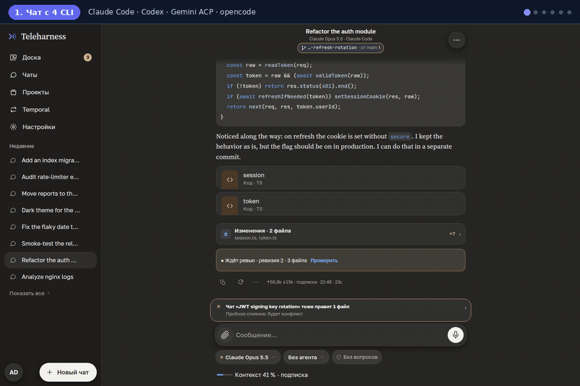
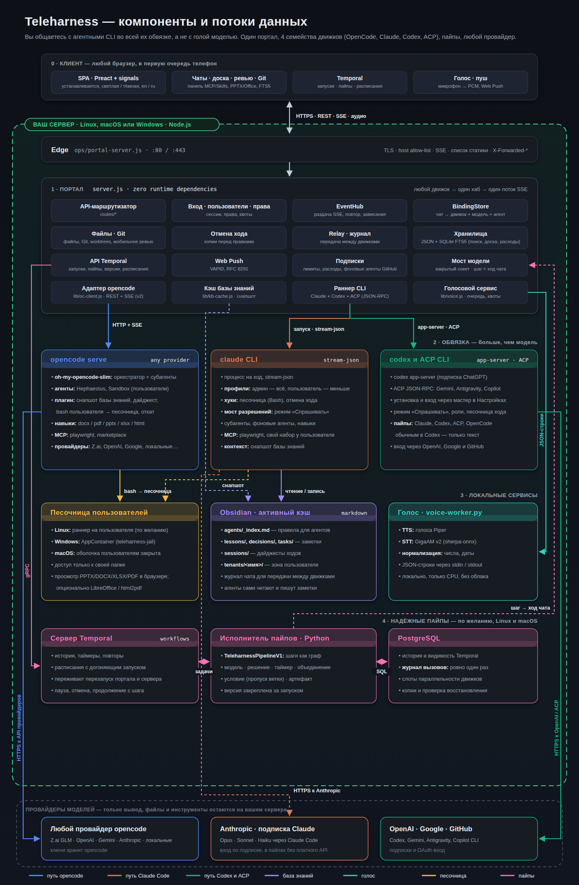

<div align="center">


## Self-hosted веб-интерфейс для Claude Code, Codex, Gemini (ACP) и opencode

**Запускайте локальные CLI-агенты в одной вкладке браузера на уже оплаченных подписках. Ревью диффов в изолированных git worktrees, передача чата другому CLI при лимите квоты и многошаговые пайпы на Temporal. Работает на десктопе и как опциональная мобильная PWA.**

**Чат** · **Доска внимания** · **Ревью диффов и Worktrees** · **Relay между CLI** · **Пайпы Temporal** · **Self-Hosted**

[](https://www.npmjs.com/package/teleharness)
[](https://github.com/al3x4kov/teleharness/releases/latest)
[](https://github.com/al3x4kov/teleharness/actions/workflows/ci.yml)
[](LICENSE)
[](https://nodejs.org)
[](#поддержка-платформ)

[Попробовать за 10 с](#попробовать-за-10-секунд) •
[Сравнение](#сравнение-с-альтернативами) •
[Что умеет](#что-умеет) •
[Визуальный тур](docs/tour.ru.md) •
[Быстрый старт](#быстрый-старт) •
[Безопасность](#модель-безопасности) •
[Архитектура](#архитектура) •
[Конфигурация](#конфигурация) •
[English](README.md)



</div>

---

## Попробовать за 10 секунд

Работает на синтетических чатах во временной папке. Движки и API-ключи не нужны, домашний каталог не трогается.

**1. Node.js ≥ 22:**
```bash
npx teleharness --demo
# → http://127.0.0.1:4180/teleharness/  (токен: demo-demo-demo-demo)
```

**2. Docker Compose:**
```bash
git clone https://github.com/al3x4kov/teleharness.git && cd teleharness
docker compose up
# → http://127.0.0.1:4180/teleharness/  (токен: demo-demo-demo-demo)
```

**3. Облачная песочница в 1 клик (бесплатный тариф, read-only демо из [`render.yaml`](render.yaml)):**

[](https://render.com/deploy?repo=https://github.com/al3x4kov/teleharness)

---

## Сравнение с альтернативами

Teleharness запускает **настоящие локальные CLI** (со всеми их скиллами, MCP-серверами, хуками и файлами проекта), а не ходит в платный API за токены.

| Возможность | Teleharness | Claude Code Web | OpenCode Web | Cursor | Vibe Kanban |
|---|:---:|:---:|:---:|:---:|:---:|
| Работает на оплаченных CLI-подписках (без доплаты за API) | **Да** | Только Claude | Свой API / OAuth | Свой тариф | Да |
| Claude Code + Codex + Gemini/ACP + opencode в одном UI | **Да (4 семейства)** | Нет | Только opencode | Модели IDE | Частично |
| Передача чата другому CLI при лимите (ручной и Авто-Relay) | **Да** | Нет | Нет | Нет | Нет |
| Доска внимания + инлайн-ревью диффов + Plan-First | **Да** | Частично | Частично | IDE | Частично |
| Изолированные Git Worktrees с проверкой пересечений | **Да** | Нет | Нет | Фон | Да |
| Многошаговые пайпы, переживающие рестарт (Temporal) | **Да** | Нет | Нет | Нет | Нет |
| Self-hosted, 0 зависимостей бэкенда, опциональная PWA | **Да** | Облако | Локально | Десктоп | Локально |

---

## Что умеет

- **Четыре семейства CLI в одном окне:** Claude Code, Codex, Gemini/Copilot (ACP) и opencode работают рядом с живыми шагами, карточками субагентов, правой панелью MCP / Скиллов / Плана, поиском SQLite FTS5, просмотром Office/PPTX, кэшем Obsidian и опциональным локальным CPU-голосом.
- **Доска внимания, ревью диффов и Plan-First:** все чаты и запуски разложены по колонкам *Ждут вас*, *В работе*, *Готово* и *Ошибки* с боковым превью, инлайн-комментариями по строкам диффа и подтверждением плана до правки файлов.
- **Git worktrees и учёт расходов:** параллельные чаты работают в отдельных ветках с предупреждением о пересечении файлов и dry-run проверкой конфликтов. Учёт расходов сравнивает API-эквивалент токенов с ценой подписок.
- **Передача чата между CLI (Relay и Авто-Relay):** когда у Claude или Codex заканчивается квота посреди задачи, чат продолжается в той же папке на другом CLI или резервной модели. ([Подробнее](docs/cross-cli-handoff.md))
- **Пайпы на Temporal и фоновые агенты GitHub (опционально):** цепочки из Claude, Codex, Gemini (ACP), opencode, allowlist-команд и ручных подтверждений, которые переживают рестарт, продолжаются с любого шага и запускаются по GitHub Issues или упавшему CI. ([Подробнее](docs/temporal.md))

Все экраны, анимации и полная таблица возможностей: **[Визуальный тур (`docs/tour.ru.md`)](docs/tour.ru.md)**.

---

## Быстрый старт

> [!TIP]
> Пошаговая установка на Linux, macOS и Windows (все 4 движка, Worktrees, Obsidian, Temporal, триггеры GitHub, HTTPS + QR PWA, автозапуск): **[`docs/installation.ru.md`](docs/installation.ru.md)** ([English](docs/installation.md)).

### Требования

| | Версия | Зачем |
|---|---|---|
| [Node.js](https://nodejs.org) | ≥ 22.5 (22 LTS / 24 LTS) | сервер портала и встроенный SQLite FTS5 |
| [Git](https://git-scm.com) | ≥ 2.20 | экран Git, ревью диффов, Worktrees |
| [opencode](https://opencode.ai) | 2.x (проверено на 2.2.6) | движок opencode |
| [Claude Code](https://docs.anthropic.com/en/docs/claude-code) | 2.x | движок Claude |
| [Codex CLI](https://github.com/openai/codex) | 0.169+ | опционально, движок Codex |
| ACP CLI (`gemini` / `copilot` / свой) | актуальная | опционально, настраивается в Настройки → ACP-агенты |
| Python | 3.11+ | опционально, локальный CPU-голос и воркер Temporal |

Достаточно **хотя бы одного** движка (или ни одного для `--demo`).

### Одной командой

```bash
npx teleharness                                # → http://127.0.0.1:4180/teleharness/
```

Проверяет Node, хранит данные в `~/.teleharness`, использует предсобранный фронт (или собирает при необходимости), находит установленные CLI и печатает токен администратора. Флаги: `--demo`, `--port N`, `--host 0.0.0.0`, `--rebuild`.

### Установка из исходников

<details open>
<summary><b>macOS / Linux</b></summary>

```bash
git clone --branch v2.13.2 https://github.com/al3x4kov/teleharness.git
cd teleharness
npm ci && npm run build

cp .env.example .env               # все параметры опциональны

opencode auth login                # opencode
claude setup-token                 # прописать токен в .env как CLAUDE_CODE_OAUTH_TOKEN

./ops/opencode/serve-v2.sh &       # opencode 2.x на 127.0.0.1:4196
./ops/web-v2.sh                    # → http://127.0.0.1:4170/teleharness/
```
</details>

<details>
<summary><b>Windows (PowerShell)</b></summary>

```powershell
git clone --branch v2.13.2 https://github.com/al3x4kov/teleharness.git
cd teleharness
npm ci; npm run build

Copy-Item .env.example .env        # все параметры опциональны

opencode auth login
claude setup-token

$env:OPENCODE_SERVER_PASSWORD = [guid]::NewGuid().ToString('N')
Start-Process opencode -ArgumentList 'serve','--hostname','127.0.0.1','--port','4196'

$env:TELEHARNESS_OC_API = 'v2'; $env:TELEHARNESS_UPSTREAM = 'http://127.0.0.1:4196'; $env:TELEHARNESS_OC_PASSWORD = $env:OPENCODE_SERVER_PASSWORD
node server.js                     # → http://127.0.0.1:4170/teleharness/
```
</details>

<details>
<summary><b>Docker (self-hosted профиль)</b></summary>

```bash
docker compose --profile selfhosted up -d teleharness
```
</details>

> [!NOTE]
> Портал раздаётся по пути `/teleharness/`; все параметры задаются переменными `TELEHARNESS_*` ([`.env.example`](.env.example)). macOS launchd: [`docs/macos.md`](docs/macos.md). Linux systemd: [`ops/linux/teleharness.service`](ops/linux/teleharness.service).

### Поддержка платформ

| | macOS | Linux | Windows |
|---|:---:|:---:|:---:|
| Портал, opencode, Claude, Codex, ACP, ревью диффов, worktrees, push | да | да | да |
| Пайпы Temporal и фоновые агенты GitHub (опционально) | да | да | — |
| Активный кэш Obsidian, локальный CPU-голос | да | да | да |
| Многопользовательская песочница для не-админов | выкл (fail-closed) | опц. раннер | AppContainer |

---

## Модель безопасности

- **Один пользователь на `localhost` / Tailscale:** Teleharness работает под вашим пользователем ОС поверх локальных CLI. Песочница тенантов не нужна, все движки работают одинаково на macOS, Linux и Windows.
- **Несколько пользователей / общий сервер:** не-админы получают изолированные папки, квоты и наборы MCP; выполнение shell закрыто по умолчанию (fail-closed), пока не настроен Linux-раннер (`ops/sandbox/linux`) или Windows AppContainer. Подробнее: [SECURITY.md](SECURITY.md).

---

## Архитектура

<p align="center"></p>

- **Бэкенд (`server.js`, `lib/`, `routes/`):** стандартная библиотека Node.js без сторонних веб-фреймворков (`node:http`, SSE с догонкой, встроенный `node:sqlite` FTS5, доска внимания, расходы, Git/Worktrees) и адаптер на каждое семейство движков (`lib/oc-client.js`, раннер `claude`, `codex-shim.mjs`, `lib/acp-chat.js`).
- **Фронтенд (`src/` → `public/`):** Preact + Signals со сборкой esbuild, светлая и тёмная темы, RU/EN, опциональная мобильная PWA.
- **Опциональные модули:** активный кэш Obsidian, локальный Python CPU-голос (Piper TTS / GigaAM STT), воркер пайпов Temporal ([`docs/temporal.md`](docs/temporal.md)).

Схема слоёв и конвейер поиска: [`docs/tour.ru.md#схемы-архитектуры`](docs/tour.ru.md#схемы-архитектуры). Подробнее: [`docs/architecture.md`](docs/architecture.md), спеки: [`openspec/specs/`](openspec/specs/).

---

## Конфигурация

Настройки проверяются схемой в [`lib/config.js`](lib/config.js); шаблон в [`.env.example`](.env.example).

| Переменная | По умолчанию | Назначение |
|---|---|---|
| `PORT` | `4170` (`4180` в CLI) | порт портала |
| `TELEHARNESS_DEMO` | `0` | `1` — запуск мгновенного демо-режима |
| `TELEHARNESS_UPSTREAM` | `http://127.0.0.1:4196` | адрес `opencode serve` 2.x |
| `TELEHARNESS_OC_API` | `v1` | `v2` для opencode 2.x |
| `TELEHARNESS_OC_PASSWORD` | — | пароль HTTP Basic для opencode 2.x |
| `CLAUDE_CODE_OAUTH_TOKEN` | — | токен подписки Claude (`claude setup-token`) |
| `TELEHARNESS_ADMIN_TOKEN` | генерируется | токен входа администратора |
| `TELEHARNESS_PUBLIC_URL` | — | HTTPS-адрес для QR-подключения телефона |
| `TELEHARNESS_KB_ROOT` | `off` | путь к Obsidian vault для активного кэша |

Примеры конфигов агентов (Claude Code + opencode): [`config/`](config/) (`./config/install.sh` / `./config/install.ps1`).

---

## Разработка

```bash
npm test                 # unit, компоненты UI (happy-dom), server и edge тесты
npm run build            # esbuild → public/app.js, public/app.css
npm run demo             # синтетическое демо на fixtures-demo/
```

См. [CONTRIBUTING.md](CONTRIBUTING.md) и [CHANGELOG.md](CHANGELOG.md).

## На чём построено

[opencode](https://opencode.ai) · [Claude Code](https://docs.anthropic.com/en/docs/claude-code) · [Codex CLI](https://github.com/openai/codex) · [Temporal](https://temporal.io) ·
[Preact](https://preactjs.com) · [esbuild](https://esbuild.github.io) · [marked](https://marked.js.org) · [DOMPurify](https://github.com/cure53/DOMPurify) · [highlight.js](https://highlightjs.org)

## Лицензия

[MIT](LICENSE). Включённые сторонние файлы сохраняют свои лицензии: `openspec-*` / `opsx-*` — MIT ([OpenSpec](https://github.com/Fission-AI/OpenSpec)), `dogfood` — Apache-2.0.
