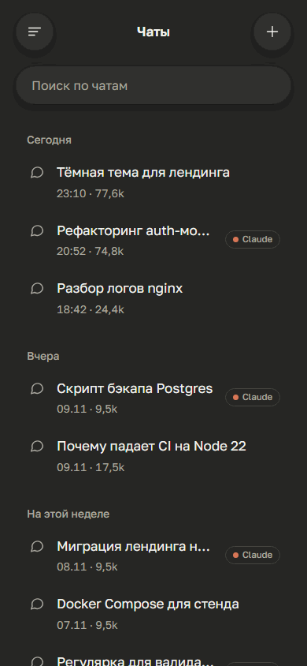
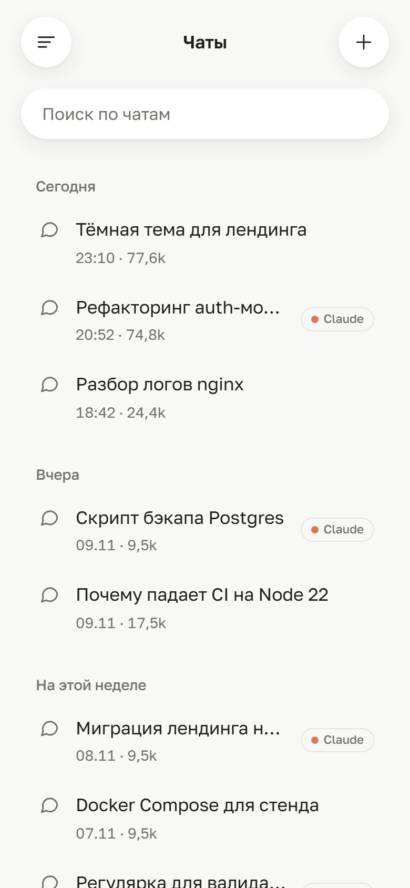
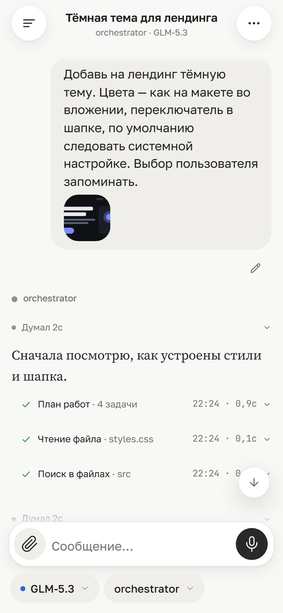
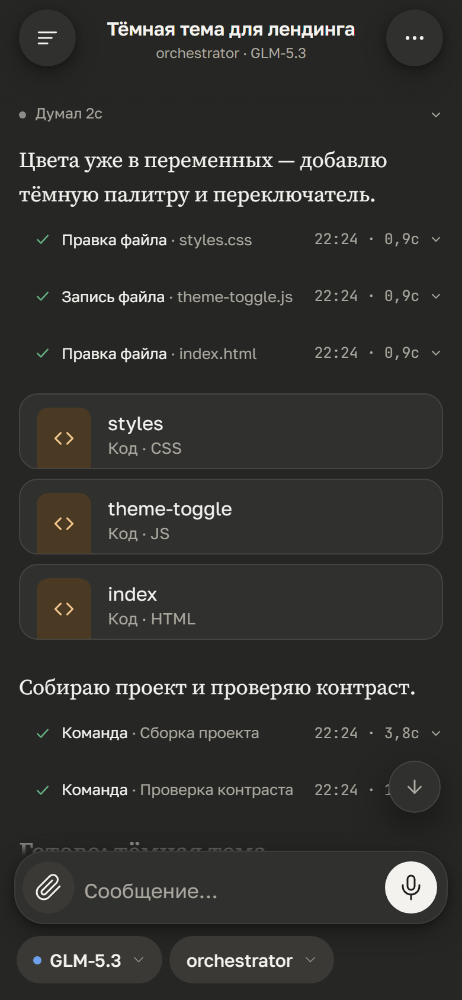
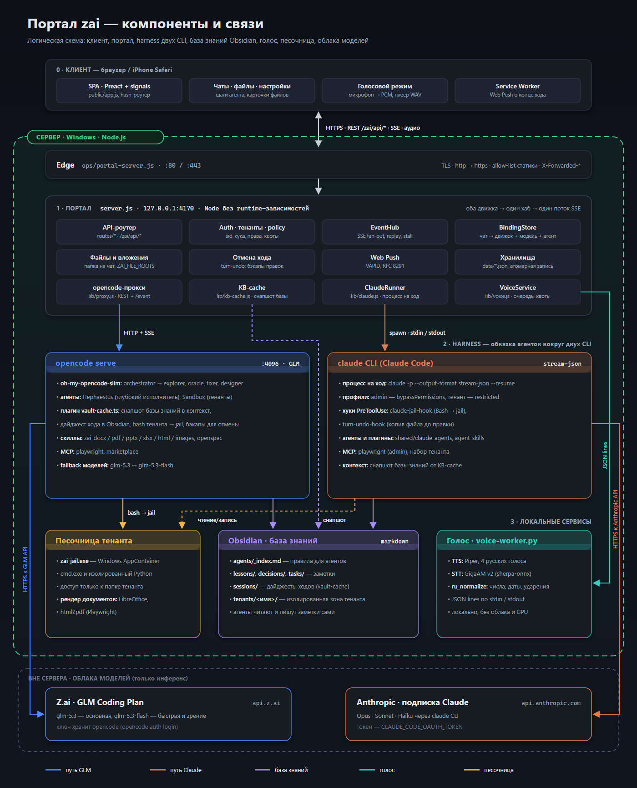
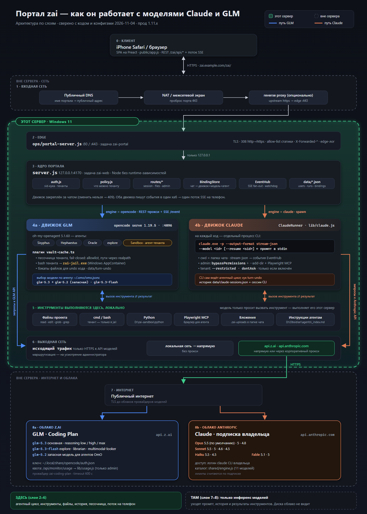

<div align="center">

# Teleharness

### Агентные CLI со всей их обвязкой — у вас в телефоне

Запускайте **Claude Code** и **opencode** на своей машине и работайте с ними из любого браузера.
Вы общаетесь не с голой моделью: каждое сообщение проходит через настоящий агентный CLI — с его агентами,
скиллами, MCP-серверами, хуками и базой знаний Obsidian в роли долгой памяти.

[](https://github.com/al3x4kov/teleharness/releases/latest)
[](https://github.com/al3x4kov/teleharness/actions/workflows/ci.yml)
[](LICENSE)
[](https://nodejs.org)
[](#поддержка-платформ)

[Демо](#попробовать-за-30-секунд) •
[Возможности](#возможности) •
[Быстрый старт](#быстрый-старт) •
[Архитектура](#архитектура) •
[Конфигурация](#конфигурация) •
[English](README.md)



</div>

---

## Зачем это

Чат-приложения дают доступ к модели. Агентные CLI дают гораздо больше — инструменты, доступ к файлам,
субагентов, скиллы, MCP, хуки, память проекта, — но живут в терминале на рабочем столе.

Teleharness ставит перед этими CLI мобильный веб-интерфейс, и вся обвязка оказывается под рукой:

- **CLI, а не модели.** Каждый чат идёт через `opencode serve` или `claude` CLI. Всё, что вы там настроили, —
  агенты, скиллы, плагины, MCP — работает с телефона.
- **Много провайдеров через один портал.** opencode работает с Z.ai GLM, OpenAI, Google Gemini, Anthropic,
  OpenRouter, локальными моделями и другими; Claude Code — с подпиской Claude. Движок и модель выбираются
  для каждого чата.
- **Память дольше одного чата.** Хранилище Obsidian работает как активный кэш: в начале чата агент получает
  снапшот заметок, после каждого хода дописывает дайджест.
- **Ваша машина — ваши данные.** Файлы, инструменты и история остаются на вашем сервере. Провайдеры видят
  только то, что нужно для инференса.
- **Можно поделиться.** Несколько пользователей со своими папками, квотами и системным промптом;
  на Windows их команды выполняются в песочнице AppContainer.

## Попробовать за 30 секунд

Без движков и ключей — интерфейс на синтетических чатах:

```bash
git clone https://github.com/al3x4kov/teleharness.git
cd teleharness
npm ci
npm run demo     # → http://127.0.0.1:4171/zai/
```

Язык интерфейса выбирается по языку браузера, переключается в настройках.

<p align="center">
  
  
  
</p>

## Возможности

| | | |
|---|---|---|
| 💬 | **Два движка в одном интерфейсе** | opencode (любой провайдер) и Claude Code рядом; чат закреплён за движком, моделью и агентом. |
| 🧠 | **Шаги агента** | Ход в реальном времени: рассуждения, вызовы инструментов с выводом, субагенты, фоновые задачи. Отмена хода вместе с правками файлов. |
| 📡 | **Устойчивый стриминг** | Один SSE-хаб для всех движков с replay, детектором зависаний и защитой от зацикливания — переживает нестабильную мобильную сеть. |
| 📎 | **Файлы** | Вложения и картинки, файлы-результаты карточками, просмотр разрешённых папок. Своя папка на каждый чат. |
| 🗂️ | **Obsidian как активный кэш** | Снапшот заметок в контексте, дайджесты ходов обратно в хранилище, отдельная зона на пользователя. |
| 🎙️ | **Голос** | Локальные распознавание и синтез речи (Python-воркер, только CPU) и голосовой режим. |
| 🔔 | **Push-уведомления** | Уведомление, когда долгий ход завершился (Web Push, VAPID). |
| 👥 | **Несколько пользователей** | Админ и пользователи: свои папки, системный промпт, набор MCP, квоты, rate-limit. |
| 📱 | **Mobile-first** | Сделано под iOS Safari: учёт клавиатуры, safe-area, светлая и тёмная темы, русский и английский интерфейс. |
| 🪶 | **Без runtime-зависимостей** | Бэкенд — чистый stdlib Node.js. |

## Быстрый старт

### Требования

| | Версия | Для чего |
|---|---|---|
| [Node.js](https://nodejs.org) | ≥ 22 | портал |
| [opencode](https://opencode.ai) | 1.19.5 | движок opencode |
| [Claude Code](https://docs.anthropic.com/en/docs/claude-code) | 2.x | движок Claude |
| Python | 3.11+ | по желанию, голос |

Нужен хотя бы один из двух движков.

### Установка и запуск

<details open>
<summary><b>macOS / Linux</b></summary>

```bash
git clone --branch v1.15.1 https://github.com/al3x4kov/teleharness.git
cd teleharness
npm ci && npm run build

cp .env.example .env               # заполните нужное, затем: set -a; . ./.env; set +a

opencode auth login                # добавьте нужных провайдеров
opencode serve --port 4096 &       # движок opencode
claude setup-token                 # движок Claude (токен → CLAUDE_CODE_OAUTH_TOKEN)

node server.js                     # → http://127.0.0.1:4170/zai/
```
</details>

<details>
<summary><b>Windows (PowerShell)</b></summary>

```powershell
git clone --branch v1.15.1 https://github.com/al3x4kov/teleharness.git
cd teleharness
npm ci; npm run build

Copy-Item .env.example .env        # заполните нужное

opencode auth login
Start-Process opencode -ArgumentList 'serve','--port','4096'
claude setup-token

node server.js                     # → http://127.0.0.1:4170/zai/
```
</details>

При первом запуске портал создаёт администратора и пишет токен входа в `data/admin-token.txt`
(или берёт `ZAI_ADMIN_TOKEN`). Чтобы открыть портал с телефона, поставьте перед ним TLS — встроенный
edge-сервер (`ops/portal-server.js`) или любой reverse proxy (Caddy, nginx, Tailscale Serve).

> [!NOTE]
> `zai` — исходное кодовое имя проекта. Оно осталось в пути (`/zai/`), переменных окружения (`ZAI_*`)
> и ключах хранилища, чтобы существующие установки продолжали работать.

### Поддержка платформ

| | macOS | Linux | Windows |
|---|:---:|:---:|:---:|
| Портал, оба движка, файлы, push | ✅ | ✅ | ✅ |
| Кэш Obsidian, голос | ✅ | ✅ | ✅ |
| Выполнение команд для не-админов | — | — | ✅ (песочница AppContainer) |

Без песочницы командная строка для обычных пользователей отключена (fail-closed); на админа это не влияет.

## Архитектура

<p align="center"></p>

- **Портал** (`server.js`) — API, авторизация и пользователи, хаб событий, привязка чата к движку.
  Для каждого движка свой адаптер: прокси к `opencode serve` и раннер, запускающий `claude` на каждый ход.
- **Harness** — всё, что окружает CLI: агенты и оркестрация (oh-my-opencode-slim), плагин `vault-cache.ts`,
  хуки Claude Code, скиллы, MCP-серверы. Здесь решается, что агенту можно и что он знает.
- **Obsidian** — долгая память агентов, своя зона у каждого пользователя.
- **Голос** — отдельный локальный Python-процесс (Piper TTS, GigaAM STT).
- **Песочница** — Windows AppContainer для команд других пользователей.

Послойная схема и путь запроса:

<p align="center"></p>

Подробнее — [`docs/architecture.md`](docs/architecture.md), требования — [`openspec/specs/`](openspec/specs/).

## Конфигурация

Все параметры задаются переменными окружения; схема с типами, значениями по умолчанию и валидацией —
[`lib/config.js`](lib/config.js), шаблон — [`.env.example`](.env.example).

| Переменная | По умолчанию | |
|---|---|---|
| `PORT` | `4170` | порт портала |
| `ZAI_UPSTREAM` | `http://127.0.0.1:4096` | адрес `opencode serve` |
| `CLAUDE_CODE_OAUTH_TOKEN` | — | токен подписки Claude (`claude setup-token`) |
| `ZAI_ADMIN_TOKEN` | генерируется | токен входа администратора |
| `ZAI_DATA_DIR` | `./data` | пользователи, сессии, логи |
| `ZAI_FILE_ROOTS` | домашняя папка | папки, доступные в файловом браузере |
| `ZAI_KB_ROOT` | `off` | папка Obsidian для агентов, например `~/Obsidian/agents` |
| `ZAI_TENANT_HOME` | `~/.zai-tenants` | папки пользователей |
| `ZAI_VOICE_PYTHON`, `ZAI_VOICE_MODELS` | `~/.zai/voice/…` | локальный голосовой воркер |

### Конфиги агентов

В [`config/`](config/) лежит рабочий пример настроек Claude Code и opencode автора: агенты, промпты,
плагин vault-cache, скиллы документов. Установка — `./config/install.sh` (macOS/Linux) или
`./config/install.ps1` (Windows); секреты берутся из окружения. В конфигах прописаны абсолютные пути —
проверьте их перед использованием.

Сторонние скиллы в репозиторий не входят, ставьте их из первоисточников:
[agent-skills](https://github.com/addyosmani/agent-skills) (`/plugin marketplace add addyosmani/agent-skills`),
[OpenSpec](https://github.com/Fission-AI/OpenSpec) (`npm i -g @fission-ai/openspec`).

## Разработка

```bash
npm test                 # unit, UI-компоненты (happy-dom), сервер и edge
npm run build            # esbuild → public/app.js, public/app.css
npm run demo             # мок-режим на fixtures-demo/
```

Как участвовать — [CONTRIBUTING.md](CONTRIBUTING.md), изменения — [CHANGELOG.md](CHANGELOG.md).

## Лицензия

[MIT](LICENSE). Сторонние файлы — под своими лицензиями: скиллы и команды `openspec-*` / `opsx-*` — MIT
([OpenSpec](https://github.com/Fission-AI/OpenSpec)), скилл `dogfood` — Apache-2.0.
