<div align="center">

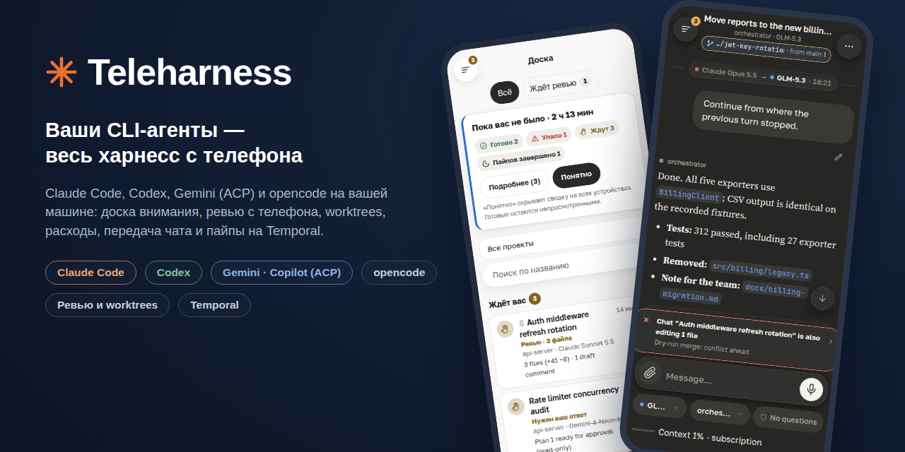

## Единый веб-пульт для ваших AI-агентов кода

**Работайте с Claude Code, Codex, Gemini (ACP) и opencode в одном десктопном веб-пульте — проверяйте диффы и
изолированные git worktrees, передавайте задачу другому CLI, когда кончился лимит, и собирайте агентов в пайпы,
которые переживают перезапуск. А если нужен доступ вдали от компьютера, тот же интерфейс работает как мобильная
веб-версия / PWA — на усмотрение пользователя.**

Teleharness — открытый self-hosted пульт для AI coding CLI. Он запускает настоящие CLI на вашей машине — с их
агентами, скиллами, MCP-серверами, хуками и контекстом проекта — и добавляет то, чего нет в терминале: Доску внимания,
ревью диффов с «Сначала план», изолированные git worktrees, правую панель MCP/Skills/План на десктопе, учёт расходов
по ценам API, передачу чата между CLI и надёжные пайпы из нескольких агентов на [Temporal](https://temporal.io).
Всё это работает на подписках CLI, которые у вас уже есть, а не на платном API.

**Чат** · **Поиск** · **Доска и ревью** · **Worktrees** · **Передача между CLI** · **Пайпы** · **на ваших подписках** · **на своём сервере**

[](https://github.com/al3x4kov/teleharness/releases/latest)
[](https://github.com/al3x4kov/teleharness/actions/workflows/ci.yml)
[](LICENSE)
[](https://nodejs.org)
[](#поддержка-платформ)

[Что умеет](#что-умеет) •
[Доска, ревью, worktrees и расходы](#доска-ревью-диффов-worktrees-и-расходы) •
[Переключение CLI](#переключение-cli-посреди-разговора) •
[Пайпы](#пайпы-которые-переживают-перезапуск-temporal) •
[Демо](#попробовать-за-30-секунд) •
[Обзор](#обзор-по-экранам) •
[Возможности](#возможности) •
[Быстрый старт](#быстрый-старт) •
[Архитектура](#архитектура) •
[Конфигурация](#конфигурация) •
[Участие](CONTRIBUTING.md) •
[English](README.md)

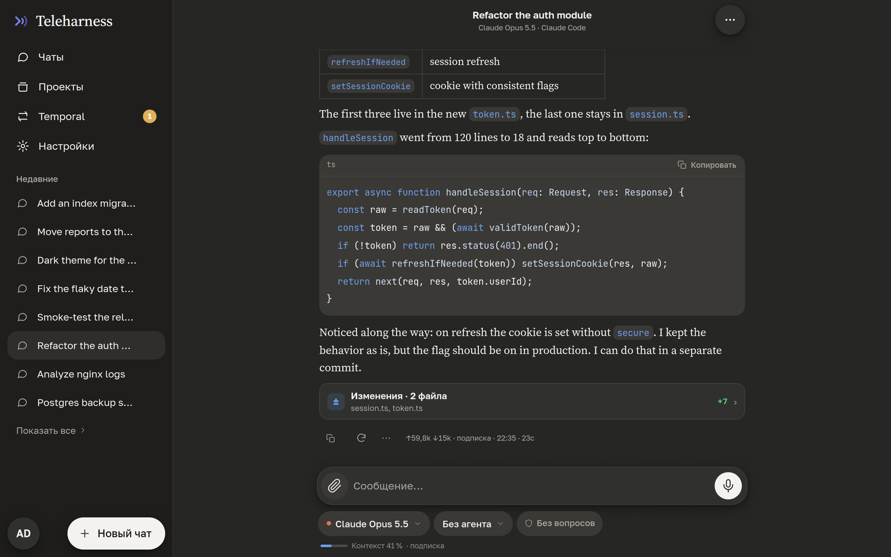

</div>

---

## Что умеет

<table>
<tr>
<td width="33%"></td>
<td width="33%"></td>
<td width="33%">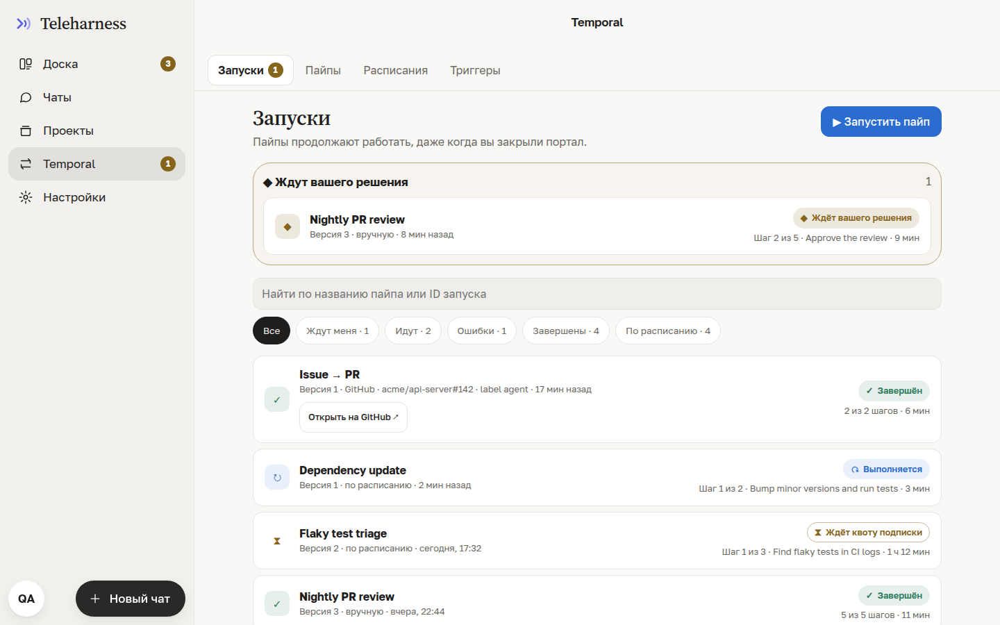</td>
</tr>
<tr>
<td valign="top"><b>Чат</b><br>Claude Code, Codex, Gemini и Copilot (ACP) и opencode рядом в десктопном веб-интерфейсе (с мобильным PWA по желанию): живые шаги, карточки субагентов, правая панель MCP/Skills/План, «Сначала план», диффы и git worktrees, файлы, голос и push-уведомления.</td>
<td valign="top"><b>Передача</b><br>Кончилась подписка посреди задачи? Тот же чат продолжается на другом CLI или модели — та же папка, одна лента, пропущенные ходы передаются. Вручную или автоматически.</td>
<td valign="top"><b>Пайпы</b><br>Собирайте агентов и локальные allowlist-команды в многошаговые запуски на Temporal: Claude делает ревью, вы одобряете, Codex пишет — с таймерами, условиями, расписаниями, управлением внешними workflow и артефактами. Переживают перезапуск.</td>
</tr>
</table>

## Доска, ревью диффов, worktrees и расходы

Ведите несколько агентов одновременно, не жонглируя десятком вкладок терминала:

- **Доска внимания (`#/board`)** — одна лента по всем чатам и запускам Temporal (*Ждёт вас*, *Работает*, *Готово*,
  *Упало*) со сводкой «Пока вас не было», боковой панелью предпросмотра на десктопе (≥ 768 px), быстрыми действиями и
  push-уведомлениями по категориям с тихими часами.
- **Ревью диффов и «Сначала план» (`#/board/review`)** — двухпанельный дифф на десктопе (и удобная одноколоночная
  версия на мобильных), выделение любой строки или диапазона для черновика комментария, отправка структурированных
  правок обратно агенту или принятие с коммитом. Режим *Сначала план* просит Claude, Codex, opencode или Gemini
  сначала подготовить план в режиме чтения и дождаться вашего одобрения до правки файлов.
- **Изолированные Git Worktrees (`#/worktrees`)** — свой worktree и ветка на каждый чат или запуск пайпа, раннее
  обнаружение пересечения файлов и конфликтов при пробном слиянии, слияние обратно (squash / merge / fast-forward)
  после прогона вашей тестовой команды.
- **Учёт расходов по ценам API (`#/settings/costs`)** — каждый ход записывается в SQLite и оценивается по
  редактируемому прайсу моделей, сравниваясь с вашими подписками (Claude Max, ChatGPT Plus, Google Antigravity,
  GitHub Copilot CLI): видна реальная экономия, окупаемость, мягкие месячные лимиты и экспорт в CSV.
- **Агенты ACP (`#/settings/acp`)** — установка и вход в **Google Antigravity** (`Gemini 4 Neon`, `Gemini 3.8 Flash`)
  и **GitHub Copilot CLI** прямо из Настроек, с ролями, vision, «Сначала план», авто-передачей и автоматическим восстановлением устаревшей сессии после прерванных ходов.

<p align="center">
  
</p>
<p align="center"><sub>Доска внимания на десктопе: очереди ревью, ожидающие планы, запущенные пайпы и боковая панель предпросмотра (≥ 768 px) без автоматической пометки просмотренным.</sub></p>

<p align="center">
  
</p>
<p align="center"><sub>Ревью диффов на десктопе: дерево файлов, построчные комментарии, возврат на доработку агенту и коммит.</sub></p>

<p align="center">
  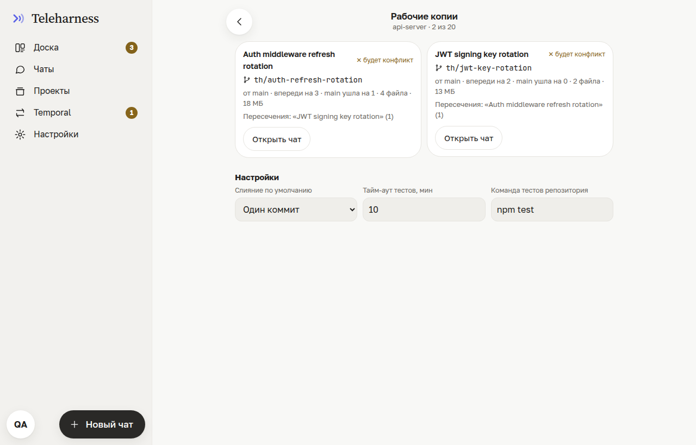
</p>
<p align="center"><sub>Изолированные Git Worktrees: отдельный worktree на каждый чат или пайп с живой проверкой пересечений и пробного слияния.</sub></p>

<p align="center">
  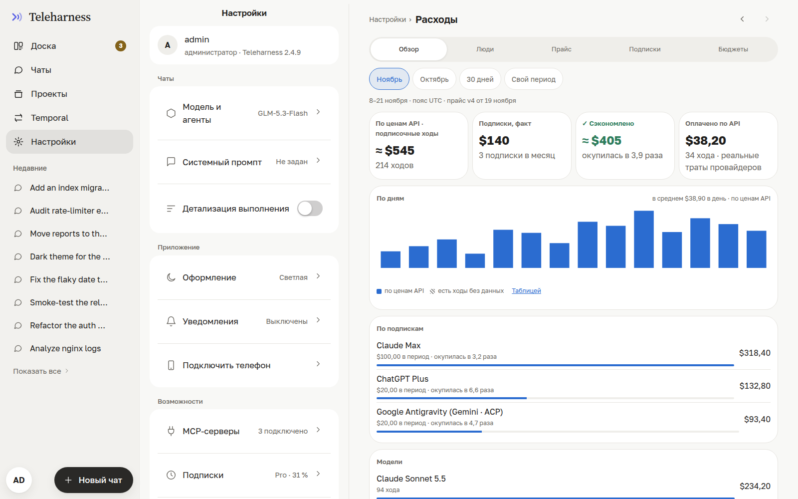
</p>
<p align="center"><sub>Расходы в эквиваленте API против фиксированных подписок, график по дням и разбивка по моделям.</sub></p>

<details>
<summary>Мобильная веб-версия / PWA (по желанию: Доска, ревью, «Сначала план», Worktrees)</summary>

<p align="center">
  
  
  
  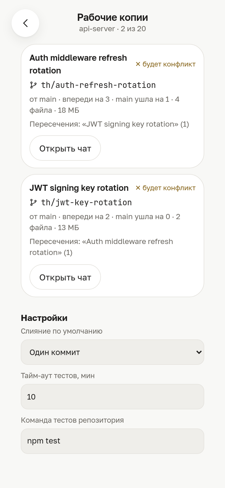
</p>

</details>

## Переключение CLI посреди разговора

Начните задачу в Claude Code, а продолжите в Gemini (ACP), Codex или opencode на GLM или любой другой модели —
в любую сторону.

- **Из меню чата, в любой момент:** *Продолжить в…* → движок и модель.
- **Когда кончилась подписка:** в уведомлении о лимите есть кнопка *Продолжить в &lt;модель&gt;* — в один клик.
- **Что переносится:** папка проекта, одна общая лента с отметкой передачи, пропущенные новым CLI ходы
  (приходят с его первым запросом) и, если подключена база знаний, полный журнал чата.
- **Автоматически, если хотите:** включите *Продолжать автоматически при лимите* в Настройки → Модель и агенты и
  укажите до трёх запасных моделей; сервер сам передаст чат и попросит новый CLI продолжить без вашего участия.
  По умолчанию выключено.
- **Что не переносится:** внутреннее состояние сессии прежнего CLI.

<p align="center">
  
</p>
<p align="center"><sub>Передача между CLI на десктопе: Claude Opus сделал первую половину, GLM-5.3 подхватил задачу в той же ленте и папке проекта.</sub></p>

<details>
<summary>Мобильная веб-версия / PWA (по желанию: отметка передачи, выбор модели, авто-передача)</summary>

<p align="center">
  
  
  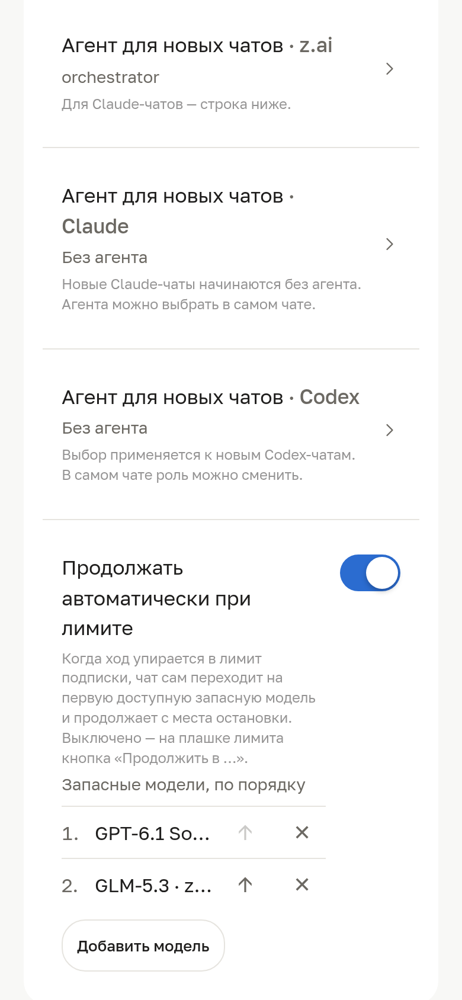
</p>

</details>

Подробности, ограничения и частые вопросы: [docs/cross-cli-handoff.md](docs/cross-cli-handoff.md).

## Пайпы, которые переживают перезапуск (Temporal)

Превратите рутину в пайп: Claude смотрит дифф, вы одобряете его в браузере (или с телефона по желанию), Codex пишет
заметки к релизу, и файл ложится в папку запуска. Каждый шаг выполняется на вашей подписке CLI как ход обычного чата,
так что его разговор всегда можно открыть позже. Запуски продолжаются при закрытом браузере и после перезапуска сервера.

Зачем Temporal: каждый шаг — надёжная activity, вызовы моделей фиксируются ровно один раз в журнале (или работают
локально без PostgreSQL через `TELEHARNESS_TEMPORAL_LEDGER=none`), шаг *Решение человека* может ждать днями без
удержания процесса, а слоты параллельности на движок и пользователя держат подписки в рамках лимитов.

Упавший или остановленный запуск не начинается с нуля: **Продолжить с шага** продолжает его с последнего успешного
шага — или с любого выбранного — на той же или последней опубликованной версии пайпа. Пройденные шаги переносятся как
есть (вместе с результатами и разговорами шагов), перезапускается только остаток, папка запуска и её файлы наследуются,
а на экране запуска появляется бейдж со ссылкой на исходный запуск.

<p align="center">
  
</p>
<p align="center"><sub>Список запусков на десктопе: когда подписка (включая OpenCode) упирается в лимит, шаг переходит в <i>Ожидает квоты подписки</i> — запуск остаётся возобновляемым вместо падения.</sub></p>

<p align="center">
  
</p>
<p align="center"><sub>Фоновые агенты GitHub: запускайте пайпы по меткам issue, командам в комментариях или красному CI с автоматическим созданием чернового PR.</sub></p>

<p align="center">
  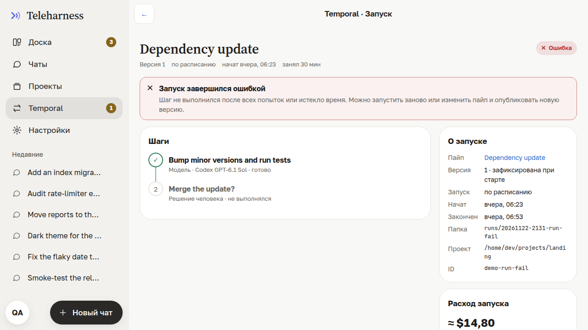
</p>
<p align="center"><sub>Продолжить с шага: просмотрите результаты шагов и продолжите с последнего успешного или любого выбранного шага.</sub></p>

<p align="center">
  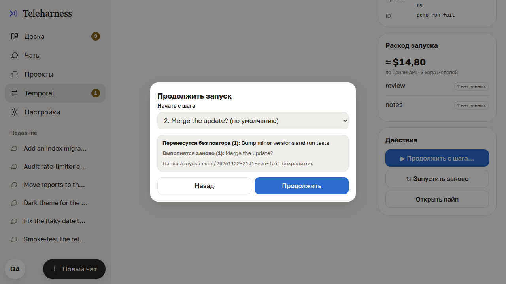
  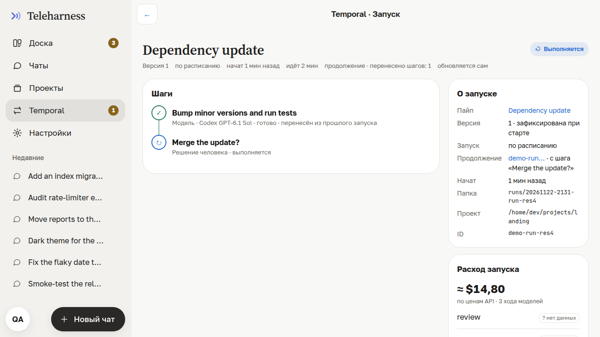
</p>

<p align="center">
  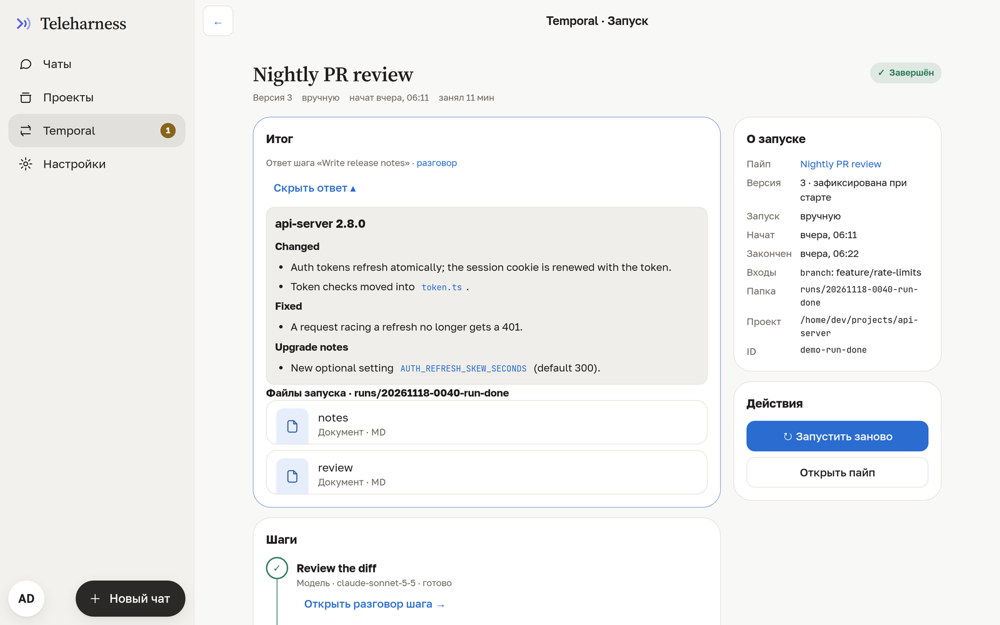
</p>

Шаги: *Модель* (Claude, Codex, Gemini ACP или OpenCode — модели GLM загружаются из ваших подключённых провайдеров
OpenCode), **Команда** (локальные allowlist-скрипты без shell или внешние workflow/расписания Temporal), *Решение
человека* (с возвратом на доработку к шагу модели до 3 циклов), *Открыть PR* (изолированная рабочая копия → черновой
PR или фикс CI в ту же ветку с подтверждением для `.github/workflows`), *Таймер*, *Объединение*, *Условие*,
*Артефакт*; входы запуска `{{input.name}}`, ответы прошлых шагов `{{steps.id}}`; расписания с предпросмотром
ближайших запусков; вкладка **Внешние** для администратора с управлением любыми workflow Temporal (Start, Signal, Query,
Reset, Cancel, Terminate); и **фоновые агенты GitHub** (webhook или опрос раз в 2 минуты по меткам issue, командам
`/agent` и красному CI, с доверенными авторами, журналом событий на 14 дней и общим выключателем). По желанию, Linux
и macOS — см. [docs/temporal.md](docs/temporal.md). Попробовать без настройки — в `npm run demo`.

<details>
<summary>Мобильная веб-версия / PWA (по желанию: анимация Temporal и мобильные экраны)</summary>

<p align="center">
  
</p>

<p align="center">
  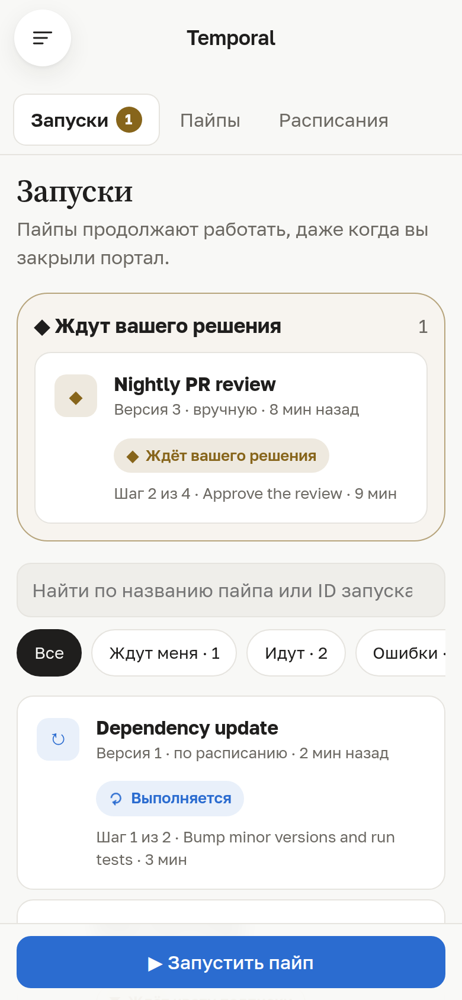
  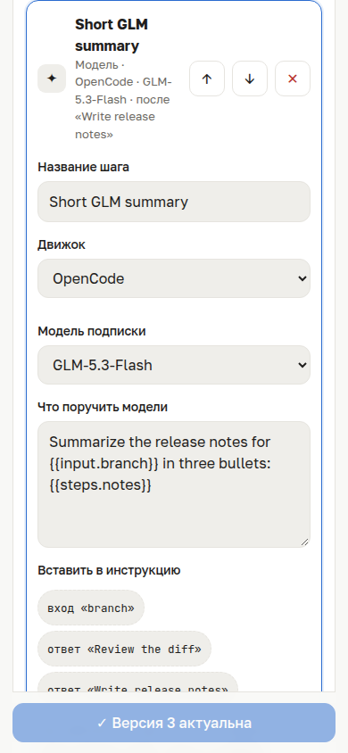
  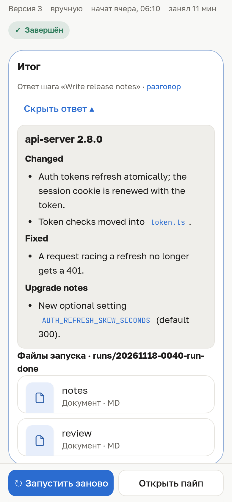
  
</p>

<p align="center">
  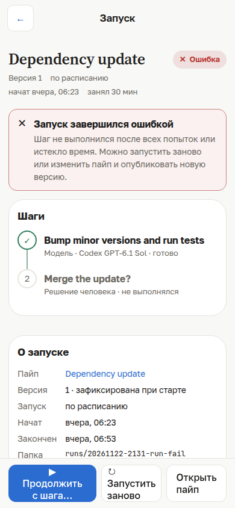
  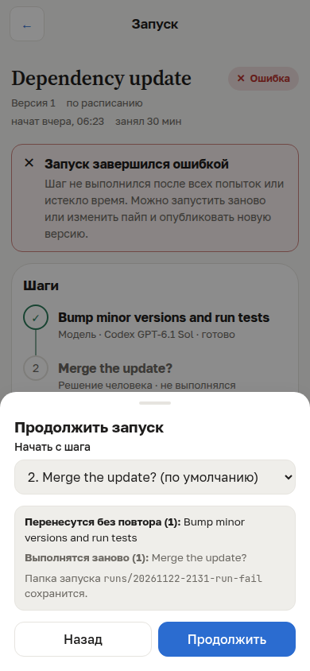
  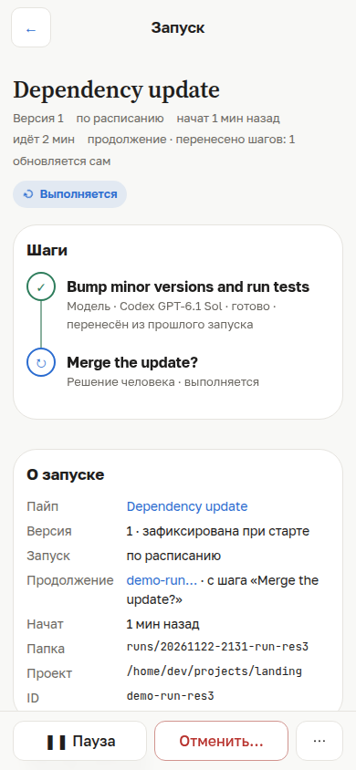
</p>

</details>

## Зачем это

Чат-клиенты дают модель. Агентные CLI дают намного больше — инструменты, доступ к файлам, субагентов, скиллы,
MCP-серверы, хуки, память проекта — но управлять несколькими параллельными агентами в десятке вкладок терминала
неудобно.

Teleharness ставит перед этими CLI единый десктопный веб-пульт (с мобильной веб-версией / PWA по желанию, если нужно
заглянуть с телефона) — и позволяет собирать их в надёжные пайпы:

- **CLI, а не модели.** Каждый чат идёт через `opencode serve`, `claude` CLI, `codex` CLI или агенты ACP. Всё, что
  вы настроили в них — агенты, скиллы, плагины, MCP — работает прямо в браузере.
- **Много провайдеров в одном окне.** opencode ходит в Z.ai GLM, OpenAI, Google Gemini, Anthropic,
  OpenRouter, локальные модели и т. д.; Claude Code даёт вашу подписку Claude, Codex — подписку ChatGPT. Движок и
  модель выбираются на каждый чат — пикер сам подгружает модели подключённых провайдеров OpenCode и обновляет их по
  кнопке.
- **Агенты работают в фоне.** Пайпы на Temporal гоняют многошаговые сценарии через Claude, Codex, Gemini ACP, opencode
  и allowlist-команды, останавливаются на вашем решении и продолжаются после перезапусков — на подписках, не на платном API.
- **Задача переживает лимит.** Если подписка кончилась посреди работы, передайте чат другому движку или модели:
  папка та же, лента одна, пропущенные ходы передаются.
- **Память дольше одного чата.** Хранилище Obsidian работает как активный кэш: агенты получают сводку заметок
  при старте чата и дописывают дайджест после каждого хода.
- **Ваша машина, ваши данные.** Файлы, инструменты и история остаются на вашем сервере. Провайдеры видят только
  промпты и результаты инструментов, нужные для ответа.
- **Вы контролируете действия.** В каждом чате задаётся, спрашивать ли разрешение перед правками и командами;
  разрешать и отклонять можно прямо в чате или через опциональные Web Push уведомления.
- **Десктоп в основе, мобильная версия по желанию.** Полноценное десктопное рабочее пространство с адаптивной боковой
  панелью, правой панелью MCP/Skills/План и двухпанельным ревью диффов; при желании подключите телефон по QR-коду, чтобы
  проверять статусы и одобрять планы на ходу.
- **Безопасный доступ для нескольких пользователей.** Свои папки, квоты и системный промпт; на Windows команды
  других пользователей идут в песочнице AppContainer, на Linux — через опциональный раннер на пользователя.

## Попробовать за 30 секунд

Без движков и ключей — интерфейс на синтетических чатах:

```bash
git clone https://github.com/al3x4kov/teleharness.git
cd teleharness
npm ci
npm run demo     # → http://127.0.0.1:4171/teleharness/
```

## Обзор по экранам

Все скриншоты сняты с `npm run demo` — ровно то, что вы увидите у себя.

### Десктопное рабочее пространство

<p align="center">
  
</p>
<p align="center"><sub>Правая панель на компьютере (&ge; 1024 px): статусы MCP, поиск по скиллам с просмотром SKILL.md в модальном окне и живой план текущего хода.</sub></p>

<p align="center">
  
</p>
<p align="center"><sub>Модальное окно Skill: полная документация SKILL.md с рендером Markdown, не выходя из чата.</sub></p>

<p align="center">
  
</p>
<p align="center"><sub>Codex CLI на десктопе: правки файлов, зелёные тесты, режимы разрешений и индикатор контекста.</sub></p>

<p align="center">
  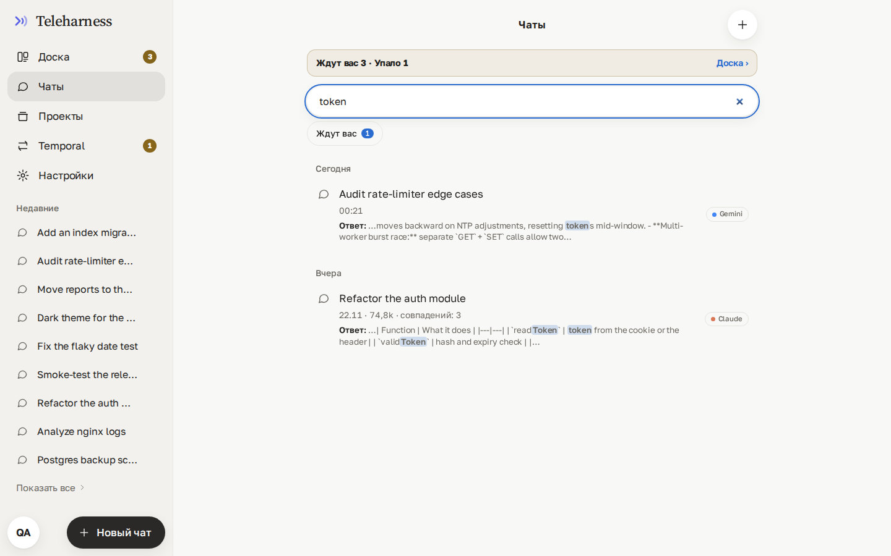
</p>
<p align="center"><sub>Полнотекстовый поиск SQLite FTS5 по всем чатам с подсвеченными сниппетами и переходом прямо к сообщению.</sub></p>

<p align="center">
  
  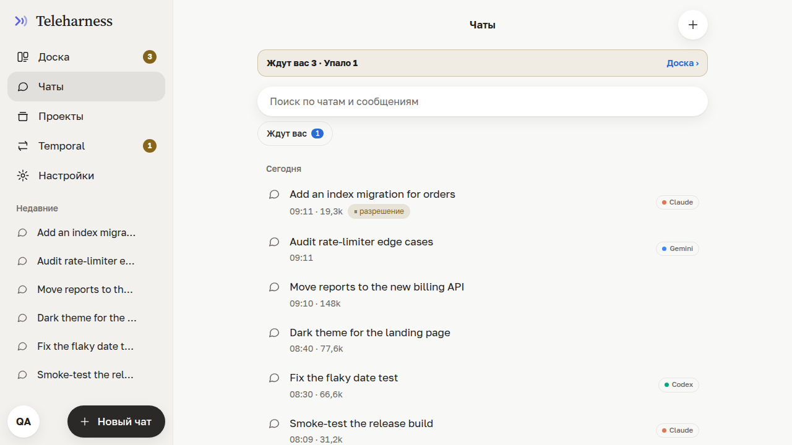
</p>
<p align="center"><sub>Адаптивная боковая панель на десктопе (&ge; 900 px): «Недавние» заполняют доступную высоту, а подвал остаётся аккуратно внизу.</sub></p>

<p align="center">
  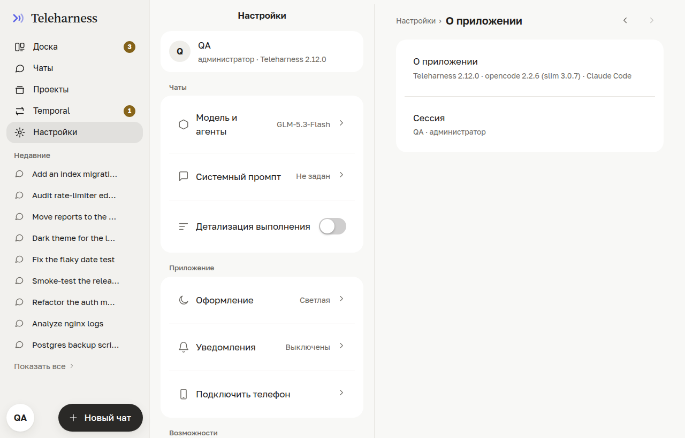
  
</p>
<p align="center"><sub>Настройки → О приложении (точные версии портала и движков) и опциональное подключение телефона по QR-коду.</sub></p>

### Мобильная веб-версия / PWA (по желанию)

Если вы решите открыть портал по HTTPS, тот же веб-интерфейс адаптируется под iOS Safari и Android Chrome как
устанавливаемое PWA-приложение — полностью на ваше усмотрение.

<details>
<summary>Показать галерею мобильной веб-версии / PWA и анимацию</summary>

<p align="center">
  
</p>

<table>
<tr>
<td width="25%"></td>
<td width="25%"></td>
<td width="25%"></td>
<td width="25%"></td>
</tr>
<tr>
<td valign="top"><b>Чаты</b><br>Каждый чат закреплён за движком, моделью и агентом. Чаты Claude Code отмечены отдельно.</td>
<td valign="top"><b>Субагенты</b><br>Когда агент делегирует, каждый запуск — карточка: кто, зачем, сколько времени, шагов и токенов.</td>
<td valign="top"><b>Внутри запуска</b><br>Откройте карточку — видны шаги субагента и его ответ, можно перейти в его чат.</td>
<td valign="top"><b>Передача</b><br>Кончился лимит? Тот же чат продолжается на другом движке — одна лента с отметкой передачи.</td>
</tr>
<tr>
<td width="25%"></td>
<td width="25%">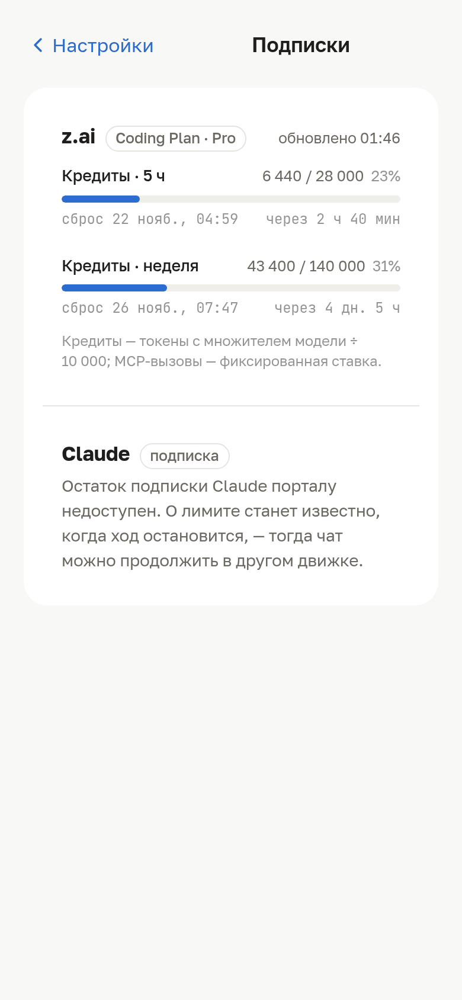</td>
<td width="25%"></td>
<td width="25%">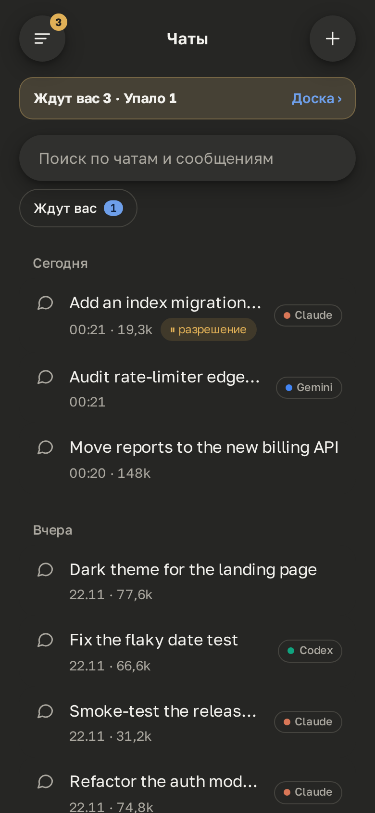</td>
</tr>
<tr>
<td valign="top"><b>Выбор продолжения</b><br>Из меню чата в любой момент или прямо из плашки лимита. Папка остаётся прежней.</td>
<td valign="top"><b>Подписки</b><br>Расход и остаток квоты по подключённым провайдерам, где есть официальный API.</td>
<td valign="top"><b>Шаги и файлы</b><br>Рассуждения, вызовы инструментов с выводом и файлы-результаты с превью и скачиванием.</td>
<td valign="top"><b>Светлая и тёмная</b><br>Подстраивается под систему или ваш выбор; удобно управлять и с телефона.</td>
</tr>
</table>

</details>

## Возможности

| | |
|---|---|
| **Четыре семейства движков, один интерфейс** | opencode (любой провайдер), Claude Code, Codex CLI и агенты ACP (Google Antigravity / Gemini и GitHub Copilot CLI) рядом; чат закрепляется за своим движком, моделью и агентом. Пикер группирует модели по подключённым провайдерам opencode (подписка, бесплатные, API) с кнопкой «Обновить список»; платные модели opencode с оплатой за токены скрыты от пользователей. Администратор может выдавать доступ к Claude, Codex и Gemini (ACP) каждому пользователю в Настройки → Пользователи (только в его папках и без shell).<br> 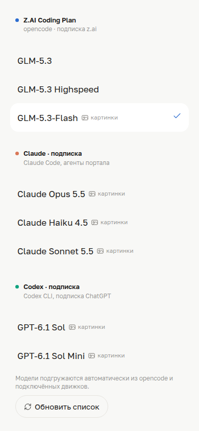  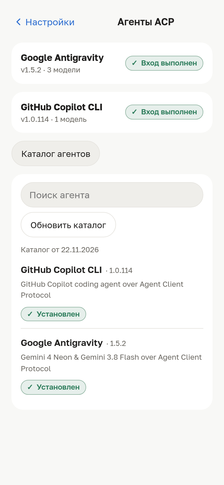 |
| **Доска внимания** | Единый экран для всех чатов и запусков Temporal: *Ждёт вас*, *Работает*, *Готово* и *Упало*, сводка «Пока вас не было», боковая панель предпросмотра на десктопе (≥ 768 px), быстрые действия и push по категориям с тихими часами.<br> |
| **Поиск по сообщениям** | Полнотекстовый поиск по каждому вопросу и ответу во всех чатах: сниппеты с ролями «Вы:»/«Ответ:», подсветкой и счётчиком совпадений, переход сразу к сообщению (история догружается сама, затем подсветка), производный локальный SQLite FTS5 (trigram) индекс, изоляция тенантов и честная деградация к поиску по заголовкам, пока индекс строится.<br> |
| **Адаптивные «Недавние»** | На десктопе (≥ 900 px) список «Недавние» в боковой панели заполняет её высоту вместо фиксированных восьми строк — до 100 чатов под рукой (минимум 8; компактные строки 40 px на ПК, чтобы подвал не перекрывал список даже на 1280×720/800).<br>  |
| **Правая панель на ПК: MCP, Skills и план хода** | На компьютере (≥ 1024 px) рядом с открытым чатом появляется фиксированная панель шириной 300 px: подключённые **MCP**-серверы, доступные **Skills** и живой **План** текущего хода (ACP, Claude Code и opencode). Поле поиска фильтрует MCP и Skills с показом счётчиков совпадений, а клик по любому скиллу открывает модальное окно с отрендеренным `SKILL.md` (обычные пользователи видят только разрешённые `teleharness-*` скиллы без путей к файлам).<br>  |
| **Ревью диффов и «Сначала план»** | Очередь ревью по чатам и пайпам, двухпанельный дифф на десктопе (и одноколоночный на мобильных) с выбором строк и черновиками комментариев, возврат агенту и принятие с коммитом. Режим *Сначала план* просит агента составить план в режиме чтения до правок.<br>  |
| **Изолированные Git Worktrees** | Своя рабочая копия и ветка на чат или пайп, раннее предупреждение о пересечении файлов и конфликтах при пробном слиянии, слияние squash/merge/ff с прогоном тестов и очистка забытых веток.<br> |
| **Учёт расходов по ценам API** | Журнал ходов в SQLite по редактируемому прайсу, реальные подписки (Claude Max, ChatGPT Plus, Google Antigravity, Copilot CLI) с экономией и окупаемостью, мягкие месячные бюджеты, сводки по чатам/проектам/запускам и экспорт в CSV.<br> |
| **Режим разрешений на чат** | *Спрашивать* — агент запрашивает подтверждение перед правками файлов и командами (Claude — через мост разрешений, Codex — нативно); *Правки без вопросов*; *Без вопросов* (только админ).<br> 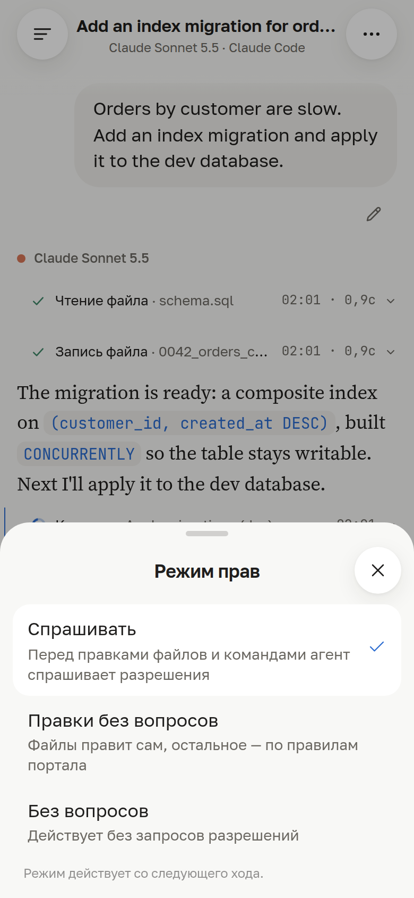 |
| **Ждёт вас** | Фильтр списка чатов со счётчиком тех, где агент ждёт решения, и push-уведомление в момент ожидания.<br> |
| **Контекст и расход** | Строка над полем ввода: насколько заполнено окно контекста модели (с предупреждением после 80 %) и сколько стоил чат — или что он идёт по подписке.<br>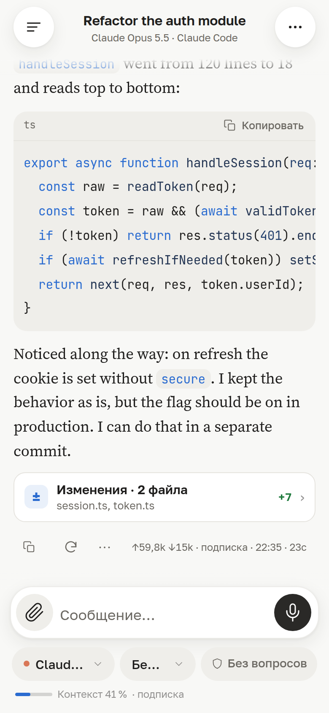  |
| **Шаги агента** | Ход в реальном времени: рассуждения, вызовы инструментов с выводом, фоновые задачи. Каждый запуск субагента — карточка с длительностью, числом шагов и токенами; в раскрытой карточке видны все шаги: подряд идущие однотипные сворачиваются в строку, которая раскрывается по клику, а «Показать все шаги (N)» выводит их по одному. Отмена хода вместе с правками файлов.<br>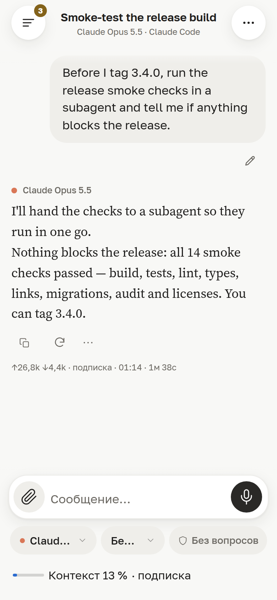 |
| **Правки хода и Git** | У ответа, который менял файлы, появляется строка *Изменения · N файлов*: по клику — дифф по каждому файлу, что изменил именно этот ход или текущее состояние к последнему коммиту (две панели на компьютере, одна колонка на узком экране). Экран Git папки чата показывает ветку, расхождение с origin и изменённые файлы: отметьте нужные, попросите модель этого чата предложить сообщение коротким отдельным запросом (в историю чата не попадает), сделайте коммит и отправьте в origin — push доступен только админу. Остальные работают с git в своих папках, без push и переключения веток. В Настройки → Git задаются автор коммита, язык сообщения и выбор файлов по умолчанию. |
| **Фоновые субагенты продолжают работу** | Claude Code отвечает сразу, а запущенные им фоновые субагенты работают дальше после ответа. Полоска над полем ввода показывает, кто ещё занят; новое сообщение встаёт в очередь, а когда субагенты закончат — Claude сам подхватывает их результаты и отвечает снова. |
| **Пайпы Temporal и фоновые агенты GitHub** *(по желанию)* | Многошаговые сценарии, переживающие перезапуск: шаги Claude, Codex, Gemini (ACP) и OpenCode (GLM), шаги **Команда** из allowlist-каталога (локальные скрипты без shell и внешние workflow/расписания Temporal), решения человека с доработками (до 3 циклов), шаг *Открыть PR* в изолированной рабочей копии, таймеры, условия и артефакты. Работает и локально без PostgreSQL (`TELEHARNESS_TEMPORAL_LEDGER=none`), а во вкладке **Внешние** администратор может просматривать и управлять любыми workflow Temporal (Start, Signal, Query, Reset, Cancel, Terminate). Завершённый или упавший запуск продолжается с последнего успешного шага — или с любого выбранного, — перенося выполненные шаги, папку запуска и разговоры шагов. Подключите fine-grained токен в Настройки → GitHub и запускайте пайпы автоматически по webhook или опросу (*Задача → PR*, *Починить CI*, *Ночное обновление*) с доверенными авторами, журналом событий и общим выключателем. Работает на подписках CLI, платный API не используется. Linux и macOS; по умолчанию выключено — см. [docs/temporal.md](docs/temporal.md).<br>  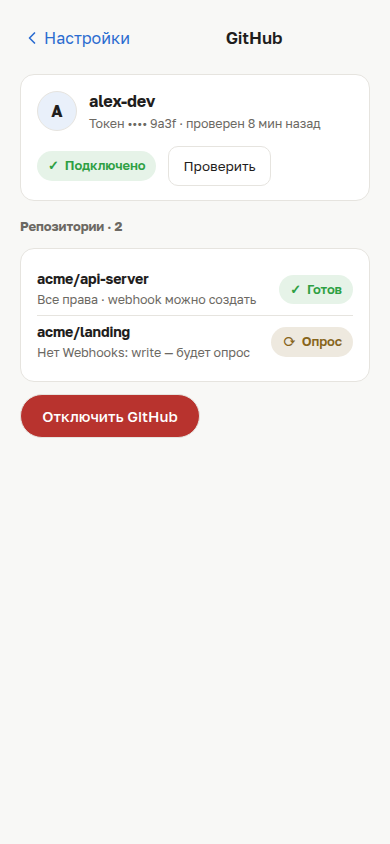 |
| **Передача между движками** | Упёрлись в лимит посреди задачи? Продолжите тот же чат на другом движке или модели: та же папка, одна лента, пропущенные ходы передаются. По желанию — автоматически, с вашим порядком запасных моделей. |
| **Подписки** | Расход и остаток квоты по подключённым провайдерам, где провайдер отдаёт их через официальный API. |
| **Надёжный стриминг** | Единый SSE-хаб для всех движков с повтором пропущенных событий, защитой от зависаний и петель — переживает обрывы сети и засыпание вкладок. |
| **Файлы и превью Office** | Вложения и картинки — скрепкой, вставкой (Ctrl/⌘+V: снимок экрана получает имя с датой, длинный вставленный текст становится файлом .txt) или перетаскиванием в чат. Файлы-результаты приходят карточками со встроенным предпросмотром прямо в браузере для **PowerPoint (`.pptx`)** (слайды, списки, таблицы, встроенные картинки, заметки докладчика), `.docx`, `.xlsx`, `.csv`, `.pdf`, `.md`, `.html`, кода и медиа — и с авторизованным скачиванием, которое работает и в standalone PWA на iOS/Android (Web Share API + Blob). Просмотр разрешённых папок; своя папка на каждый чат.<br>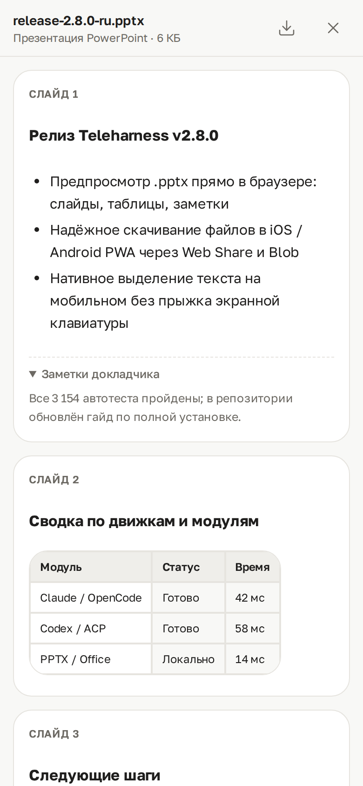 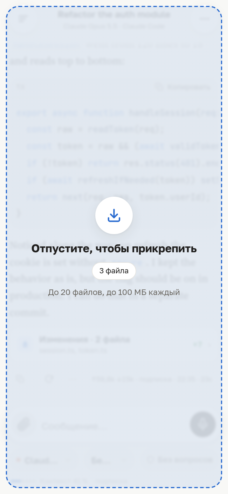  |
| **Obsidian как активный кэш** | Срез базы знаний в контексте, дайджесты ходов и журнал чата на запись, отдельная зона на пользователя. |
| **Голос** | Локальное распознавание и синтез речи (Python-воркер, только CPU) и голосовой режим без рук. |
| **Push-уведомления** | Уведомление, когда длинный ход завершился или агент ждёт вашего решения (Web Push, VAPID). |
| **Телефон по QR-коду (по желанию)** | Настройки → Подключить телефон показывают одноразовый QR-код (действует 10 минут): при желании можно войти с телефона без ввода токена. Нужен `TELEHARNESS_PUBLIC_URL`.<br> |
| **Несколько пользователей** | Админ и пользователи: свои папки, системный промпт, набор MCP, квоты, rate-limit. |
| **Настройки → О приложении** | Точная версия портала и каждого движка в одном месте — удобно, когда создаёте issue.<br> |
| **Десктопный веб-интерфейс и мобильный PWA (по желанию)** | Сделан под десктопные браузеры (светлая и тёмная темы, адаптивная боковая панель, правая панель, клавиатурная навигация, русский и английский интерфейс) и при желании работает как мобильный standalone PWA в iOS Safari и Android Chrome (нативное выделение текста, копирование в один тап, safe-area). |
| **Без runtime-зависимостей** | Бэкенд — чистый stdlib Node.js. |

## Быстрый старт

> [!TIP]
> **Нужен рабочий весь функционал без пробелов?** Откройте **[Полное руководство по установке (`docs/installation.ru.md`)](docs/installation.ru.md)** ([English: `docs/installation.md`](docs/installation.md)) — пошаговая настройка на Linux, macOS и Windows для всех 4 семейств движков, десктопного пространства, правой панели MCP/Skills, превью Office/PPTX, Git и Worktrees, активного кэша Obsidian, фоновых агентов GitHub, пайпов Temporal, локального голоса (CPU), песочницы для нескольких пользователей, автозапуска и опционального HTTPS + QR-входа для мобильного PWA + Web Push.

### Требования

| | Версия | Для чего |
|---|---|---|
| [Node.js](https://nodejs.org) | ≥ 22.5 (22 LTS / 24 LTS) | портал и встроенный SQLite FTS5 (поиск, расходы, доска) |
| [Git](https://git-scm.com) | ≥ 2.20 | экран Git, ревью диффов, изолированные Worktrees |
| [opencode](https://opencode.ai) | 2.x (проверено на 2.2.6) | движок opencode |
| [Claude Code](https://docs.anthropic.com/en/docs/claude-code) | 2.x | движок Claude |
| [Codex CLI](https://github.com/openai/codex) | 0.169+ | по желанию, движок Codex (админу по умолчанию; выдаётся пользователям) |
| ACP CLI (`gemini` / `copilot` / свой) | актуальная | по желанию, агенты ACP (подключаются в Настройки → Агенты ACP) |
| Python | 3.11+ | по желанию, локальный голосовой воркер и воркер пайпов Temporal |

Нужен хотя бы один движок.

### Одной командой

```bash
npx github:al3x4kov/teleharness            # → http://127.0.0.1:4180/teleharness/
```

Команда проверит Node, сохранит данные в `~/.teleharness`, при первом запуске соберёт интерфейс, покажет, какие
движки найдены (и как поставить недостающие), и напечатает токен администратора. Параметры: `--port N`,
`--host 0.0.0.0` (доступ из локальной сети), `--rebuild`. opencode serve она не запускает — печатает команду.

### Установка и запуск

<details open>
<summary><b>macOS / Linux</b></summary>

```bash
git clone --branch v2.12.0 https://github.com/al3x4kov/teleharness.git
cd teleharness
npm ci && npm run build

cp .env.example .env               # все значения необязательны

# движки (нужен хотя бы один)
opencode auth login                # добавьте нужных провайдеров
claude setup-token                 # движок Claude: токен — в .env как CLAUDE_CODE_OAUTH_TOKEN

./ops/opencode/serve-v2.sh &       # opencode 2.x на 127.0.0.1:4196, пароль в ~/.teleharness/oc2-password
./ops/web-v2.sh                    # → http://127.0.0.1:4170/teleharness/
```
</details>

<details>
<summary><b>Windows (PowerShell)</b></summary>

```powershell
git clone --branch v2.12.0 https://github.com/al3x4kov/teleharness.git
cd teleharness
npm ci; npm run build

Copy-Item .env.example .env        # все значения необязательны

opencode auth login
claude setup-token

# opencode 2.x с HTTP Basic; портал получает тот же пароль
$env:OPENCODE_SERVER_PASSWORD = [guid]::NewGuid().ToString('N')
Start-Process opencode -ArgumentList 'serve','--hostname','127.0.0.1','--port','4196'

$env:TELEHARNESS_OC_API = 'v2'; $env:TELEHARNESS_UPSTREAM = 'http://127.0.0.1:4196'; $env:TELEHARNESS_OC_PASSWORD = $env:OPENCODE_SERVER_PASSWORD
node server.js                     # → http://127.0.0.1:4170/teleharness/
```
</details>

Полная пошаговая инструкция для **всех возможностей на Linux, macOS и Windows**: [`docs/installation.ru.md`](docs/installation.ru.md)
(чек-лист для Mac с launchd и опциональным телефоном: [`docs/macos.md`](docs/macos.md)). На Linux
запускайте портал службой systemd по образцу [`ops/linux/teleharness.service`](ops/linux/teleharness.service) — с ним один ход
агента, которому не хватило памяти, не останавливает весь портал.

При первом запуске портал создаёт администратора и пишет токен входа в `data/admin-token.txt`
(или берёт `TELEHARNESS_ADMIN_TOKEN`). Откройте портал в десктопном браузере по адресу `http://127.0.0.1:4170/teleharness/`.
Если захотите открывать его и с телефона (PWA), поставьте перед ним TLS — встроенный
edge-сервер (`ops/portal-server.js`) или любой reverse proxy (Caddy, nginx, Tailscale Serve).

> [!NOTE]
> Портал открывается по пути `/teleharness/`; все настройки — переменные окружения `TELEHARNESS_*`
> (см. [`.env.example`](.env.example)).

### Поддержка платформ

| | macOS | Linux | Windows |
|---|:---:|:---:|:---:|
| Портал, движки opencode и Claude, файлы, push | да | да | да |
| Движки Codex и ACP (чаты) | да (админ; выдача пользователю) | да (админ; выдача пользователю) | да (админ; выдача пользователю) |
| Пайпы Temporal (по желанию) | да | да | — |
| Codex в пайпах Temporal | да (у пользователей — только текст) | да (у пользователей — только текст) | — |
| Кэш Obsidian, голос | да | да | да |
| Команды оболочки для не-админов | — | да, с отдельным раннером на пользователя¹ | да (песочница AppContainer) |

На macOS (и на Linux без раннера) командная строка для обычных пользователей отключена (fail-closed); на админа это не
влияет. ¹ На Linux команды пользователей могут выполняться через раннер на пользователя (`/usr/local/libexec/teleharness-tenant-run`,
см. `ops/sandbox/linux`); без него они по-прежнему отключены.
Изоляция пользователей движется к контейнеру на пользователя с полным окружением агентов — одинаковому на любой
хост-ОС — поэтому песочница Windows намеренно не портируется на другие системы.

## Архитектура

<p align="center"></p>

- **Портал** (`server.js`) — API, авторизация и пользователи, хаб событий, привязка чатов к движкам,
  передача чата между движками, поиск по чатам SQLite FTS5, доска внимания, расходы и API Git/Worktrees. По адаптеру
  на семейство движков: `lib/oc-client.js` для `opencode serve` (1.x и 2.x), раннеры для `claude` CLI и прослойки
  Codex поверх `codex app-server`, а также JSON-RPC мост ACP (`lib/acp-chat.js`) для Gemini / Copilot / своих ACP-агентов.
- **Харнесс** — всё вокруг CLI: агенты и оркестрация (oh-my-opencode-slim), плагин базы знаний и песочницы
  для opencode (`ops/opencode/plugin-v2` для 2.x, `vault-cache.ts` для 1.x), хуки Claude Code, скиллы, MCP-серверы.
  Именно это определяет, что агент умеет и что знает.
- **Obsidian** — долговременная память агентов, своя зона на пользователя; здесь же лежит журнал чата,
  который движок читает после передачи.
- **Голос** — отдельный локальный Python-процесс (Piper TTS, GigaAM STT).
- **Песочница** — команды оболочки других пользователей: раннер на пользователя на Linux (по желанию),
  AppContainer на Windows, на macOS закрыто.
- **Пайпы Temporal** (по желанию, Linux и macOS) — сервер Temporal, исполнитель на Python и опциональный PostgreSQL
  (история, журнал «ровно один раз», слоты параллельности; или локальный режим `TELEHARNESS_TEMPORAL_LEDGER=none`).
  Шаг модели — ход чата портала в папке пайпа через закрытый сокет; шаги «Команда» запускают allowlist-скрипты или
  внешние workflow Temporal. Подробнее — [`docs/temporal.md`](docs/temporal.md).

Послойная схема и путь запроса:

<p align="center">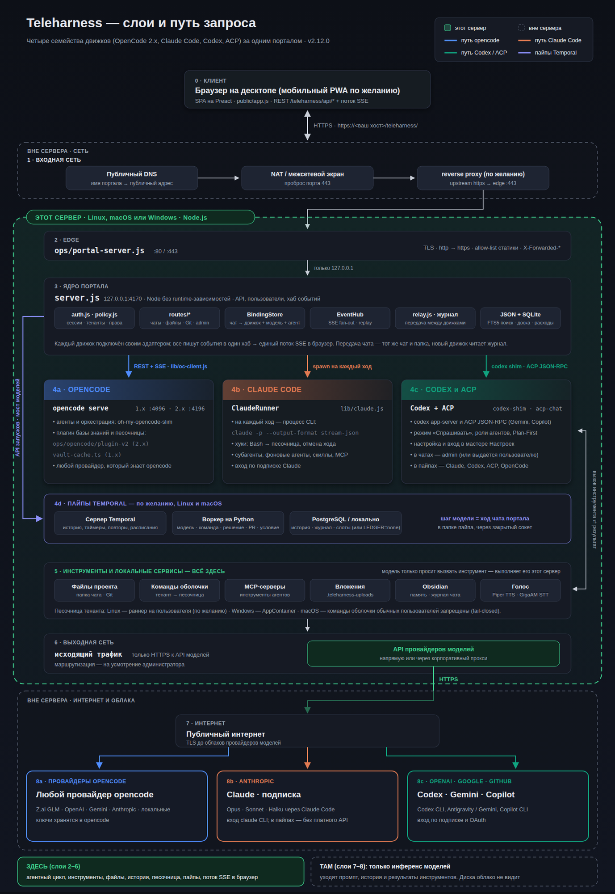</p>

Поиск по чатам работает на производном индексе, который всегда может перестроиться:

<p align="center"></p>
<p align="center"><sub>Сообщения чистятся и попадают в локальный SQLite FTS5 (trigram) индекс, опрашиваются через API с изоляцией тенантов и превращаются в сниппеты со ссылками прямо в чат.</sub></p>

Подробнее — [`docs/architecture.md`](docs/architecture.md), требования — [`openspec/specs/`](openspec/specs/).

## Конфигурация

Все параметры задаются переменными окружения; схема с типами, значениями по умолчанию и валидацией —
[`lib/config.js`](lib/config.js), шаблон — [`.env.example`](.env.example).

| Переменная | По умолчанию | |
|---|---|---|
| `PORT` | `4170` | порт портала |
| `TELEHARNESS_UPSTREAM` | `http://127.0.0.1:4096` | адрес `opencode serve` (значение по умолчанию — исторический порт opencode 1.x; для 2.x — `:4196`) |
| `TELEHARNESS_OC_API` | `v1` | `v2` для opencode 2.x (его ставит `ops/web-v2.sh`) |
| `TELEHARNESS_OC_PASSWORD` | — | пароль HTTP Basic у `opencode serve` 2.x |
| `CLAUDE_CODE_OAUTH_TOKEN` | — | токен подписки Claude (`claude setup-token`) |
| `TELEHARNESS_ADMIN_TOKEN` | генерируется | токен входа администратора |
| `TELEHARNESS_PUBLIC_URL` | — | публичный https-адрес корня портала (`https://host/teleharness/`) для опционального QR-кода подключения телефона; пусто — QR нет |
| `TELEHARNESS_CODEX` | вкл. | `off` скрывает движок Codex, даже если `codex` установлен и в нём выполнен вход |
| `TELEHARNESS_CODEX_BIN` | `codex` из глобальных npm или `PATH` | путь к бинарю codex или его `bin/codex.js` |
| `TELEHARNESS_DATA_DIR` | `./data` | пользователи, сессии, логи |
| `TELEHARNESS_FILE_ROOTS` | домашняя папка | папки, доступные в файловом браузере |
| `TELEHARNESS_KB_ROOT` | `off` | папка Obsidian для агентов, например `~/Obsidian/agents` |
| `TELEHARNESS_TENANT_HOME` | `~/.teleharness-tenants` | папки пользователей |
| `TELEHARNESS_VOICE_PYTHON`, `TELEHARNESS_VOICE_MODELS` | `~/.teleharness/voice/…` | локальный голосовой воркер |

Группы функций и тонкие настройки — в той же схеме: `TELEHARNESS_LISTEN_HOST` / `TELEHARNESS_ENV`
(адрес привязки, guard стенда), `TELEHARNESS_EDGE_ALLOWED_HOSTS` (белый список хостов edge для HTTPS-редиректа),
`TELEHARNESS_ACP` (агенты ACP), `TELEHARNESS_PUSH…` (Web Push: вкл/выкл, VAPID-ключи, тихие часы),
`TELEHARNESS_VOICE…` (лимиты распознавания и синтеза на пользователя), `TELEHARNESS_TENANT…`
(лимиты запросов, загрузок и vision на пользователя) и набор Temporal — `TELEHARNESS_TEMPORAL_PIPELINES`,
`TELEHARNESS_TEMPORAL_LEDGER`, `TELEHARNESS_TEMPORAL_MODELS`, `TELEHARNESS_TEMPORAL_DRAIN` и соседние — описаны в
[`docs/temporal.md`](docs/temporal.md). Полный список с типами, значениями по умолчанию и валидацией —
в [`lib/config.js`](lib/config.js); неизвестные переменные останавливают старт.

### Конфиги агентов

В [`config/`](config/) лежит рабочий пример настроек Claude Code и opencode автора: агенты, промпты,
плагин vault-cache, скиллы документов. Установка — `./config/install.sh` (macOS/Linux) или
`./config/install.ps1` (Windows); секреты берутся из окружения. В конфигах прописаны абсолютные пути —
проверьте их перед использованием.

Сторонние скиллы в репозиторий не входят, ставьте их из первоисточников:
[agent-skills](https://github.com/addyosmani/agent-skills) (`/plugin marketplace add addyosmani/agent-skills`),
[OpenSpec](https://github.com/Fission-AI/OpenSpec) (`npm i -g @fission-ai/openspec`).

## Разработка

```bash
npm test                 # unit, UI-компоненты (happy-dom), сервер и edge
npm run build            # esbuild → public/app.js, public/app.css
npm run demo             # мок-режим на fixtures-demo/
```

| Путь | |
|---|---|
| `server.js`, `lib/`, `routes/` | бэкенд |
| `src/` → `public/` | фронтенд (Preact + signals) |
| `shared/` | общий код сервера и клиента |
| `ops/` | скрипты запуска, плагины opencode, edge-сервер, песочница, голосовой воркер, рендер документов |
| `config/` | конфиги Claude Code и opencode |
| `tests/`, `fixtures/`, `fixtures-demo/` | тесты и синтетические фикстуры |
| `openspec/specs/`, `docs/` | требования, архитектура, ADR |

Как участвовать — [CONTRIBUTING.md](CONTRIBUTING.md), изменения — [CHANGELOG.md](CHANGELOG.md).

## Собрано с помощью

[opencode](https://opencode.ai) · [Claude Code](https://docs.anthropic.com/en/docs/claude-code) · [Codex CLI](https://github.com/openai/codex) · [Temporal](https://temporal.io) ·
[oh-my-opencode-slim](https://www.npmjs.com/package/oh-my-opencode-slim) · [Preact](https://preactjs.com) ·
[esbuild](https://esbuild.github.io) · [marked](https://marked.js.org) · [DOMPurify](https://github.com/cure53/DOMPurify) ·
[highlight.js](https://highlightjs.org) · [Piper](https://github.com/rhasspy/piper) · [sherpa-onnx](https://github.com/k2-fsa/sherpa-onnx)

## Лицензия

[MIT](LICENSE). Сторонние файлы — под своими лицензиями: скиллы и команды `openspec-*` / `opsx-*` — MIT
([OpenSpec](https://github.com/Fission-AI/OpenSpec)), скилл `dogfood` — Apache-2.0.
