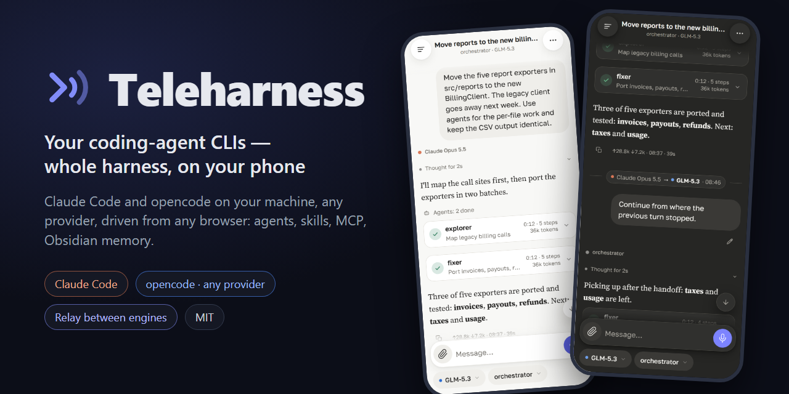
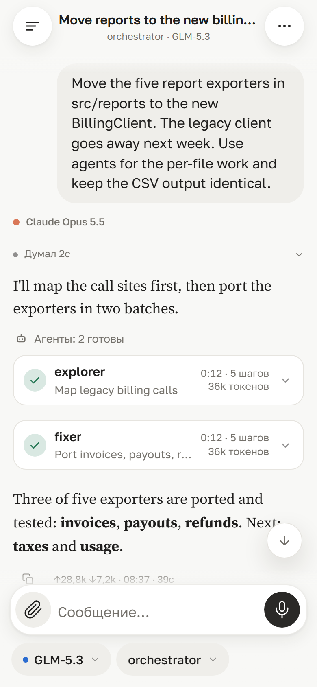
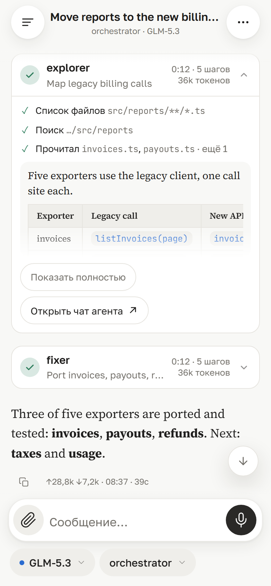
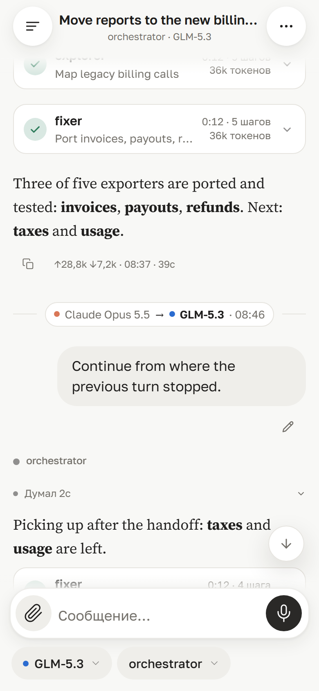
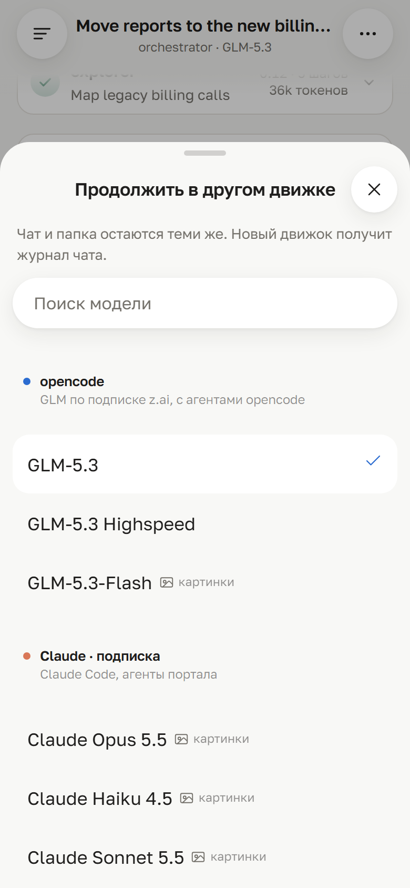
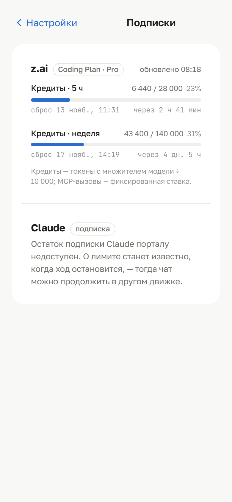
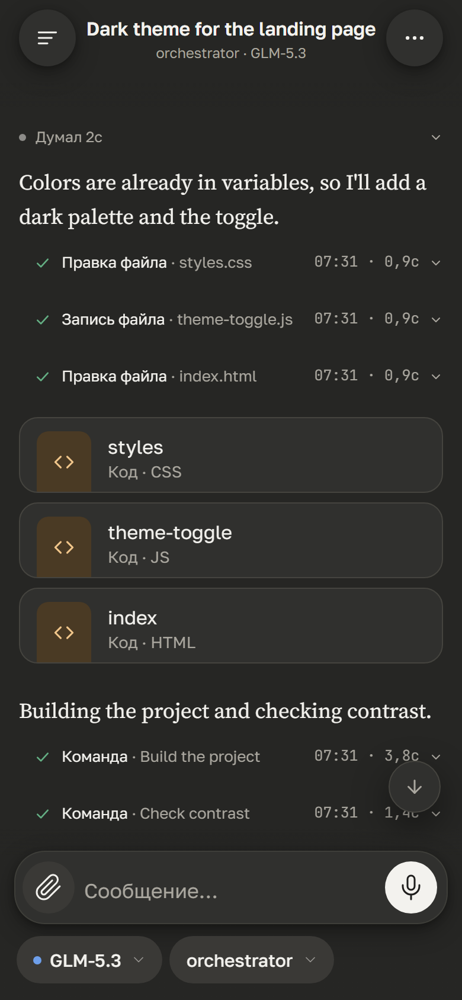
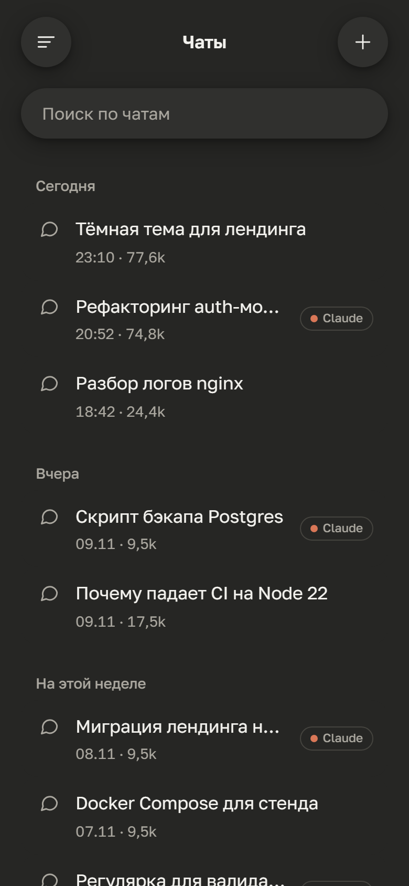
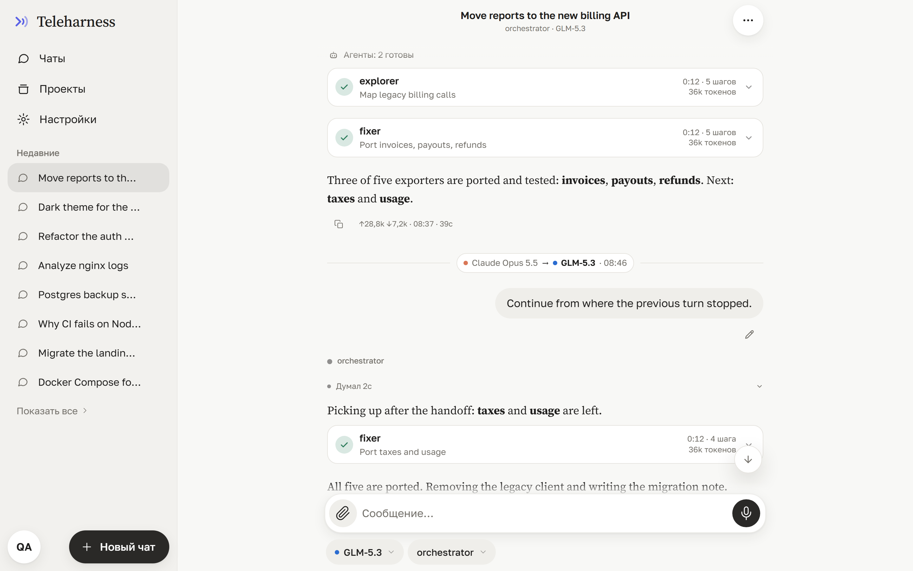
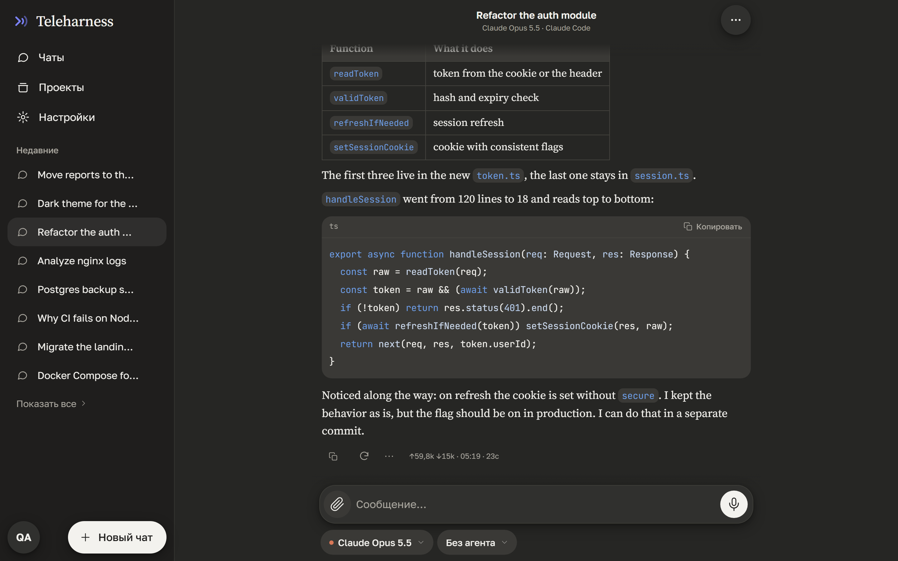

<div align="center">



Запускайте **Claude Code** и **opencode** на своей машине и работайте с ними из любого браузера.
Вы общаетесь не с голой моделью: каждое сообщение проходит через настоящий агентный CLI — с его агентами,
скиллами, MCP-серверами, хуками и базой знаний Obsidian в роли долгой памяти.

[](https://github.com/al3x4kov/teleharness/releases/latest)
[](https://github.com/al3x4kov/teleharness/actions/workflows/ci.yml)
[](LICENSE)
[](https://nodejs.org)
[](#поддержка-платформ)

[Демо](#попробовать-за-30-секунд) •
[Обзор](#обзор-по-экранам) •
[Возможности](#возможности) •
[Быстрый старт](#быстрый-старт) •
[Архитектура](#архитектура) •
[Конфигурация](#конфигурация) •
[English](README.md)


</div>

---

## Зачем это

Чат-приложения дают доступ к модели. Агентные CLI дают гораздо больше — инструменты, доступ к файлам,
субагентов, скиллы, MCP, хуки, память проекта, — но живут в терминале на рабочем столе.

Teleharness ставит перед этими CLI мобильный веб-интерфейс, и вся обвязка оказывается под рукой:

- **CLI, а не модели.** Каждый чат идёт через `opencode serve` или `claude` CLI. Всё, что вы там настроили, —
  агенты, скиллы, плагины, MCP — работает с телефона.
- **Много провайдеров через один портал.** opencode работает с Z.ai GLM, OpenAI, Google Gemini, Anthropic,
  OpenRouter, локальными моделями и другими; Claude Code — с подпиской Claude. Движок и модель выбираются
  для каждого чата.
- **Память дольше одного чата.** Хранилище Obsidian работает как активный кэш: в начале чата агент получает
  снапшот заметок, после каждого хода дописывает дайджест.
- **Задача переживает лимит.** Подписка закончилась посреди задачи — передайте чат другому движку или модели:
  та же папка, одна лента, новый движок получает пропущенные ходы.
- **Ваша машина — ваши данные.** Файлы, инструменты и история остаются на вашем сервере. Провайдеры видят
  только то, что нужно для инференса.
- **Можно поделиться.** Несколько пользователей со своими папками, квотами и системным промптом;
  на Windows их команды выполняются в песочнице AppContainer.

## Попробовать за 30 секунд

Без движков и ключей — интерфейс на синтетических чатах:

```bash
git clone https://github.com/al3x4kov/teleharness.git
cd teleharness
npm ci
npm run demo     # → http://127.0.0.1:4171/zai/
```

Язык интерфейса выбирается по языку браузера, переключается в настройках.

## Обзор по экранам

Все снимки сделаны в `npm run demo` — ровно это вы и увидите.

<table>
<tr>
<td width="25%"></td>
<td width="25%"></td>
<td width="25%"></td>
<td width="25%"></td>
</tr>
<tr>
<td valign="top"><b>Чаты</b><br>Каждый чат закреплён за движком, моделью и агентом. Чаты Claude Code отмечены.</td>
<td valign="top"><b>Субагенты</b><br>Когда агент делегирует, каждый запуск — карточка: кто, зачем, сколько времени, шагов и токенов.</td>
<td valign="top"><b>Внутри запуска</b><br>Раскройте карточку — шаги субагента и его ответ; можно перейти в его собственный чат.</td>
<td valign="top"><b>Передача</b><br>Упёрлись в лимит? Тот же чат продолжается на другом движке — одна лента с отметкой передачи.</td>
</tr>
<tr>
<td width="25%"></td>
<td width="25%"></td>
<td width="25%"></td>
<td width="25%"></td>
</tr>
<tr>
<td valign="top"><b>Куда продолжить</b><br>Из меню чата в любой момент или прямо с плашки лимита. Папка остаётся той же.</td>
<td valign="top"><b>Подписки</b><br>Расход и остаток по каждому подключённому провайдеру — там, где он отдаёт их официальным API.</td>
<td valign="top"><b>Шаги и файлы</b><br>Рассуждения, вызовы инструментов с выводом и файлы-результаты карточками с просмотром и скачиванием.</td>
<td valign="top"><b>Светлая и тёмная</b><br>По системной теме или вашему выбору; рассчитано на работу одной рукой с телефона.</td>
</tr>
</table>

<p align="center">
  
</p>
<p align="center"><sub>Тот же интерфейс на десктопе: первую половину сделал Claude Opus, после передачи задачу подхватил GLM-5.3.</sub></p>

<p align="center">
  
</p>
<p align="center"><sub>Чат Claude Code в тёмной теме.</sub></p>

## Возможности

| | | |
|---|---|---|
| 💬 | **Два движка в одном интерфейсе** | opencode (любой провайдер) и Claude Code рядом; чат закреплён за движком, моделью и агентом. |
| 🧠 | **Шаги агента** | Ход в реальном времени: рассуждения, вызовы инструментов с выводом, карточки субагентов с их собственными шагами, фоновые задачи. Отмена хода вместе с правками файлов. |
| 🔀 | **Передача между движками** | Упёрлись в лимит посреди задачи? Тот же чат продолжается на другом движке или модели: та же папка, одна лента, новый движок получает пропущенные ходы. |
| 📊 | **Подписки** | Расход и остаток по каждому подключённому провайдеру — там, где провайдер отдаёт их официальным API. |
| 📡 | **Устойчивый стриминг** | Один SSE-хаб для всех движков с replay, детектором зависаний и защитой от зацикливания — переживает нестабильную мобильную сеть. |
| 📎 | **Файлы** | Вложения и картинки, файлы-результаты карточками, просмотр разрешённых папок. Своя папка на каждый чат. |
| 🗂️ | **Obsidian как активный кэш** | Снапшот заметок в контексте, дайджесты ходов и журнал каждого чата обратно в хранилище, отдельная зона на пользователя. |
| 🎙️ | **Голос** | Локальные распознавание и синтез речи (Python-воркер, только CPU) и голосовой режим. |
| 🔔 | **Push-уведомления** | Уведомление, когда долгий ход завершился (Web Push, VAPID). |
| 👥 | **Несколько пользователей** | Админ и пользователи: свои папки, системный промпт, набор MCP, квоты, rate-limit. |
| 📱 | **Mobile-first** | Сделано под iOS Safari: учёт клавиатуры, safe-area, светлая и тёмная темы, русский и английский интерфейс. |
| 🪶 | **Без runtime-зависимостей** | Бэкенд — чистый stdlib Node.js. |

## Быстрый старт

### Требования

| | Версия | Для чего |
|---|---|---|
| [Node.js](https://nodejs.org) | ≥ 22 | портал |
| [opencode](https://opencode.ai) | 2.x (проверено на 2.2.6) | движок opencode |
| [Claude Code](https://docs.anthropic.com/en/docs/claude-code) | 2.x | движок Claude |
| Python | 3.11+ | по желанию, голос |

Нужен хотя бы один из двух движков.

### Установка и запуск

<details open>
<summary><b>macOS / Linux</b></summary>

```bash
git clone --branch v1.19.4 https://github.com/al3x4kov/teleharness.git
cd teleharness
npm ci && npm run build

cp .env.example .env               # все значения необязательны

# движки (нужен хотя бы один)
opencode auth login                # добавьте нужных провайдеров
claude setup-token                 # движок Claude: токен — в .env как CLAUDE_CODE_OAUTH_TOKEN

./ops/opencode/serve-v2.sh &       # opencode 2.x на 127.0.0.1:4196, пароль в ~/.zai/oc2-password
./ops/web-v2.sh                    # → http://127.0.0.1:4170/zai/
```
</details>

<details>
<summary><b>Windows (PowerShell)</b></summary>

```powershell
git clone --branch v1.19.4 https://github.com/al3x4kov/teleharness.git
cd teleharness
npm ci; npm run build

Copy-Item .env.example .env        # все значения необязательны

opencode auth login
claude setup-token

# opencode 2.x с HTTP Basic; портал получает тот же пароль
$env:OPENCODE_SERVER_PASSWORD = [guid]::NewGuid().ToString('N')
Start-Process opencode -ArgumentList 'serve','--hostname','127.0.0.1','--port','4196'

$env:ZAI_OC_API = 'v2'; $env:ZAI_UPSTREAM = 'http://127.0.0.1:4196'; $env:ZAI_OC_PASSWORD = $env:OPENCODE_SERVER_PASSWORD
node server.js                     # → http://127.0.0.1:4170/zai/
```
</details>

Пошагово для Mac, включая службы launchd и доступ с телефона: [`docs/macos.md`](docs/macos.md) (на английском).

При первом запуске портал создаёт администратора и пишет токен входа в `data/admin-token.txt`
(или берёт `ZAI_ADMIN_TOKEN`). Чтобы открыть портал с телефона, поставьте перед ним TLS — встроенный
edge-сервер (`ops/portal-server.js`) или любой reverse proxy (Caddy, nginx, Tailscale Serve).

> [!NOTE]
> `zai` — исходное кодовое имя проекта. Оно осталось в пути (`/zai/`), переменных окружения (`ZAI_*`)
> и ключах хранилища, чтобы существующие установки продолжали работать.

### Поддержка платформ

| | macOS | Linux | Windows |
|---|:---:|:---:|:---:|
| Портал, оба движка, файлы, push | ✅ | ✅ | ✅ |
| Кэш Obsidian, голос | ✅ | ✅ | ✅ |
| Команды оболочки для не-админов | — | — | ✅ (песочница AppContainer) |

На macOS и Linux командная строка для обычных пользователей отключена (fail-closed); на админа это не влияет.
Изоляция пользователей переезжает на контейнер на пользователя с полным агентным рантаймом — одинаково на любой ОС сервера,
поэтому песочница Windows на другие системы намеренно не переносится.

## Архитектура

<p align="center"></p>

- **Портал** (`server.js`) — API, авторизация и пользователи, хаб событий, привязка чата к движку, передача
  чата между движками. Для каждого движка свой адаптер: клиент `opencode serve` (1.x и 2.x) и раннер,
  запускающий `claude` на каждый ход.
- **Harness** — всё, что окружает CLI: агенты и оркестрация (oh-my-opencode-slim), плагин базы знаний
  и песочницы для opencode (`ops/opencode/plugin-v2` для 2.x, `vault-cache.ts` для 1.x), хуки Claude Code,
  скиллы, MCP-серверы. Здесь решается, что агенту можно и что он знает.
- **Obsidian** — долгая память агентов, своя зона у каждого пользователя; здесь же журнал каждого чата,
  который движок читает после передачи.
- **Голос** — отдельный локальный Python-процесс (Piper TTS, GigaAM STT).
- **Песочница** — Windows AppContainer для команд других пользователей.

Послойная схема и путь запроса:

<p align="center"></p>

Подробнее — [`docs/architecture.md`](docs/architecture.md), требования — [`openspec/specs/`](openspec/specs/).

## Конфигурация

Все параметры задаются переменными окружения; схема с типами, значениями по умолчанию и валидацией —
[`lib/config.js`](lib/config.js), шаблон — [`.env.example`](.env.example).

| Переменная | По умолчанию | |
|---|---|---|
| `PORT` | `4170` | порт портала |
| `ZAI_UPSTREAM` | `http://127.0.0.1:4096` | адрес `opencode serve` (значение по умолчанию — исторический порт opencode 1.x; для 2.x — `:4196`) |
| `ZAI_OC_API` | `v1` | `v2` для opencode 2.x (его ставит `ops/web-v2.sh`) |
| `ZAI_OC_PASSWORD` | — | пароль HTTP Basic у `opencode serve` 2.x |
| `CLAUDE_CODE_OAUTH_TOKEN` | — | токен подписки Claude (`claude setup-token`) |
| `ZAI_ADMIN_TOKEN` | генерируется | токен входа администратора |
| `ZAI_DATA_DIR` | `./data` | пользователи, сессии, логи |
| `ZAI_FILE_ROOTS` | домашняя папка | папки, доступные в файловом браузере |
| `ZAI_KB_ROOT` | `off` | папка Obsidian для агентов, например `~/Obsidian/agents` |
| `ZAI_TENANT_HOME` | `~/.zai-tenants` | папки пользователей |
| `ZAI_VOICE_PYTHON`, `ZAI_VOICE_MODELS` | `~/.zai/voice/…` | локальный голосовой воркер |

### Конфиги агентов

В [`config/`](config/) лежит рабочий пример настроек Claude Code и opencode автора: агенты, промпты,
плагин vault-cache, скиллы документов. Установка — `./config/install.sh` (macOS/Linux) или
`./config/install.ps1` (Windows); секреты берутся из окружения. В конфигах прописаны абсолютные пути —
проверьте их перед использованием.

Сторонние скиллы в репозиторий не входят, ставьте их из первоисточников:
[agent-skills](https://github.com/addyosmani/agent-skills) (`/plugin marketplace add addyosmani/agent-skills`),
[OpenSpec](https://github.com/Fission-AI/OpenSpec) (`npm i -g @fission-ai/openspec`).

## Разработка

```bash
npm test                 # unit, UI-компоненты (happy-dom), сервер и edge
npm run build            # esbuild → public/app.js, public/app.css
npm run demo             # мок-режим на fixtures-demo/
```

Как участвовать — [CONTRIBUTING.md](CONTRIBUTING.md), изменения — [CHANGELOG.md](CHANGELOG.md).

## Лицензия

[MIT](LICENSE). Сторонние файлы — под своими лицензиями: скиллы и команды `openspec-*` / `opsx-*` — MIT
([OpenSpec](https://github.com/Fission-AI/OpenSpec)), скилл `dogfood` — Apache-2.0.
