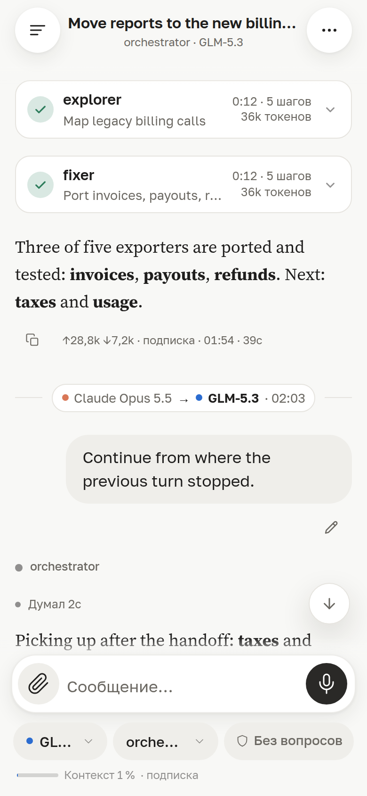
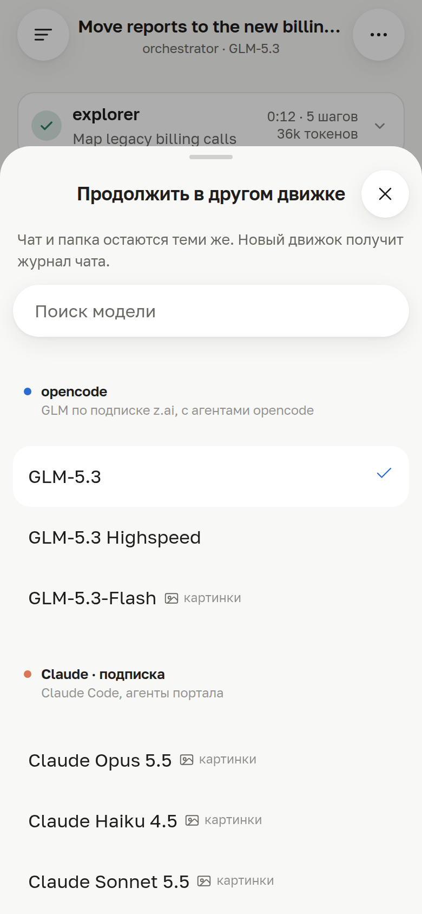
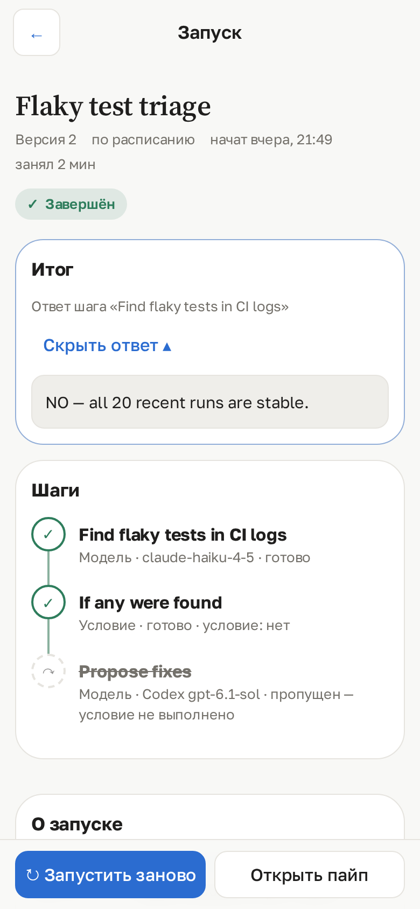
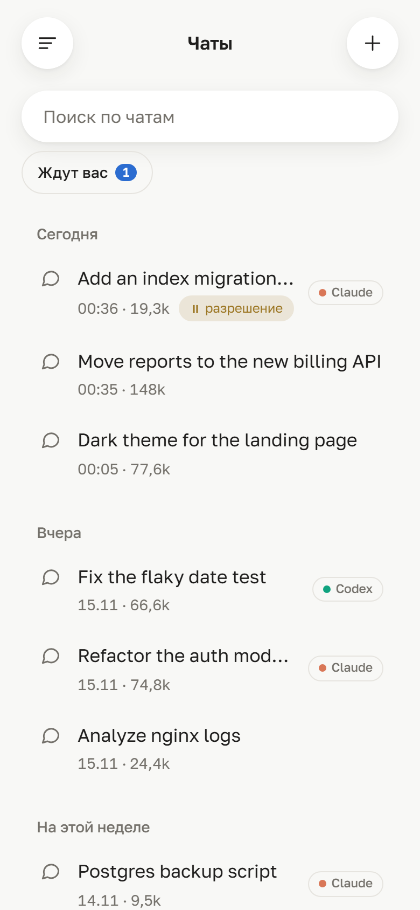
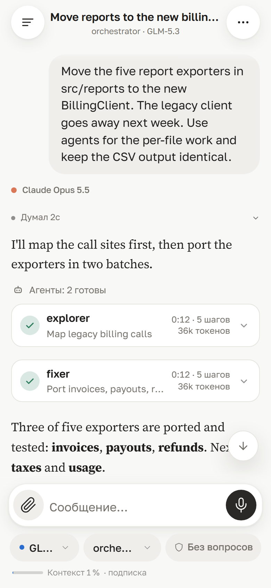
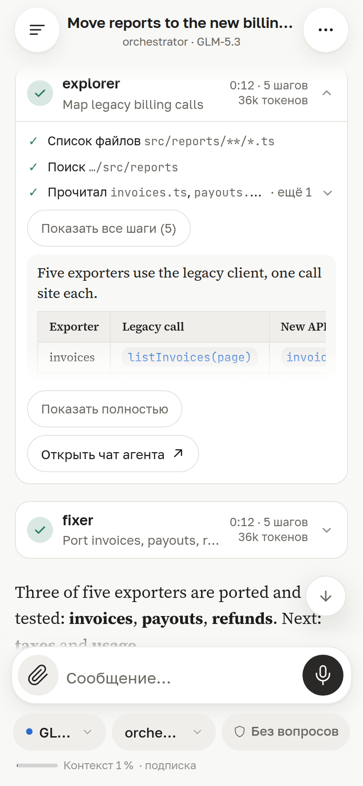
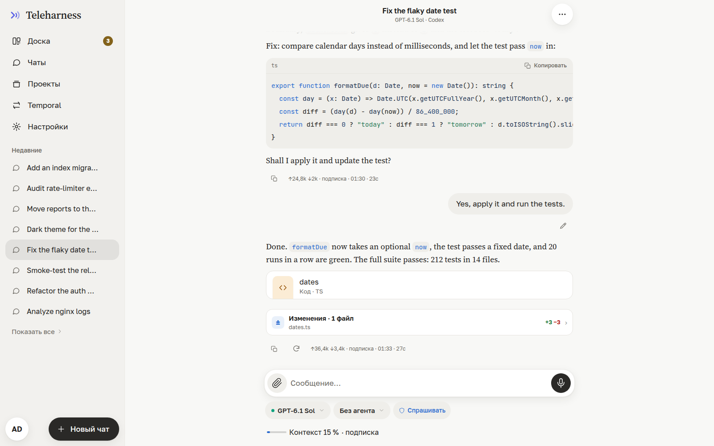
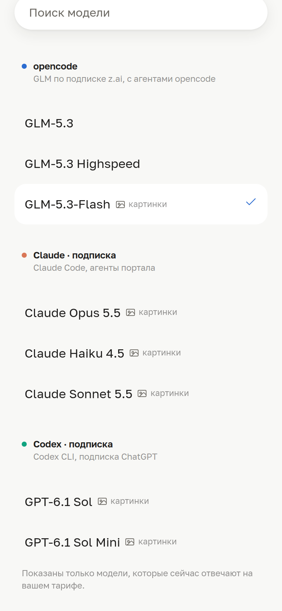
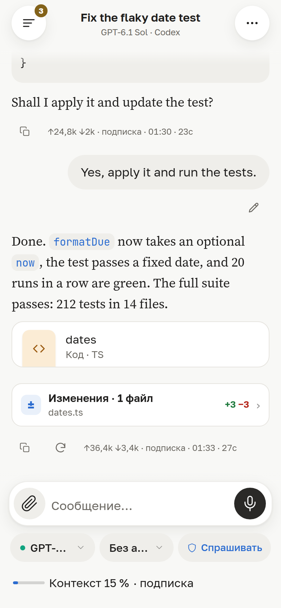
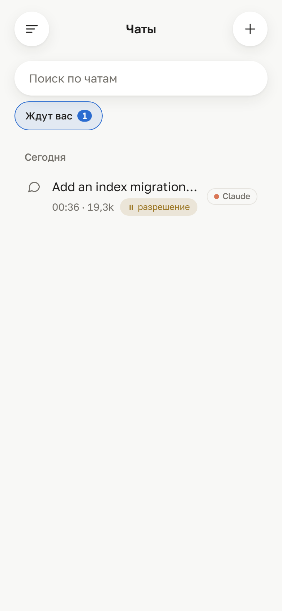

<div align="center">


## Один чат для нескольких AI coding CLI

**Переключайтесь между Claude Code, opencode и Codex в том же разговоре — без начала заново.**

Teleharness — открытый self-hosted веб-интерфейс для агентов, пишущих код. Он запускает настоящие CLI на вашей
машине — с их агентами, скиллами, MCP-серверами, хуками и контекстом проекта — и позволяет передать чат другому
CLI, когда подписка упёрлась в лимит.

**Чат на несколько CLI** · **передача контекста между CLI** · **остаток подписок** · **интерфейс для телефона** · **долгая память** · **на своём сервере**

[](https://github.com/al3x4kov/teleharness/releases/latest)
[](https://github.com/al3x4kov/teleharness/actions/workflows/ci.yml)
[](LICENSE)
[](https://nodejs.org)
[](#поддержка-платформ)

[Переключение CLI](#переключение-cli-посреди-разговора) •
[Демо](#попробовать-за-30-секунд) •
[Обзор](#обзор-по-экранам) •
[Возможности](#возможности) •
[Быстрый старт](#быстрый-старт) •
[Архитектура](#архитектура) •
[Конфигурация](#конфигурация) •
[English](README.md)


</div>

---

## Переключение CLI посреди разговора

Начните задачу в Claude Code и продолжите в opencode на GLM или любой другой модели opencode либо в Codex — в любую сторону.

- **Из меню чата, в любой момент:** *Продолжить в…* → движок и модель.
- **Когда подписка закончилась:** плашка лимита предлагает *Продолжить в &lt;модель&gt;* — одно нажатие.
- **Что переносится:** папка проекта, одна лента с отметкой передачи, ходы, которых новый CLI не видел
  (уходят с первым запросом), и, если задана папка базы знаний, полный журнал чата.
- **Автоматически, если хотите:** включите *Продолжать автоматически при лимите* в Настройках → Модель и агенты и
  задайте до трёх запасных моделей — сервер сам передаст чат и попросит новый CLI продолжить, даже при закрытом
  телефоне. По умолчанию выключено.
- **Что нет:** внутреннее состояние сессии прежнего CLI.

<p align="center">
  
  
  
</p>

Подробности, ограничения и FAQ: [docs/cross-cli-handoff.md](docs/cross-cli-handoff.md#переключение-cli-в-одном-чате-relay).

## Пайпы, которые переживают перезапуск (Temporal)

Превратите рутину в пайп: Claude проверяет дифф, вы одобряете с телефона, Codex пишет заметки к релизу, а файл
сохраняется в папку запуска. Каждый шаг работает на вашей подписке CLI как ход вашего собственного чата — его разговор
можно открыть потом. Запуски продолжаются, даже когда портал закрыт или сервер перезапускается.

<p align="center">
  
</p>

<p align="center">
  
  
  
  
</p>

Шаги: *Модель* (Claude или Codex), *Решение человека*, *Таймер*, *Объединение*, *Условие*, *Артефакт*; входы запуска —
`{{input.имя}}`, ответы прошлых шагов — `{{steps.id}}`; расписания с предпросмотром ближайших запусков. По желанию,
Linux и macOS — см. [docs/temporal.md](docs/temporal.md). Попробовать без настройки — в `npm run demo`.

## Зачем это

Чат-приложения дают доступ к модели. Агентные CLI дают гораздо больше — инструменты, доступ к файлам,
субагентов, скиллы, MCP, хуки, память проекта, — но живут в терминале на рабочем столе.

Teleharness ставит перед этими CLI мобильный веб-интерфейс, и вся обвязка оказывается под рукой:

- **CLI, а не модели.** Каждый чат идёт через `opencode serve`, `claude` CLI или `codex` CLI. Всё, что вы там настроили, —
  агенты, скиллы, плагины, MCP — работает с телефона.
- **Много провайдеров через один портал.** opencode работает с Z.ai GLM, OpenAI, Google Gemini, Anthropic,
  OpenRouter, локальными моделями и другими; Claude Code — с подпиской Claude, Codex — с подпиской ChatGPT.
  Движок и модель выбираются для каждого чата.
- **Память дольше одного чата.** Хранилище Obsidian работает как активный кэш: в начале чата агент получает
  снапшот заметок, после каждого хода дописывает дайджест.
- **Задача переживает лимит.** Подписка закончилась посреди задачи — передайте чат другому движку или модели:
  та же папка, одна лента, новый движок получает пропущенные ходы.
- **Ваша машина — ваши данные.** Файлы, инструменты и история остаются на вашем сервере. Провайдеры видят
  только то, что нужно для инференса.
- **Контроль за вами.** Для каждого чата решаете, спрашивает ли агент перед правками и командами; разрешить или
  отклонить можно прямо в чате или из push-уведомления.
- **Можно поделиться.** Несколько пользователей со своими папками, квотами и системным промптом;
  на Windows их команды выполняются в песочнице AppContainer.

## Попробовать за 30 секунд

Без движков и ключей — интерфейс на синтетических чатах:

```bash
git clone https://github.com/al3x4kov/teleharness.git
cd teleharness
npm ci
npm run demo     # → http://127.0.0.1:4171/teleharness/
```

Язык интерфейса выбирается по языку браузера, переключается в настройках.

## Обзор по экранам

Все снимки сделаны в `npm run demo` — ровно это вы и увидите.

<table>
<tr>
<td width="25%"></td>
<td width="25%"></td>
<td width="25%"></td>
<td width="25%"></td>
</tr>
<tr>
<td valign="top"><b>Чаты</b><br>Каждый чат закреплён за движком, моделью и агентом. Чаты Claude Code отмечены.</td>
<td valign="top"><b>Субагенты</b><br>Когда агент делегирует, каждый запуск — карточка: кто, зачем, сколько времени, шагов и токенов.</td>
<td valign="top"><b>Внутри запуска</b><br>Раскройте карточку — шаги субагента и его ответ; можно перейти в его собственный чат.</td>
<td valign="top"><b>Передача</b><br>Упёрлись в лимит? Тот же чат продолжается на другом движке — одна лента с отметкой передачи.</td>
</tr>
<tr>
<td width="25%"></td>
<td width="25%"></td>
<td width="25%"></td>
<td width="25%"></td>
</tr>
<tr>
<td valign="top"><b>Куда продолжить</b><br>Из меню чата в любой момент или прямо с плашки лимита. Папка остаётся той же.</td>
<td valign="top"><b>Подписки</b><br>Расход и остаток по каждому подключённому провайдеру — там, где он отдаёт их официальным API.</td>
<td valign="top"><b>Шаги и файлы</b><br>Рассуждения, вызовы инструментов с выводом и файлы-результаты карточками с просмотром и скачиванием.</td>
<td valign="top"><b>Светлая и тёмная</b><br>По системной теме или вашему выбору; рассчитано на работу одной рукой с телефона.</td>
</tr>
</table>

<p align="center">
  
</p>
<p align="center"><sub>Тот же интерфейс на десктопе: первую половину сделал Claude Opus, после передачи задачу подхватил GLM-5.3.</sub></p>

<p align="center">
  
</p>
<p align="center"><sub>Чат Claude Code в тёмной теме.</sub></p>

<p align="center">
  
</p>

<p align="center">
  
</p>

## Возможности

| | | |
|---|---|---|
| 💬 | **Три движка в одном интерфейсе** | opencode (любой провайдер), Claude Code и Codex CLI рядом; чат закреплён за движком, моделью и агентом. Чаты Codex пока только для администратора, на любой ОС — другим пользователям их откроет собственная песочница Codex (в пайпах Temporal Codex доступен всем, у пользователей — только текстом).<br>  |
| 🛡️ | **Режим прав для чата** | *Спрашивать* — агент спрашивает перед правками файлов и командами, вы разрешаете или отклоняете прямо в чате (Claude — через мост разрешений, Codex — нативно); *Правки без вопросов*; *Без вопросов* (только администратор).<br>  |
| ⏸️ | **Ждут вас** | Фильтр списка чатов со счётчиком чатов, где агент ждёт вашего решения, и push-уведомление, когда он начинает ждать.<br> |
| 📈 | **Контекст и расход** | Строка над полем ввода: насколько заполнено окно контекста модели (с предупреждением после 80 %) и сколько стоил чат — или что он идёт по подписке.<br>  |
| 🧠 | **Шаги агента** | Ход в реальном времени: рассуждения, вызовы инструментов с выводом, карточки субагентов с их собственными шагами, фоновые задачи. Отмена хода вместе с правками файлов. |
| 🧾 | **Изменения хода и Git** | Под ответом, который правил файлы, — строка *Изменения · N файлов*: по ней открывается дифф по каждому файлу — что изменил этот ход или файл сейчас против последнего коммита (на телефоне одна колонка, на компьютере две панели). Экран Git папки чата показывает ветку, опережение и отставание и изменённые файлы: отметьте файлы для коммита, попросите модель этого чата предложить сообщение отдельным коротким запросом (в историю чата он не попадает), сделайте коммит и отправку — отправка только у администратора. Остальные пользователи работают с git в своих папках, без отправки и смены веток. В Настройках → Git — автор коммитов, язык сообщения и отметка файлов по умолчанию. |
| 🌙 | **Фоновые субагенты не прерываются** | Claude Code отвечает сразу, а субагенты, запущенные им в фоне, продолжают работать после ответа. Полоса над полем ввода показывает, кто ещё работает; новое сообщение ждёт в очереди, а когда они закончат, Claude забирает их результаты и отвечает снова. |
| 🔁 | **Пайпы Temporal** *(по желанию)* | Сценарии из нескольких шагов, которые переживают перезапуск: шаги Claude или Codex работают в собственной папке пайпа (в том числе с файлами), ваше решение между шагами, таймеры, условия, сохранение артефактов, входы запуска через `{{input.имя}}` и ответы прошлых шагов через `{{steps.id}}`. Статус запусков виден без лишних нажатий, блок «Ждут вашего решения» и счётчик в меню, блок «Итог» с финальным ответом, файлами запуска и разговором каждого шага; пауза, отмена, остановка с причиной; расписания с предпросмотром ближайших запусков. Работает на ваших подписках CLI, платный API не используется. Linux и macOS; по умолчанию выключено — см. [docs/temporal.md](docs/temporal.md).<br> |
| 🔀 | **Передача между движками** | Упёрлись в лимит посреди задачи? Тот же чат продолжается на другом движке или модели: та же папка, одна лента, новый движок получает пропущенные ходы. По желанию — автоматически, со своим порядком запасных моделей. |
| 📊 | **Подписки** | Расход и остаток по каждому подключённому провайдеру — там, где провайдер отдаёт их официальным API. |
| 📡 | **Устойчивый стриминг** | Один SSE-хаб для всех движков с replay, детектором зависаний и защитой от зацикливания — переживает нестабильную мобильную сеть. |
| 📎 | **Файлы** | Вложения и картинки, файлы-результаты карточками, просмотр разрешённых папок. Своя папка на каждый чат. |
| 🗂️ | **Obsidian как активный кэш** | Снапшот заметок в контексте, дайджесты ходов и журнал каждого чата обратно в хранилище, отдельная зона на пользователя. |
| 🎙️ | **Голос** | Локальные распознавание и синтез речи (Python-воркер, только CPU) и голосовой режим. |
| 🔔 | **Push-уведомления** | Уведомление, когда долгий ход завершился или агенту нужно ваше решение (Web Push, VAPID). |
| 📲 | **Телефон по QR-коду** | Настройки → Подключить телефон показывают одноразовый QR-код (действует 10 минут): навели камеру — телефон вошёл под вашей учётной записью без ввода токена. Нужен `TELEHARNESS_PUBLIC_URL`.<br> |
| 👥 | **Несколько пользователей** | Админ и пользователи: свои папки, системный промпт, набор MCP, квоты, rate-limit. |
| 📱 | **Mobile-first** | Сделано под iOS Safari: учёт клавиатуры, safe-area, светлая и тёмная темы, русский и английский интерфейс. |
| 🪶 | **Без runtime-зависимостей** | Бэкенд — чистый stdlib Node.js. |

## Быстрый старт

### Требования

| | Версия | Для чего |
|---|---|---|
| [Node.js](https://nodejs.org) | ≥ 22 | портал |
| [opencode](https://opencode.ai) | 2.x (проверено на 2.2.6) | движок opencode |
| [Claude Code](https://docs.anthropic.com/en/docs/claude-code) | 2.x | движок Claude |
| [Codex CLI](https://github.com/openai/codex) | 0.169+ | по желанию, движок Codex (только администратор) |
| Python | 3.11+ | по желанию, голос |

Нужен хотя бы один движок.

### Одной командой

```bash
npx github:al3x4kov/teleharness            # → http://127.0.0.1:4180/teleharness/
```

Команда проверит Node, сохранит данные в `~/.teleharness`, при первом запуске соберёт интерфейс, покажет, какие
движки найдены (и как поставить недостающие), и напечатает токен администратора. Параметры: `--port N`,
`--host 0.0.0.0` (доступ из локальной сети), `--rebuild`. opencode serve она не запускает — печатает команду.

### Установка и запуск

<details open>
<summary><b>macOS / Linux</b></summary>

```bash
git clone --branch v1.21.0 https://github.com/al3x4kov/teleharness.git
cd teleharness
npm ci && npm run build

cp .env.example .env               # все значения необязательны

# движки (нужен хотя бы один)
opencode auth login                # добавьте нужных провайдеров
claude setup-token                 # движок Claude: токен — в .env как CLAUDE_CODE_OAUTH_TOKEN

./ops/opencode/serve-v2.sh &       # opencode 2.x на 127.0.0.1:4196, пароль в ~/.teleharness/oc2-password
./ops/web-v2.sh                    # → http://127.0.0.1:4170/teleharness/
```
</details>

<details>
<summary><b>Windows (PowerShell)</b></summary>

```powershell
git clone --branch v1.21.0 https://github.com/al3x4kov/teleharness.git
cd teleharness
npm ci; npm run build

Copy-Item .env.example .env        # все значения необязательны

opencode auth login
claude setup-token

# opencode 2.x с HTTP Basic; портал получает тот же пароль
$env:OPENCODE_SERVER_PASSWORD = [guid]::NewGuid().ToString('N')
Start-Process opencode -ArgumentList 'serve','--hostname','127.0.0.1','--port','4196'

$env:TELEHARNESS_OC_API = 'v2'; $env:TELEHARNESS_UPSTREAM = 'http://127.0.0.1:4196'; $env:TELEHARNESS_OC_PASSWORD = $env:OPENCODE_SERVER_PASSWORD
node server.js                     # → http://127.0.0.1:4170/teleharness/
```
</details>

Пошагово для Mac, включая службы launchd и доступ с телефона: [`docs/macos.md`](docs/macos.md) (на английском).

При первом запуске портал создаёт администратора и пишет токен входа в `data/admin-token.txt`
(или берёт `TELEHARNESS_ADMIN_TOKEN`). Чтобы открыть портал с телефона, поставьте перед ним TLS — встроенный
edge-сервер (`ops/portal-server.js`) или любой reverse proxy (Caddy, nginx, Tailscale Serve).

> [!NOTE]
> Портал открывается по пути `/teleharness/`; все настройки — переменные окружения `TELEHARNESS_*`
> (см. [`.env.example`](.env.example)).

### Поддержка платформ

| | macOS | Linux | Windows |
|---|:---:|:---:|:---:|
| Портал, движки opencode и Claude, файлы, push | ✅ | ✅ | ✅ |
| Движок Codex (чаты) | только админ | только админ | только админ |
| Пайпы Temporal (по желанию) | ✅ | ✅ | — |
| Codex в пайпах Temporal | ✅ (у пользователей — только текст) | ✅ (у пользователей — только текст) | — |
| Кэш Obsidian, голос | ✅ | ✅ | ✅ |
| Команды оболочки для не-админов | — | ✅ с отдельным раннером на пользователя¹ | ✅ (песочница AppContainer) |

На macOS (и на Linux без раннера) командная строка для обычных пользователей отключена (fail-closed); на админа это не
влияет. ¹ На Linux команды пользователей могут выполняться через раннер на пользователя (`/usr/local/libexec/teleharness-tenant-run`,
см. `ops/sandbox/linux`); без него они по-прежнему отключены.
Изоляция пользователей переезжает на контейнер на пользователя с полным агентным рантаймом — одинаково на любой ОС сервера,
поэтому песочница Windows на другие системы намеренно не переносится.

## Архитектура

<p align="center"></p>

- **Портал** (`server.js`) — API, авторизация и пользователи, хаб событий, привязка чата к движку, передача
  чата между движками. Для каждого движка свой адаптер: клиент `opencode serve` (1.x и 2.x) и раннер,
  запускающий `claude` (или посредника Codex поверх `codex app-server`) на каждый ход.
- **Harness** — всё, что окружает CLI: агенты и оркестрация (oh-my-opencode-slim), плагин базы знаний
  и песочницы для opencode (`ops/opencode/plugin-v2` для 2.x, `vault-cache.ts` для 1.x), хуки Claude Code,
  скиллы, MCP-серверы. Здесь решается, что агенту можно и что он знает.
- **Obsidian** — долгая память агентов, своя зона у каждого пользователя; здесь же журнал каждого чата,
  который движок читает после передачи.
- **Голос** — отдельный локальный Python-процесс (Piper TTS, GigaAM STT).
- **Песочница** — команды оболочки других пользователей: раннер на пользователя на Linux (по желанию),
  AppContainer на Windows, на macOS закрыто.
- **Пайпы Temporal** (по желанию, Linux и macOS) — сервер Temporal, исполнитель на Python и PostgreSQL
  (история, журнал «ровно один раз», слоты параллельности). Шаг модели — ход чата портала в папке пайпа
  через закрытый сокет. Подробнее — [`docs/temporal.md`](docs/temporal.md).

Послойная схема и путь запроса:

<p align="center"></p>

Подробнее — [`docs/architecture.md`](docs/architecture.md), требования — [`openspec/specs/`](openspec/specs/).

## Конфигурация

Все параметры задаются переменными окружения; схема с типами, значениями по умолчанию и валидацией —
[`lib/config.js`](lib/config.js), шаблон — [`.env.example`](.env.example).

| Переменная | По умолчанию | |
|---|---|---|
| `PORT` | `4170` | порт портала |
| `TELEHARNESS_UPSTREAM` | `http://127.0.0.1:4096` | адрес `opencode serve` (значение по умолчанию — исторический порт opencode 1.x; для 2.x — `:4196`) |
| `TELEHARNESS_OC_API` | `v1` | `v2` для opencode 2.x (его ставит `ops/web-v2.sh`) |
| `TELEHARNESS_OC_PASSWORD` | — | пароль HTTP Basic у `opencode serve` 2.x |
| `CLAUDE_CODE_OAUTH_TOKEN` | — | токен подписки Claude (`claude setup-token`) |
| `TELEHARNESS_ADMIN_TOKEN` | генерируется | токен входа администратора |
| `TELEHARNESS_PUBLIC_URL` | — | публичный https-адрес корня портала (`https://host/teleharness/`) для QR-кода подключения телефона; пусто — QR нет |
| `TELEHARNESS_CODEX` | вкл. | `off` скрывает движок Codex, даже если `codex` установлен и в нём выполнен вход |
| `TELEHARNESS_CODEX_BIN` | `codex` из глобальных npm или `PATH` | путь к бинарю codex или его `bin/codex.js` |
| `TELEHARNESS_DATA_DIR` | `./data` | пользователи, сессии, логи |
| `TELEHARNESS_FILE_ROOTS` | домашняя папка | папки, доступные в файловом браузере |
| `TELEHARNESS_KB_ROOT` | `off` | папка Obsidian для агентов, например `~/Obsidian/agents` |
| `TELEHARNESS_TENANT_HOME` | `~/.teleharness-tenants` | папки пользователей |
| `TELEHARNESS_VOICE_PYTHON`, `TELEHARNESS_VOICE_MODELS` | `~/.teleharness/voice/…` | локальный голосовой воркер |

### Конфиги агентов

В [`config/`](config/) лежит рабочий пример настроек Claude Code и opencode автора: агенты, промпты,
плагин vault-cache, скиллы документов. Установка — `./config/install.sh` (macOS/Linux) или
`./config/install.ps1` (Windows); секреты берутся из окружения. В конфигах прописаны абсолютные пути —
проверьте их перед использованием.

Сторонние скиллы в репозиторий не входят, ставьте их из первоисточников:
[agent-skills](https://github.com/addyosmani/agent-skills) (`/plugin marketplace add addyosmani/agent-skills`),
[OpenSpec](https://github.com/Fission-AI/OpenSpec) (`npm i -g @fission-ai/openspec`).

## Разработка

```bash
npm test                 # unit, UI-компоненты (happy-dom), сервер и edge
npm run build            # esbuild → public/app.js, public/app.css
npm run demo             # мок-режим на fixtures-demo/
```

Как участвовать — [CONTRIBUTING.md](CONTRIBUTING.md), изменения — [CHANGELOG.md](CHANGELOG.md).

## Лицензия

[MIT](LICENSE). Сторонние файлы — под своими лицензиями: скиллы и команды `openspec-*` / `opsx-*` — MIT
([OpenSpec](https://github.com/Fission-AI/OpenSpec)), скилл `dogfood` — Apache-2.0.
