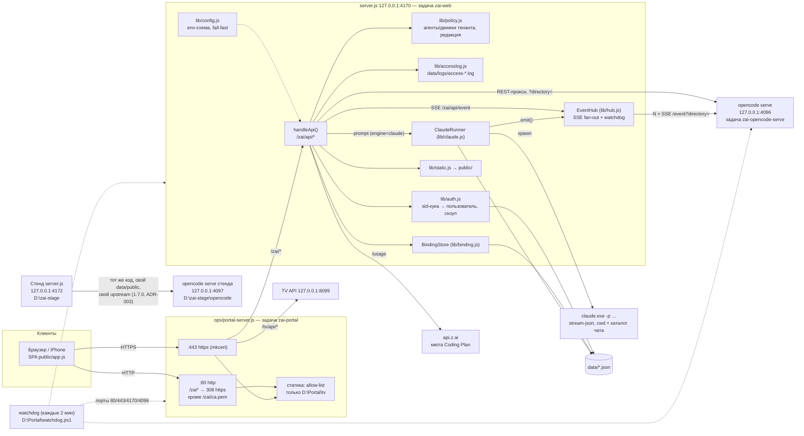

# Архитектура портала zai (1.7.0)

> **Что изменилось в 1.7.0** (подробно — §11 и docs/reviews/2026-11-02/integration.md):
> - Сервер: единая конфигурация с валидацией env (`lib/config.js`, ADR-006), политика тенанта (`lib/policy.js`: без shell-агентов, Claude только по `engines`, редактирование tool-частей), журнал запросов и `healthz` (`lib/accesslog.js`, ADR-007), серверные сессии `sid` вместо токена в куке, CSRF-гейт, квоты; единая политика путей (`lib/paths.js`); dry-run сборщик мусора (`lib/gc.js`); атомарные JSON-хранилища с карантином (`lib/json-store.js`, ADR-002); guard стенда `ZAI_ENV`.
> - Хаб: id событий `<epoch>.<seq>` и resync (ADR-005), персист счётчика повторов, детектор цикла, `zai.turn.incomplete`, снятие молчащего хода перед промптом, диалоги не отклоняются по таймеру, пагинация истории, отчёт `admin/sessions`, backpressure SSE.
> - Claude CLI: промпт через stdin, чистое окружение, профили прав admin/tenant, очередь досылок вместо 409, idle-таймаут и `zai.keepalive`, восстановление после рестарта (ADR-010), единый каталог моделей `shared/engine.js`.
> - Клиент: `store.js` разнесён на `src/lib/store/*`, самовосстанавливающийся поток событий и плашка связи, баннеры ошибки хода, статус доставки, загрузка через XHR с прогрессом и отменой, просмотр xlsx/docx, хранилище префов/проектов/черновиков по пользователю.
> - Edge: XFP/XFF выставляет сам, кука `Path=/zai` + `Secure`, свой access-лог (ADR-009). Стенд — `D:\zai-stage` со своим opencode :4097 (ADR-003).
> - Ниже разделы обновлены по коду 1.7.0; места, где описано поведение 1.6.1, помечены «(до 1.7.0)».

zai — мобильный веб-портал (UI в стиле Claude) над двумя движками агентов:
локальным `opencode serve` (модели z.ai/GLM и другие провайдеры opencode) и
`claude` CLI (модели Anthropic по подписке владельца). Бэкенд — один процесс
Node без runtime-зависимостей npm (только node:stdlib). Фронтенд — Preact и
@preact/signals, собранные esbuild в статику. Наружу портал публикует
edge-сервер `ops/portal-server.js` на :80/:443.

Все цифры ниже сверены с кодом и с графом graphify. У `.jsx` граф извлечён
частично (tree-sitter не разбирает JSX), поэтому импорты фронтенда проверены
чтением исходников.

Содержание:

1. Контекст и границы
2. Модули и их ответственность
3. Потоки данных
4. Хранение данных
5. Конфигурация (env)
6. Развёртывание и стенд
7. Наблюдаемость
8. Тестовые уровни
9. Решения по улучшению архитектуры (ADR)
10. Риски
11. Журнал изменений документа

---

## 1. Контекст и границы

### 1.1. Компоненты в рантайме



### 1.2. Границы и доверие

| Граница | Кто по ту сторону | Что защищает |
|---|---|---|
| LAN/Интернет → edge :80/:443 | любой клиент без авторизации | edge: `/zai*` по http — 308 на https; статика — allow-list `D:\Portal\tv`; отказ путям с `:`, `~`, управляющими символами и хвостовыми точками/пробелами; try/catch вокруг маршрутизации (§6.2) |
| edge → server.js :4170 | только 127.0.0.1 | server.js слушает `127.0.0.1`; авторизация — sid-кука/Bearer в каждом `/zai/api/*`, кроме `auth/login|logout|me` и `healthz` (только прямой loopback); мутирующие запросы с `Sec-Fetch-Site: cross-site` или чужим `Origin` → 403 (1.7.0); edge перезаписывает `x-forwarded-*` (ADR-009) |
| server.js → opencode :4096 | доверенный локальный сервис | все session-вызовы пинят `?directory=` (`withDir`, `scopedQuery`); у тенанта и у admin-промпта каталог берётся из серверного индекса сессий, а не из запроса (1.7.0); кука и `authorization` портала в opencode не уходят |
| server.js → claude.exe | процесс с правами владельца | 1.7.0: промпт через stdin, окружение по allow-list без `ZAI_*`; профиль прав по роли — admin `bypassPermissions` + `--add-dir`, tenant `--restricted --strict-mcp-config` (ADR-004). OS-изоляции нет: тенанту Claude закрыт, пока admin не включит `engines` |
| server.js → api.z.ai | внешний HTTPS | ключ владельца из `~/.local/share/opencode/auth.json`, только для admin |
| Стенд :4172 → opencode стенда :4097 | свой upstream (1.7.0) | `ZAI_UPSTREAM=http://127.0.0.1:4097`; guard: экземпляр с `ZAI_ENV≠prod` (кроме мока) и upstream :4096 не стартует (ADR-003). До 1.7.0 стенд работал с прод-upstream |

### 1.3. Внешние зависимости

- npm runtime: нет. `package.json` содержит только devDependencies (esbuild,
  preact, @preact/signals, marked, dompurify, highlight.js).
- Внешние процессы: `opencode serve` 1.19.5 (контракт зафиксирован в
  `fixtures/`), `claude.exe` (по умолчанию
  `C:\Users\USER\.local\bin\claude.exe`), PowerShell CIM (lib/host.js).
- Внешние сервисы: `api.z.ai` (квота), подписка Anthropic (через CLI).

---

## 2. Модули и их ответственность

### 2.1. Цифры графа (graphify, 2026-11-02 — снимок 1.6.1)

На 2026-11-03 (1.7.0, после `graphify update .`) граф целиком — 3554 узла / 5803 ребра / 304 сообщества; god-узлы `handleApi()` 89, `EventHub` 69, `ClaudeRunner` 36, `reduce()` 24. `server.js` импортирует 15 модулей: config, mock, proxy, static, hub, host, usage, attach, file, paths, accesslog, policy, gc, claude, binding (+ `shared/engine.js` через binding/claude). Таблица ниже — снимок до 1.7.0.

| Метрика | Значение |
|---|---|
| Граф целиком (код + документы + openspec/tracker) | 1638 узлов / 2658 рёбер / 131 сообщество |
| Кодовые узлы `.js/.jsx/.mjs` | 664; рёбер код↔код 1400; кодовых сообществ 45 |
| Рёбра `src/**` ↔ `lib/**` | **0**: фронт и бэк связаны только по HTTP/SSE |
| Рёбра tests ↔ код | 103 |
| Циклы импорта | нет |
| God-узлы (кодовые) | `handleApi()` 55, `EventHub` 50, `preact` 22, `ClaudeRunner` 21, `init()` (store) 19, `reduce()` 16 |
| `server.js` импортирует | 12 lib-модулей: hub, claude, binding, auth, proxy, attach, file, static, usage, host, paths, mock |
| Вызовов `dirAllowed(` в server.js | 13 — проверки прав расставлены вручную по веткам |
| Частично извлечённые файлы | 19 `.jsx` (синтаксические ошибки парсера), 16 файлов без символов (ps1, main.jsx, часть тестов) |

`graphify explain "handleApi"`: прямые рёбра к `dirAllowed`, `proxyRequest`,
`materializeFileParts`, `ClaudeRunner.dispatch`, `bindingFor/makeBinding/
applyBinding/patchBinding`, `serveWorkspaceFile`, `createUser/updateUser/
regenerateToken`, `isAbsoluteDir`, `EventHub.syncDirectories`. Путь
`handleApi → ClaudeRunner` — 2 хопа через `server.js`: интеграция движков
целиком сосредоточена в одной функции.

### 2.2. Бэкенд

Строки — непустые строки файла на 2026-11-03 (1.7.0). **Новые в 1.7.0** — выделены.

| Файл | Строк | Ответственность | Ключевые экспорты |
|---|---|---|---|
| `server.js` | 1264 | HTTP-сервер, вход, `handleApi()`: все маршруты `/zai/api/*` (таблица маршрутов ADR-001 ещё не сделана, TASK-12.18), гейты политики тенанта до любых побочных эффектов, индекс сессий (TTL 10 с), мерж `/status` (+`x-zai-epoch`, `live`/`since` Claude-ходов), загрузка `req.pipe` с backpressure и удалением частичного файла, квоты и rate limit тенанта, `trackStream`/закрытие SSE пользователя, `redactEventForTenant`, guard `ZAI_ENV`, `uncaughtException` → лог + exit 1 | — (точка входа) |
| **`lib/config.js`** | 132 | схема env (int/ms/bool/url/path/list/enum/string, min/max, secret) — 30 переменных; `loadConfig` чистая, без исключений; ошибки → `[zai-config] NAME: …` и exit 1; строка эффективной конфигурации при старте с `***` у секретов (ADR-006) | `SCHEMA, loadConfig, describeConfig, config, configSources, configErrors` |
| **`lib/policy.js`** | 102 | политика тенанта: `agentHasShell` (ruleset opencode, `ask` = shell), агенты тенанта — без `task` и `external_directory` (bash разрешён: исполнение только в AppContainer через zai-jail, FEAT-04.9) и дефолт тенанта (`ZAI_TENANT_AGENT` или первый primary), публичная форма агента без prompt/permission, редакция tool/patch-частей для не-admin, фильтр `/provider` без anthropic, если Claude не включён | `agentHasShell, tenantAgents, agentAllowedForTenant, defaultTenantAgent, publicAgent, redactPart, redactMessages, providerForUser` |
| **`lib/accesslog.js`** | 84 | JSON-строка на запрос (`ts, rid, method, path без query, status, ms, user, ip`), `access-YYYYMMDD.log`, ротация 10 МБ, хранение 14 дней; `errLog` с троттлингом для бывших «тихих» catch; `x-request-id` (ADR-007) | `requestId, accessLogger, errLog, clientIp` |
| **`lib/gc.js`** | 61 | план сборки мусора (только dry-run): осиротевшие привязки и Claude-истории, `.zai-uploads` старше N дней, пустые чаты | `planGc` |
| **`lib/json-store.js`** | 62 | `readJsonStore` (битый файл → `.corrupt-<ts>`, старт с пустого без затирания), `writeJsonAtomic` (tmp + rename с повтором при EPERM/EBUSY) — ADR-002 | `readJsonStore, writeJsonAtomic` |
| `lib/paths.js` | 100 | политика путей (было 13 строк): `dirProblem` — запрет относительных, `..`, `\\?\` `\\.\` `\??\`, UNC, корней дисков, `:`/`~`/wildcards, системных каталогов на **любом** диске (Windows, Program Files, ProgramData, $Recycle.Bin, System Volume Information, Recovery, $Windows.~BT/~WS); для тенантов ещё D:\Portal, DATA_DIR, корень профиля; `driveProblem` (несуществующий диск, final-fixes ISSUE-006); `isUnderAny` (скрытие TEMP-сессий) | `isAbsoluteDir, dirProblem, driveProblem, isUnderAny, dirProblemText` |
| `lib/hub.js` | 1352 | `EventHub`: SSE-коннект к upstream на каталог, ring 1000, id `<epoch>.<seq>`, replay/`zai.resync` по `Last-Event-ID` (чужая эпоха, legacy-число, мусор, будущий или устаревший seq), keepalive 15 с, backoff 1–30 с, `transform` для тенантов; backpressure (буфер > 16 МБ → отключение), ≤ 8 потоков на ключ; watchdog: stall-abort, dialog-timeout (по умолчанию выкл.), stall-replay с персистом счётчика в `data/hub-pending.json`, pending снимается только ответом на свой messageID; детектор цикла (`zai.loop`), `zai.turn.incomplete`, `prepareForPrompt` (снятие молчащего хода), `sessionsReport()` | `EventHub` |
| `lib/claude.js` | 836 | `ClaudeRunner`: процесс `claude.exe -p --input-format text --output-format stream-json` на ход, промпт в stdin UTF-8, `childEnv()` по allow-list; профили прав по `access`; FIFO-очередь досылок (до 5); `AnswerText` (многошаговый ответ); idle-таймаут `ZAI_CLAUDE_IDLE_MS` и `zai.keepalive {startedAt,lastOutputAt,lastAction,queued}`; `data/claude-runs.json` + убийство своих сирот при старте и «[Прервано рестартом портала]»; `liveness()`, `shutdown()`; история — атомарно, картинки ссылками; каталог моделей — из `shared/engine.js` + `data/claude-models.json`, неизвестный `modelID` → 400 | `ClaudeRunner, providerPatch, buildPrompt, translateLine, childEnv, permissionArgs, …` |
| **`shared/engine.js`** | 52 | единый модуль движков для сервера и клиента (`src/lib/engine.js` — реэкспорт): провайдер Claude, `engineOf`, каталог моделей и дефолт (`claude-opus-5-5`), `normalizeCatalog`, `isClaudeModel` | `CLAUDE_PROVIDER, engineOf, CLAUDE_MODELS, DEFAULT_CLAUDE_MODEL, normalizeCatalog, isClaudeModel` |
| `lib/binding.js` | 132 | привязка чата: engine + model + agent + `prompted`; stored → upstream → claude-store → null; PATCH с блокировкой движка (409); каталог — из `shared/engine.js`; запись атомарная, битый файл — карантин | `BindingStore, resolveBinding, applyBinding, makeBinding, patchBinding, engineOf` |
| `lib/auth.js` | 498 | тенанты: токен 64 hex (SHA-256, timing-safe), **серверные сессии**: в куке случайный `sid`, в `data/sessions.json` — `sha256(sid) → userId`; кука `Path=/zai`, `Secure` за https; legacy-кука (сырой токен) принимается один раз и мигрирует; отзыв сессий при logout/disable/regenerate/delete; поле `engines` (Claude тенанту — явно); `POST /auth/token` — самостоятельная ротация; битый `users.json` → `.corrupt-<ts>` и отказ старта; удаление УЗ удаляет провижн-папки | `initAuth, userFromReq, userByToken, setAuthCookie, dirAllowed, engineAllowed, defaultDir, fileRoots, CRUD тенантов, ApiError, StoreCorruptError` |
| `lib/proxy.js` | 375 | потоковый reverse-proxy: hop-by-hop, лимит тела (413), дедлайн только до заголовков + idle-таймаут по чанкам; `paginate` (`limit`/`before` режутся локально, `x-zai-has-more`/`x-zai-next-before`); кэш 60 с + ETag для `agent`/`mcp`; кука/`authorization` портала вырезаются; наружу «Сервер агента недоступен» | `proxyRequest, resetProxyCache, pageParams, paginateMessages, …` |
| `lib/file.js` | 197 | `/zai/api/file`: `resolveInside` + `realInside` (realpath против junction/симлинков → 403), MIME (+m4a/aac/flac/opus/m4v/tsv/toml/ini/sql/go/rs/java/c/diff…), CSP `sandbox` для inline html/xml и `sandbox; default-src 'none'` для svg | `serveWorkspaceFile, resolveInside, mimeFor` |
| `lib/attach.js` | 87 | data:URL не-картинок → `<dir>/.zai-uploads/`, замена file-part на текстовую ссылку | `materializeFileParts, sanitizeFilename, pickUniqueName, UPLOAD_DIR` |
| `lib/static.js` | 102 | статика `public/` (или `ZAI_PUBLIC_DIR`): защита от traversal, ETag/304 | `serveStatic` |
| `lib/usage.js` | 132 | квота z.ai: RAW-ключ, Bearer — запасной, кэш 60 с | `usageStats, normalizeUsage` |
| `lib/host.js` | 166 | CPU/RAM/диски/температура (CIM, кэш 10 с), детектор «замёрзшего» датчика, температура SSD из SMART (`diskTempC`, под Limited-токеном недоступна), версия opencode из `/global/health` | `hostStats, thermalCelsius, trackTempStuck, diskTempCelsius, opencodeVersion` |
| `lib/mock.js` | 129 | `ZAI_MOCK=1`: ответы из фикстур, SSE из `events.sse`, запись POST в `_captured.jsonl` | `mockHandler` |
| `ops/portal-server.js` | 394 | edge :80/:443: allow-list статики, отказ алиасам путей (ADR-008); перезапись `x-forwarded-*`/`forwarded`/`x-real-ip`, XFP по листенеру, XFF по сокету; на `/tv/api` вырезаются кука портала и `authorization`; свой access-лог `edge-YYYYMMDD.log`, `x-request-id`; `/zai/api/healthz` снаружи → 404 (ADR-009); env-оверрайды для тестов (`ZAI_EDGE_ROOT/…_LOG_DIR/…_UPSTREAM`) | — |

### 2.3. Фронтенд

| Файл | Строк | Ответственность |
|---|---|---|
| `src/lib/store.js` | 82 | **фасад** (1.7.0, TASK-01.42): реэкспорт действий и сигналов из `src/lib/store/*`; компоненты импортируют только его |
| **`src/lib/store/state.js`** | 255 | сигналы (сессии, `activeId` вместо `globalThis.__zaiActiveId`, `busyMap`, `connection`, `sessionsError`/`providerError`), префы/проекты/черновики по пользователю (`bindUserStorage`: `zai.prefs.<id>`, `zai.projects.<id>`, `zai.draft.<user>.<chat>`), `sanitizePrefs`/`effectivePrefs` против `me.engines/defaultAgent` |
| **`src/lib/store/session.js`** | 407 | `openSession` с поколениями, `send({sessionId})`, failed-пузыри и `resendLast`, `info.delivery` (sending → delivered → accepted), rename/delete с откатом и notice, `createAndOpen` с разрешёнными дефолтами |
| **`src/lib/store/events.js`** | 255 | SSE-редьюсер `reduce()`/`handleEvent`: `upsertIncoming` (ответ под своим вопросом), `zai.keepalive` без сброса stall-часов, `zai.turn.incomplete`, `zai.loop`, `info.zai.interrupted`, `turnError` |
| **`src/lib/store/stream.js`** | 135 | поток событий: пересоздание EventSource с backoff 1→30 с, эпоха из id и `x-zai-epoch` → `resync()`, `noteAlive` по любому признаку связи, плашка «Нет связи» |
| **`src/lib/store/dialogs.js`** | 121 | диалоги: все вопросы, multi-select, счётчик попыток, таймаут + 404/409 = успех |
| **`src/lib/store/catalog.js`** | 165 | каталоги и админ-действия через store: `refreshSessions/refreshProvider/refreshAbout/refreshMcp`, `checkProjectDir` (`/dircheck`), `uploadFile`/`fileUrl`, `admin.*` (пользователи, `status`, `abort`) |
| `src/lib/normalize.js` | 908 | чистые преобразования форм opencode + хелперы отображения 1.7.0: `buildTurns`, `turnMetaLine`, `turnAuthor`, `queuedUserIds`, `splitEnvPrefix`, `isImageName`, `fileBadge`, `fmtNum/fmtBytes/fmtDecimal`, `parseCsv`, `displayTitle/titleFromText`, `collectArtifacts` (голое имя картинки → папка сессии), `normalizeAgents` (без hidden/служебных) |
| **`src/lib/turn.js`** | 250 | описание ошибки хода (`describeTurnError`: лимит z.ai/Claude, авторизация, провайдер, папка недоступна) и действия баннера |
| **`src/lib/office.js`** | 307 | xlsx/docx без зависимостей: листы, строки, формулы-кэш, лимиты, защита от zip-бомбы |
| **`src/lib/clipboard.js`** | 44 | `copyText` с фолбэком для http |
| `src/lib/api.js` | 395 | REST-клиент; `uploadFile` через XHR с прогрессом и `AbortSignal`; `explainApiError` (403 политики словами, а не «проверьте связь»); `onReachable`, `reconnectNow`; 401 → вход |
| `src/lib/engine.js` | 58 | `bindingOf/defaultBinding`; знания о движках — реэкспорт из `shared/engine.js` |
| `src/lib/router.js`, `theme.js`, `voice.js`, `sanitize-config.js`, `version.js` | 91/35/130/21/60 | hash-роутер (+`chatBackTarget`, `lastSourceRoute`), тема, Web Speech, конфиг DOMPurify, версия 1.7.0 |
| Views (7) | — | Home, Chat, Projects, Project, Settings, Login, AccessSection |
| Chat-компоненты (11) | — | Composer, MessageBubble, MessageList, DialogBar, FileViewer, ModelBar, ToolCard, AgentCard, Reasoning, Attachment, Markdown |

Связность (1.7.0): компоненты больше не импортируют `api.js` напрямую — только
store-фасад (integration.md §1); `globalThis.__zaiActiveId` удалён. До 1.7.0
`store.js` был одним файлом на 750 строк, а `api.js` вызывали 4 компонента.

### 2.4. Маршруты `/zai/api/*`

| Маршрут | Метод | Кто | Обработка (server.js) |
|---|---|---|---|
| `/auth/login` | POST | все | только `application/json` (иначе 415); токен → серверная сессия, кука `sid` (`Path=/zai`, `Secure` за https, старая `Path=/` гасится) |
| `/auth/logout`, `/auth/me` | POST/GET | все | logout отзывает сессию на сервере; me — текущий пользователь (+`engines`, `defaultAgent`, `directories`), legacy-кука мигрирует |
| `/auth/token` | POST | все (своя УЗ) | **1.7.0**: `{confirm:true}` → новый токен один раз, остальные сессии отозваны, новая кука (FEAT-03.11) |
| `/admin/users[/:id[/token]]` | GET/POST/PATCH/DELETE/POST | admin | CRUD тенантов (+`engines`), токен в ответе один раз; disable/delete/regenerate отзывают сессии и закрывают SSE; delete удаляет провижн-папки |
| `/admin/sessions` | GET | admin | **1.7.0**: `{now, epoch, sessions: hub.sessionsReport()}` — busy/dialog/pending с возрастом (FEAT-07.16) |
| `/admin/gc` | GET | admin | **1.7.0**: dry-run план уборки (`lib/gc.js`), ничего не удаляет |
| `/healthz` | GET | прямой loopback | **1.7.0**: без авторизации, только Host 127.0.0.1/localhost без XFF; версия из package.json, состояние upstream/индекса; 503 при индексе старше 60 с; через edge → 404 |
| `/about` | GET | все | **1.7.0**: версии zai / opencode / Claude Code для «О приложении» (все роли) |
| `/dircheck` | GET | все | **1.7.0**: проверка каталога проекта до создания (`dirProblem` + `driveProblem`) с русским текстом причины |
| `/session` | GET | все | список upstream; у тенанта — фильтр `dirAllowed`; сессии из TEMP скрыты (`ZAI_HIDE_TEMP_SESSIONS`); поле `zai` (привязка + source) |
| `/session` | POST | все | `dirProblem`/`driveProblem` (400 с `code`) → `dirAllowed` → гейт движка/агента тенанта (403 `engine not allowed`/`agent not allowed`) → `mkdirSync` → upstream; агент тенанта по умолчанию — `defaultTenantAgent` |
| `/session/:id/binding` | PATCH | все (тенант — в скоупе) | смена модели/агента; гейт тенанта; 409 «engine locked» после первого сообщения |
| `/session/:id/message` | GET | все | пагинация `limit`/`before` (`x-zai-has-more`, `x-zai-next-before`); Claude-история → `mergedMessages`; для не-admin tool-части редактируются (`redactMessages`) |
| `/session/:id/prompt` | POST | все | гейт тенанта до любых побочных эффектов; квота тела тенанта (8 МБ) и rate limit; `materializeFileParts` → привязка → Claude (`dispatch({access})`, 204; при занятом ходе — в очередь, 409 только при переполнении) или `hub.prepareForPrompt` + `prompt_async` (600 с); admin-каталог — из индекса сессий |
| `/session/:id/abort` | POST | все | живой Claude-ход → kill + отмена очереди; иначе upstream abort |
| `/session/:id` | PATCH/DELETE | все | переименование/удаление; DELETE: скоуп → upstream 2xx → `claude.forget`/`bindings.forget` (ADR-001 шаг 1, BUG-12.6) |
| `/status` | GET | все | fan-out `/session/status` + `stalledSnapshot()` + Claude `liveness()` (`live`, `since`); заголовок `x-zai-epoch`; кэш 3 с; фильтр тенанта |
| `/dialogs` | GET | все | `hub.collectDialogs()` с фильтром скоупа |
| `/provider` | GET | все | upstream + каталог Claude (`shared/engine.js` + `data/claude-models.json`); тенанту — только connected-провайдеры, без anthropic, если Claude не включён |
| `/agent` | GET | все | admin — прокси с кэшем; тенант — только агенты без `task`/`external_directory` (shell — в песочнице) без `prompt`/`permission`/`options` |
| `/mcp`, `/host` | GET | **admin** (1.7.0) | прокси/локально; тенанту 403, клиент тенанта их не запрашивает |
| `/project` | GET | все | admin — прокси; тенант — фильтр по пути |
| `/usage` | GET | admin | квота z.ai |
| `/upload` | POST | все | `req.pipe` с backpressure в `<dir>/.zai-uploads/`, ≤ 100 МБ (тенант ≤ 25 МБ, всего ≤ 500 МБ → 413); при обрыве частичный файл удаляется |
| `/upload` | DELETE | все | **1.7.0**: удаление загруженного файла при снятии чипа (final-fixes ISSUE-009) |
| `/file` | GET/HEAD | все | `serveWorkspaceFile` (скоуп, containment, realpath, CSP sandbox для html/svg) |
| `/(permission\|question)/:id/reply` | POST | все | тенант: id обязан быть открытым диалогом в его скоупе; upstream получает `scopedQuery`; на shell-разрешения — только `reject` |
| `/event` | GET | все | SSE-хаб: `visible(dir)`, для тенанта `transform` (редакция), ≤ 8 потоков на пользователя |

Прочие `GET/HEAD /zai/*` — статика. Префикс `/zai` edge **не срезает**: он
передаёт путь целиком, срезает `lib/static.js`.

---

### 2.5. Что изменилось в 1.8.0–1.9.0 (2026-11-03…04, факт прода 1.9.0)

**Маршрутизация (TASK-12.18, ADR-001 шаги 2–3).** `handleApi` делает три вещи: общий гейт формы `?directory=` (BUG-141: UNC, `\\?\`, alias, относительный путь → 400 до upstream; корни и System32 на чтение разрешены), диспетчеризация по таблице `routes/*`, иначе 404. Таблица:
- `routes/router.js` — объявление маршрута `{method, path, access, handler}`, проверка прав до вызова обработчика (тенант → 403 на admin-маршрутах без вызова);
- `routes/catalog.js` — `/status`, `/dialogs`, `/provider`, `/claude/agents`, `/agent`, `/project`, `/mcp`, `/host`, `/about`, `/usage`;
- `routes/admin.js` — `/admin/users*`, `/admin/sessions`, `/admin/gc`, `/auth/token`;
- `routes/files.js` — `/dircheck`, `/file`, `/file/exists`, `/turn-files`, `/upload`;
- `routes/session.js` — `/session*`, `/(permission|question)/:id/reply`, `/event`; тела обработчиков пока в server.js.
Единая проверка прав на сессию в таблице не введена — меняет ответы admin; решение владельца 2026-11-04 «оставить как есть».

**Новые модули и поведение.**
| Модуль | Что | Item |
|---|---|---|
| `lib/kb-cache.js` | снапшот базы знаний для Claude-чатов (admin — `ZAI_KB_ROOT`, тенант — своя зона), подаётся модели в первом ходе, в истории — `metadata.kbContext` | FEAT-13.11, FEAT-01.32 |
| `ops/opencode/vault-cache.ts` | снапшот в `metadata.kbContext` текстовой части; модели — через `experimental.chat.messages.transform`; песочница тенанта (`tool.execute.before`) | FEAT-01.32, BUG-12.20 |
| `lib/attach.js` `modelAcceptsImages` | картинка для модели без image input → `.zai-uploads` + путь для vision-субагента | FEAT-03.12, BUG-140 |
| `lib/claude.js` `onTurnStart` | автозаголовок Claude-чата в начале хода | BUG-13.20, BUG-142 |
| `lib/claude.js` `checkMcpConfig` | `ZAI_CLAUDE_MCP_CONFIG` → `--mcp-config` только admin; битый файл игнорируется | FEAT-13.10 |
| `lib/claude-transcript.js` | ход Claude по шагам (tool-части) | FEAT-13.19 |
| `lib/turn-files.js`, `GET /turn-files` | карточки файлов, созданных за ход | FEAT-05.17, BUG-092 |
| `GET /file/exists`, `src/lib/file-probe.js` | проба угаданных картинок до `` | BUG-090 |
| `src/lib/store/session.js` | история страницами (`limit`/`before`), догрузка вверх; «Чат не найден» без запроса истории | BUG-08.8, BUG-01.19 |
| `src/lib/store/state.js` `sanitizePrefs` | недоступная сохранённая модель → дефолт + предупреждение | BUG-03.15 |

**Окружение прода (1.9.0).** Переменная пользователя `ZAI_CLAUDE_MCP_CONFIG=D:\Portal\zai\ops\claude\mcp-playwright.json` (Playwright MCP для Claude-чатов admin). `ZAI_KB_ROOT` по умолчанию `D:\Obsidian\agents`.

## 3. Потоки данных

### 3.1. Вход, куки, тенанты

1. `POST /zai/api/auth/login {token}` (только JSON) → `userByToken` (SHA-256,
   timing-safe) → `createSession` → `Set-Cookie: <ZAI_COOKIE_NAME>=<sid>;
   Path=/zai; HttpOnly; SameSite=Lax; Max-Age=31536000` (+`Secure` за https;
   XFP выставляет edge, ADR-009) и `…=; Path=/; Max-Age=0` для старой куки.
2. С 1.7.0 значение куки — случайный `sid`; на сервере хранится только
   `sha256(sid) → userId` (`data/sessions.json`). `logout`, выключение,
   удаление и перевыпуск токена отзывают сессии. Legacy-кука с сырым токеном
   принимается один раз и заменяется sid-кукой. Bearer-заголовок принимается
   для скриптов. До 1.7.0 в куке лежал сам долгоживущий токен.
3. Каждый `/zai/api/*` (кроме трёх auth-маршрутов) → `userFromReq` →
   401 без пользователя. `parseCookies` с 2026-11-02 не бросает исключение
   на битом `%` (кука сохраняется сырой).
4. Скоуп: admin — без ограничений; тенант — `directories` (чаты) и
   `extraRoots` (файлы; по умолчанию `ZAI_TENANT_VAULT\<slug>`). Для
   session-маршрутов источник истины — серверный индекс сессий
   (`fetchSessionIndex`, TTL 10 с, при неизвестном id — одно принудительное
   обновление). `?directory=` клиента — только подсказка.
5. Стенд и прод на одном `127.0.0.1` разводятся по имени куки
   (`zai_t` / `zai_t_stage`, BUG-006): куки различаются доменом, а не портом.

### 3.2. Список чатов и привязка

- `GET /session`: upstream-список → фильтр тенанта → `withBinding` добавляет
  `zai: {engine, model, agent, prompted, source}`. Клиент читает модель и
  агента чата отсюда, одинаково на всех устройствах.
- Порядок источников привязки (`resolveBinding`): `stored`
  (`session-bindings.json`) → `upstream` (`session.model/agent`) →
  `claude` (история в `claude-sessions.json`) → `null` (первое сообщение
  станет привязкой).
- Создание: `POST /session` с `{model, agent}` → `makeBinding` →
  `bindings.set`. Настройки по умолчанию влияют только на **новые** чаты
  (BUG-11.1).
- Смена: `PATCH /session/:id/binding`. Пока `prompted=false`, можно сменить
  движок; после первого сообщения смена движка — 409, смена модели внутри
  движка разрешена. Клиент обновляет оптимистично и откатывает на 409.
- Брошенный пустой чат: клиент кладёт id в `freshIds` при создании и удаляет
  чат при уходе, если в нём 0 сообщений (BUG-009). Список живёт только в
  памяти вкладки (R17).

### 3.3. Промпт: opencode

```mermaid
sequenceDiagram
  autonumber
  participant C as Браузер (store.send)
  participant E as edge :443
  participant S as server.js handleApi
  participant B as BindingStore
  participant O as opencode :4096
  participant H as EventHub
  C->>E: POST /zai/api/session/:id/prompt?directory=…
  E->>S: тот же путь (+куки)
  S->>S: userFromReq; тенант: resolveSessionDir(id) → 404/403
  S->>S: readBody ≤64 МБ; materializeFileParts → <dir>/.zai-uploads
  S->>B: bindingFor(id) (stored → upstream → claude → null)
  S->>B: set({…binding, prompted:true}); applyBinding(body)
  S->>O: POST /session/:id/prompt_async?directory=<dir> (таймаут 600 с)
  O-->>S: 204
  S-->>C: 204
  O-->>H: SSE /event?directory=<dir>: message.part.delta/updated, session.status
  H->>H: #noteEvent (busy/pending/dialogs) → ring (seq) → broadcast с visible(dir)
  H-->>C: SSE /zai/api/event → reduce() → сигналы
  Note over H,O: watchdog: stall-abort 900 с, dialog-timeout выкл. (1.7.0), replay 180 с (≤2, счётчик на диске), цикл ≥8 одинаковых tool-вызовов → abort
```

С 1.7.0 перед `prompt_async` вызывается `hub.prepareForPrompt(id, dir)`: если
ход busy, молчит ≥ `ZAI_PROMPT_UNSTICK_MS` (120 с) и не ждёт диалога, хаб
делает abort, и новый промпт стартует свежий ход (BUG-07.10).

Если чат занят, upstream ставит сообщение в свою очередь; Composer показывает
его в очереди.

### 3.4. Промпт: claude

```mermaid
sequenceDiagram
  autonumber
  participant C as Браузер
  participant S as server.js handleApi
  participant R as ClaudeRunner
  participant F as data/claude-sessions.json
  participant P as claude.exe
  participant H as EventHub
  C->>S: POST /zai/api/session/:id/prompt
  S->>S: права, readBody, materializeFileParts, привязка engine=claude
  S->>R: dispatch({sid, dir, body, access: admin|tenant})
  alt ход уже идёт
    R->>F: сохранить вопрос (атомарно), в FIFO-очередь (≤5)
    R-->>C: 204 (409 только при переполнении очереди)
  else
    R->>F: записать вопрос пользователя (tmp+rename)
    R-->>C: 204
    R->>H: markManaged(sid); emit session.status busy, message.updated(user), message.updated(ответ, parentID)
    R->>P: spawn claude.exe -p --input-format text --output-format stream-json … --model <m> [--resume <claudeSid>] + флаги прав по access; cwd=dir; env = childEnv() (allow-list, без ZAI_*); промпт в stdin UTF-8, stdin закрыт
    R->>F: data/claude-runs.json {pid, image, spawnedAt, claudeSid}
    loop stdout построчно
      P-->>R: stream_event text_delta / assistant / result
      R->>H: emit message.part.delta (AnswerText: шаги через \n\n)
    end
    R->>H: zai.keepalive {startedAt, lastOutputAt, lastAction, queued}
    Note over R,P: нет вывода ZAI_CLAUDE_IDLE_MS (30 мин) → kill, «[Прервано по бездействию]»
    P-->>R: close
    R->>F: записать ответ + claudeSid; убрать запись из claude-runs.json
    R->>H: emit part.updated, message.updated, затем следующий вопрос из очереди или session.idle
  end
  H-->>C: те же события, что и у opencode
```

До 1.7.0: при занятом ходе — 409, промпт в argv, полное окружение сервера,
keepalive подделывался событием `busy`, запись истории неатомарная.

Различия движков:

| Аспект | opencode | claude |
|---|---|---|
| Где идёт ход | upstream `prompt_async` | дочерний процесс на каждый ход |
| История | upstream | `claude-sessions.json` (слияние с upstream при чтении) |
| Занятый чат | очередь upstream | серверная FIFO-очередь до 5 (1.7.0; было 409) |
| Агенты | да (тенанту — только shell-free) | нет (agent всегда null, BUG-11.2) |
| Watchdog хаба | abort/replay/pending/цикл | выключен (`markManaged`); свой idle-таймаут 30 мин |
| Таймаут | 600 с на HTTP, stall-abort 900 с | жёсткого нет (`ZAI_CLAUDE_TIMEOUT_MS=0`), по бездействию — `ZAI_CLAUDE_IDLE_MS` |
| Переживает рестарт server.js | да (ход в upstream) | ход прерывается: сирота убивается при старте, вопрос получает «[Прервано рестартом портала]», следующий промпт делает resume (1.7.0) |
| Изоляция | конфиг opencode владельца | профиль прав по роли; `~/.claude` владельца; тенанту закрыт по умолчанию |
| Кэш Obsidian (vault-cache) | плагин opencode | **нет** (FEAT-13.11) |

### 3.5. SSE: EventHub, replay, stall

- Хаб держит по одному upstream-коннекту на каталог с сессиями: upstream
  1.19.5 без `?directory=` молча отдаёт пусто. Набор каталогов обновляет
  `syncDirectories()` раз в 20 с и после каждого `POST /session`.
- `#emitEvent`: `#noteEvent` → ring (1000, `#seq` с 0 после старта) →
  broadcast. Фильтр `visible(dir)` применяется и к живым событиям, и к replay.
- С 1.7.0 (ADR-005) id события — `<epoch>.<seq>`, где `epoch` — base36
  время старта процесса; та же эпоха — в заголовке `x-zai-epoch` у
  `/zai/api/event` и `/zai/api/status`. Клиент подключается с
  `Last-Event-ID`: при чужой эпохе, legacy-числе, мусоре, `seq` из будущего
  или старее ring — кадр `zai.resync` с id текущей позиции; иначе — replay.
  До 1.7.0 после рестарта клиент не получал ни replay, ни resync (R8).
- Клиент (`src/lib/store/stream.js`): при `onerror`/CLOSED поток
  пересоздаётся с backoff 1→30 с и `resync()`; на 401 — проверка `/auth/me`;
  смена эпохи → `resync()`; `pollBusy` сверяет busy↔idle в обе стороны;
  любой признак связи (событие, успешный API-ответ, `online`) снимает
  плашку «Нет связи» (final-fixes ISSUE-004). Это закрывает R9.
- Stall: клиент считает чат зависшим, если он busy и нет событий 120 с
  (`zai.keepalive` stall-часы не сбрасывает); сервер публикует `pending`
  для неотвеченных промптов; ход с открытым диалогом зависшим не считается.
- Новые события хаба: `zai.loop` (детектор цикла), `zai.turn.incomplete`
  (ход закончился с открытыми todo), `zai.keepalive` (Claude).
- Backpressure: клиент с неотправленным буфером > 16 МБ отключается и
  переподключается с `Last-Event-ID`; ≤ 8 потоков на пользователя.

### 3.6. Вложения и файлы

- Картинки идут в теле промпта inline (data:URL). Для opencode они
  передаются как есть; для Claude `buildPrompt` пишет их в
  `<dir>/.zai-uploads` и подставляет текстовую ссылку.
- Не-картинки: `materializeFileParts` → `<dir>/.zai-uploads/<имя>` и
  текстовая ссылка (GLM не принимает бинарные file-parts).
- Большие файлы: `POST /zai/api/upload?directory=&name=` — поток на диск
  через XHR с прогрессом и отменой (1.7.0), ≤ 100 МБ на файл (500 МБ на
  пакет — на клиенте); тенант — ≤ 25 МБ на файл и ≤ 500 МБ всего (413);
  `DELETE /upload` убирает файл при снятии чипа.
- Просмотр артефактов: `GET/HEAD /zai/api/file?directory=&path=` —
  containment в каталоге чата ∪ extraRoots; для admin extraRoots по
  умолчанию `ZAI_HOME` (`ZAI_FILE_ROOTS`). С 1.7.0 цель
  проверяется realpath против junction/симлинков (SEC-8), html/svg идут с
  CSP `sandbox` (SEC-14). Клиент показывает xlsx/docx (`src/lib/office.js`)
  и миниатюры картинок-результатов, включая названные без папки.
- Чистка `.zai-uploads` — только план (`GET /admin/gc`, dry-run, R17).

### 3.7. Настройки, usage, host, mcp

| Данные | Источник | Кэш | Доступ |
|---|---|---|---|
| Каталог моделей | upstream `/provider` + каталог Claude (`shared/engine.js`, `data/claude-models.json`) | 60 с, ETag, устаревший кэш при сбое | все; тенанту — только connected, без anthropic без права на Claude (1.7.0) |
| Агенты | upstream `/agent` | 60 с, ETag | admin — все; тенант — shell-free без prompt/permission; служебные hidden-агенты клиент скрывает |
| MCP | upstream `/mcp` | 60 с, ETag | только admin (1.7.0) |
| Компьютер | `lib/host.js` (CIM, SMART) | 10 с | только admin (1.7.0) |
| Версии | `/about` (zai, opencode из `/global/health`, Claude Code) | кэш версии opencode | все |
| Активные ходы | `/admin/sessions` + `/status` | — | только admin |
| Подписка z.ai | `lib/usage.js` → api.z.ai | 60 с | только admin |
| Префы, проекты, черновики | localStorage **по пользователю** (`zai.prefs.<id>`, `zai.projects.<id>`, `zai.draft.<user>.<chat>`; 1.7.0) | — | устройство + УЗ |
| Тема | localStorage | — | устройство |

---

## 4. Хранение данных

Каталог `ZAI_DATA_DIR` (прод: `D:\Portal\zai\data`, стенд:
`D:\zai-stage\stand-data`).

| Файл | Владелец | Формат | Запись | При порче | Размер (прод, 2026-11-02) |
|---|---|---|---|---|---|
| `users.json` | lib/auth.js | `{users:[{id,name,role,tokenHash,directories,extraRoots,obsidianRoot,engines,createdAt,disabled}]}` | синхронно, tmp (с pid) + rename | 1.7.0: копия `users.json.corrupt-<ts>`, `StoreCorruptError`, сервер не стартует, файл не перезаписывается (до 1.7.0 — пересоздание admin, R21) | 1,2 КБ |
| `sessions.json` | lib/auth.js | **1.7.0**: `sha256(sid) → {userId, createdAt}` | при логине/отзыве | — | малый |
| `admin-token.txt` | lib/auth.js | открытый bootstrap-токен admin | один раз при первом старте | — | 65 Б; **удалить после ротации (BUG-12.3)** |
| `session-bindings.json` | lib/binding.js | `{version:1, sessions:{sid:{engine,model,agent,prompted,at}}}` | `writeJsonAtomic`, ошибки в лог | карантин `.corrupt-<ts>`, старт с пустого | 1,1 КБ |
| `claude-sessions.json` | lib/claude.js | `{version:1, sessions:{sid:{directory,claudeSid,messages:[{info,parts}]}}}` | 1.7.0: `writeJsonAtomic` (tmp+rename), картинки — ссылки на `.zai-uploads/…` | карантин `.corrupt-<ts>`, старт с пустого без затирания (до 1.7.0 — потеря всей истории, R11) | растёт; файл-на-сессию (S6) не сделан |
| `claude-runs.json` | lib/claude.js | **1.7.0**: живые ходы `{pid, image, spawnedAt, claudeSid, userMsgId, modelID}` | атомарно | — | малый |
| `claude-models.json` | lib/claude.js | **1.7.0**: необязательное переопределение каталога Claude-моделей | вручную | неизвестная модель → 400 | — |
| `hub-pending.json` | lib/hub.js | **1.7.0**: счётчики автоповторов pending-промптов | tmp + rename | — | малый |
| `logs/access-YYYYMMDD.log` | lib/accesslog.js | **1.7.0**: JSON-строка на запрос | append, ротация 10 МБ, 14 дней | — | — |

Состояние в памяти (не переживает рестарт): индекс сессий, ring и `#seq`
хаба, busy/dialogs/managed, живые Claude-ходы (`#runs`, но с 1.7.0 их
следы в `claude-runs.json` разбираются при старте), кэши `/status`,
`/provider`, `agent/mcp`, `host`, `usage`.

Вне портала: история opencode — в хранилище opencode; файлы чатов — в
каталогах чатов (`.zai-uploads`).

Решение по записи — ADR-002.

---

## 5. Конфигурация (env)

С 1.7.0 переменные сервера описаны схемой `lib/config.js` (ADR-006): тип,
диапазон, значение по умолчанию, признак секрета. Ошибка в env — строка
`[zai-config] NAME: ожидалось …` и exit 1 до старта; при старте печатается
эффективная конфигурация с источником каждого значения и `***` у секретов.
До 1.7.0 env читался в 10 файлах без проверки, и `NaN` тихо выключал защиту (R19).

### 5.1. server.js и lib/* (схема `lib/config.js`, 30 переменных)

| Переменная | По умолчанию | Назначение |
|---|---|---|
| `PORT` | `4170` | порт (слушает только 127.0.0.1) |
| `ZAI_MOCK` | `false` | фикстуры вместо upstream, авторизация не проверяется |
| `ZAI_UPSTREAM` | `http://127.0.0.1:4096` | opencode serve (стенд — `:4097`) |
| `ZAI_ENV` | `prod` | `prod\|stand\|test`; не-prod (кроме мока) с upstream :4096 не стартует (ADR-003) |
| `ZAI_HOME` | домашняя папка (`os.homedir()`) | каталог admin по умолчанию |
| `ZAI_CHAT_DIR` | `= ZAI_HOME` | каталог чатов без проекта (BUG-02.5; уход от HOME — решение владельца) |
| `ZAI_DATA_DIR` | `<repo>\data` | JSON-хранилища |
| `ZAI_LOG_DIR` | `<ZAI_DATA_DIR>\logs` | журнал запросов |
| `ZAI_ACCESS_LOG` | `true` | `0` — выключить журнал запросов |
| `ZAI_COOKIE_NAME` | `zai_t` | имя куки (стенд — `zai_t_stage`) |
| `ZAI_TENANT_HOME` | `<ZAI_HOME>/.zai-tenants` | каталог чатов нового тенанта (стенд — `D:\zai-stage\tenants\home`) |
| `ZAI_TENANT_VAULT` | `~/.zai/tenants-vault` | Obsidian-зона нового тенанта (стенд — `D:\zai-stage\tenants\vault`) |
| `ZAI_TENANT_AGENT` | пусто | агент тенанта по умолчанию; пусто — первый shell-free primary (сейчас `Prometheus - Plan Builder`) |
| `ZAI_FILE_ROOTS` | `<ZAI_HOME>` | extraRoots admin для `/file` (через `;`) |
| `ZAI_STALL_ABORT_MS` | `900000` | abort хода без событий; 0 — выкл. |
| `ZAI_DIALOG_TIMEOUT_MS` | **`0`** (было 600000) | авто-отказ по открытому диалогу; по умолчанию выкл. (FEAT-07.15) |
| `ZAI_STALL_REPLAY_MS` / `ZAI_STALL_REPLAY_MAX` | `180000` / `2` | повтор неотвеченного промпта и лимит за эпизод |
| `ZAI_LOOP_ABORT_COUNT` | `8` | N одинаковых tool-вызовов подряд → abort + `zai.loop`; 0 — выкл. |
| `ZAI_PROMPT_UNSTICK_MS` | `120000` | молчащий busy-ход снимается перед новым промптом |
| `ZAI_HIDE_TEMP_SESSIONS` | `true` | скрывать сессии из системного TEMP (smoke/QA, BUG-01.28) |
| `ZAI_TENANT_PROMPT_LIMIT` / `…_UPLOAD_LIMIT` / `…_UPLOAD_QUOTA` / `…_RATE_PER_MIN` | 8 МБ / 25 МБ / 500 МБ / 120 | квоты тенанта (413/429) |
| `ZAI_CLAUDE_BIN` | пусто → `~/.local/bin/claude(.exe)`, если есть, иначе `claude` из PATH | бинарник CLI |
| `ZAI_CLAUDE_TIMEOUT_MS` | `0` | жёсткий таймаут хода; 0 — без таймаута |
| `ZAI_CLAUDE_IDLE_MS` | `1800000` | таймаут по бездействию Claude-хода; 0 — выкл. |
| `ZAI_ADMIN_TOKEN` | пусто (секрет) | bootstrap-токен admin; **только** если нет `users.json` |
| `CLAUDE_CODE_OAUTH_TOKEN` | пусто (секрет) | с 1.7.0 подставляется дочернему `claude`, если его нет в env (нужен для tenant-профиля `--restricted`) |

С 2026-11-04 в схеме: `ZAI_CLAUDE_MCP_CONFIG` (`--mcp-config`, только admin; битый файл игнорируется с логом, образец ops/claude/mcp-playwright.json — FEAT-13.10) и `ZAI_KB_ROOT` (по умолчанию `off` — выкл.; путь к папке Obsidian agents включает; снапшот базы знаний первого хода Claude-чата — FEAT-13.11, lib/kb-cache.js). Голос: `ZAI_VOICE_PYTHON` / `ZAI_VOICE_MODELS` по умолчанию `~/.zai/voice/venv/(Scripts/python.exe | bin/python3)` / `~/.zai/voice/models` (нет файлов — голос скрыт). macOS/Linux: песочницы тенантов нет — их командная строка (Bash/`zai-render`) отклоняется с причиной (fail-closed). Читаются вне схемы: `ZAI_CLAUDE_ADMIN_MODE` (по умолчанию `bypassPermissions`), `ZAI_CLAUDE_ADD_DIRS` (через `;`, по умолчанию корень портала) — lib/claude.js; `ZAI_PUBLIC_DIR` (static.js), `ZAI_FIXTURES` (mock.js), `ZAI_QUOTA_BASE`, `ZAI_AUTH_FILE` (usage.js); `ZAI_UPSTREAM` ещё читают proxy.js и host.js напрямую (перенос на `config` — остаток ADR-006).

Константы в коде: индекс сессий 10 с, кэш `/status` 3 с, тела 2 МБ / промпт 64 МБ / загрузка 100 МБ, дедлайн прокси 30 с до заголовков + idle-таймаут, prompt_async 600 с, ring 1000, keepalive хаба 15 с, опрос каталогов 20 с, backoff 1–30 с, кука на год, буфер SSE 16 МБ, 8 потоков на пользователя, очередь Claude 5. Каталог Claude-моделей и дефолт — один раз, в `shared/engine.js` (было продублировано в binding.js и claude.js).

### 5.2. build.mjs

| Переменная | По умолчанию | Назначение |
|---|---|---|
| `ZAI_OUT_DIR` | `<repo>\public` | куда собрать `app.js`/`app.css` (стенд: `D:\zai-stage\public`) |

### 5.3. ops/portal-server.js (edge)

| Переменная | По умолчанию | Назначение |
|---|---|---|
| `PORT` | `80` | http-листенер |
| `TLS_PORT` | `443` | https-листенер (если есть сертификаты) |
| `ZAI_TLS_CERT` / `ZAI_TLS_KEY` | `<repo>/ops/certs/192.168.0.10(-key).pem` | mkcert-сертификат |
| `ZAI_TLS_CA` | `<repo>/ops/certs/ca/rootCA.pem` | root CA, отдаётся по `/zai/ca.pem` |
| `ZAI_HTTPS_ONLY` | включено при наличии TLS | `0` — не перенаправлять `/zai*` с http |
| `ZAI_EDGE_LOG_DIR` | `<repo>/data/logs` | **1.7.0**: access-лог edge `edge-YYYYMMDD.log`; `0` — выкл. |
| `ZAI_EDGE_ROOT`, `ZAI_EDGE_UPSTREAM`, `ZAI_EDGE_TV_UPSTREAM`, `ZAI_EDGE_PORTAL_COOKIES` | папка над `<repo>` (отдаётся только `tv/`), `127.0.0.1:4170`, `127.0.0.1:8099`, `zai_t,zai_t_stage` | **1.7.0**: оверрайды для тестов edge (`tests/helpers/spawn-edge.mjs`) и список кук портала, вырезаемых на `/tv/api` |

Edge валидирует свои env сам (без импорта `lib/`). Хост `192.168.0.10` для
редиректа задан в коде.

---

## 6. Развёртывание и стенд

### 6.1. Прод

| Компонент | Как запускается | Адрес |
|---|---|---|
| edge | задача `zai-portal`: `D:\nodejs\node.exe D:\Portal\zai\ops\portal-server.js` | 0.0.0.0:80, 0.0.0.0:443; снаружи `https://zai.home.example.net/zai/` |
| портал | задача `zai-web` (onlogon): `D:\nodejs\node.exe D:\Portal\zai\server.js` | 127.0.0.1:4170 |
| opencode | задача `zai-opencode-serve`: `opencode.exe serve --hostname 127.0.0.1 --port 4096` (1.19.5) | 127.0.0.1:4096 |
| watchdog | задача `watchdog` раз в 2 мин: `D:\Portal\watchdog.ps1` (блок zai — из шаблона `ops/watchdog-zai.ps1`) | проверяет только, что слушаются порты 80, 443, 4170, 4096, и стартует задачу через `CanRestart` |
| QA-mock | задача `zai-mock-4171` (`ops/mock-4171.cmd`) | 127.0.0.1:4171, `ZAI_MOCK=1` |

После перезапуска watchdog'ом opencode работает с cwd=system32, поэтому
все session-вызовы обязаны нести `?directory=` (инцидент 2026-10-31).

Сборка: `node build.mjs` → `public/app.js`, `public/app.css`. Прод отдаёт
`public/` напрямую, поэтому тестовая сборка идёт в `ZAI_OUT_DIR`. Выкат на
прод — только с согласия владельца, по процессу tracker → openspec → тесты
→ стенд → qa-manage run.

### 6.2. Edge после правок 2026-11-02 (факт)

Правки в `ops/portal-server.js` (по ревью безопасности, находки SEC-1, 3, 4, 6
и R2, R3). Edge перезапущен в 15:37 — правки действуют на проде.

- Статика: **allow-list** — раздаётся только дерево `D:\Portal\tv`
  (первый сегмент пути должен быть `tv`), всё прочее — 404
  (portal-server.js:129-133).
- Отказ любому пути с `:` (NTFS-потоки `::$INDEX_ALLOCATION`, `::$DATA`),
  `~` (8.3-имена вида `ZAI-ST~1`), `* ? " < > | \`, управляющими символами,
  а также с хвостовыми точками или пробелами в сегменте (portal-server.js:125).
  Этим закрыт обход BUG-001 и утечка без авторизации `zai\data\admin-token.txt`,
  `users.json`, `claude-sessions.json`, файлов из `secrets/` и содержимого
  `D:\Portal\zai-stage` (включая токен стенда).
- `HIDE` сравнивается без учёта регистра; `SEGMENT_BLOCK` дополнен
  `zai-stage` — второй эшелон за allow-list.
- Вся маршрутизация обёрнута в `handler()` с try/catch: битый request-target
  (`GET http://%zz/`) даёт 400 и строку в лог, а не падение edge.
- Не сделано на 2026-11-02: `x-forwarded-proto`/`x-forwarded-for` не
  выставлялись, `/tv/api` получал куку портала (R4, SEC-12, SEC-13).
  **В коде 1.7.0 сделано (ADR-009):** edge удаляет клиентские
  `x-forwarded-*`/`forwarded`/`x-real-ip`, ставит XFP по листенеру и XFF по
  сокету, на `/tv/api` вырезает куки портала и `authorization`, ведёт свой
  access-лог. Действует на проде только после рестарта задачи `zai-portal`
  (выкат 1.7.0).

После правки токены перевыпускаются при каждом подозрении на утечку.

`lib/auth.js` (`parseCookies` с try вокруг `decodeURIComponent`, тест
`tests/cookie-parse.test.js`) исправлен в коде. Живая проверка на проде
(`Cookie: x=%` → 401) — после рестарта `zai-web` при выкате 1.7.0 (BUG-12.2).

Наблюдение 2026-11-02: прод-процесс `zai-web` в 16:12 был поднят watchdog'ом
на файлах с диска во время работ групп Г1–Г3 (частичные правки 1.7.0, см.
impl-G1, impl-G3). Код на диске консистентен; плановый выкат 1.7.0 всё равно
нужен (сборка `public/`, рестарт `zai-web` и `zai-portal`).

### 6.3. Стенд (1.7.0, ADR-003)

| Параметр | Значение (`D:\zai-stage\stand.cmd` → `stand.ps1`) |
|---|---|
| Код | тот же `D:\Portal\zai\server.js` |
| Порт | 4172 (127.0.0.1), `ZAI_ENV=stand` |
| Данные | `ZAI_DATA_DIR=D:\zai-stage\stand-data` |
| Статика | `ZAI_PUBLIC_DIR=D:\zai-stage\public` (сборка с `ZAI_OUT_DIR`) |
| Кука | `ZAI_COOKIE_NAME=zai_t_stage` |
| Тенанты | `D:\zai-stage\tenants\{home,vault}`; QA-тенант `qa` |
| Токены | в `D:\zai-stage\secrets\*` с ACL владельца; `ZAI_ADMIN_TOKEN` выставляется только при первом старте; в `stand.cmd` секретов нет |
| Upstream | **свой `opencode serve` 1.19.5 на 127.0.0.1:4097** (`XDG_CONFIG_HOME=D:\zai-stage\opencode\config`, свои data/state, `HOME=D:\zai-stage\home` для `.omo`); 0 пересечений с прод-сессиями |
| Запуск | `stand.ps1 -Detach / -Stop / -RestartOpencode`; логи `D:\zai-stage\logs`; задачи и watchdog нет |
| Кандидаты в прод | `opencode\config\opencode\vault-cache.ts` (изоляция тенанта, BUG-12.14), `home\.omo\omo.jsonc` (`multimodal-looker` → `glm-5.3-flash`) — переносит владелец по runbook п.8 |
| Откаты | `D:\zai-stage\rollback\{1.5.2,1.6.0}`, `archive\` |

`D:\Portal\zai-stage` очищен (остался README «перенесено») и подлежит
удалению владельцем. До 1.7.0 стенд жил в web-root и работал с прод-upstream
:4096 (R18, SEC-10).

---

## 7. Наблюдаемость

| Что есть | Где |
|---|---|
| Строка эффективной конфигурации при старте (секреты `***`) | server.js + lib/config.js (1.7.0) |
| Журнал запросов: JSON-строка `ts, rid, method, path, status, ms, user, ip`, ротация 10 МБ, 14 дней | `data/logs/access-YYYYMMDD.log` (lib/accesslog.js, 1.7.0) |
| `x-request-id` в каждом ответе; `rid` в тексте внутренней ошибки | server.js, edge (1.7.0) |
| `errLog` с троттлингом в бывших «тихих» catch (индекс, fan-out статусов, agentList, mkdir, usage, mock, flush хранилищ) | lib/accesslog.js (1.7.0) |
| `GET /zai/api/healthz` (только loopback): версия, upstream, возраст индекса; 503 при индексе старше 60 с | server.js (1.7.0) |
| Access-лог edge | `D:\Portal\zai\data\logs\edge-YYYYMMDD.log` (1.7.0) |
| Лог хаба `[zai-hub]` (auto-abort, replay, loop, ошибки) | lib/hub.js, stdout задачи |
| Отчёт активных ходов | `GET /zai/api/admin/sessions`, карточка «Активные ходы» в Настройках |
| Лог watchdog | `D:\Portal\watchdog.log` |
| Лог стенда | `D:\zai-stage\logs\*` |

Чего ещё нет (остаток R20/ADR-007):

- watchdog (`ops/watchdog-zai.ps1` / `D:\Portal\watchdog.ps1`) всё ещё
  проверяет только открытые порты; опрос `healthz` (таймаут 5 с, два провала
  → перезапуск) не подключён;
- уровней логов; хвост stderr claude CLI в лог (ADR-007 п.4) не проверен.

---

## 8. Тестовые уровни

Подробная модель, покрытие и план — `docs/reviews/2026-11-02/tests.md`
(§4 «Целевая тестовая модель»). Кратко:

| Уровень | Что | Сейчас |
|---|---|---|
| L0 Статика | кодировка, сборка, `openspec validate --strict` | вручную |
| L1 Unit | `src/lib/*`, `lib/*`, `shared/*` чистая логика | normalize, chat-display, router, theme, sanitize-config, voice, store, store-chat, defaults, api, engine, paths, clipboard, office, binding, usage, host, g5-host, attach, file, cookie-name, cookie-parse, g1-units, final-fixes, no-prod |
| L2 Компонент | happy-dom + esbuild (`tests/components/`) | **1.7.0**: Composer, DialogBar, ModelBar, HomeView, ChatView — 47 тестов (C1–C5); Pickers, FileViewer, Access/Login (C6–C8) — нет; плюс g5-views |
| L3 Server-контракт | `server.js` против fake upstream / fake claude (`tests/helpers/spawn-server.mjs`, `fake-opencode.mjs`, tmp-данные, env по белому списку) | server, auth, claude-server, hub, hub-recovery, proxy, static, mock, claude |
| L3e Edge | `ops/portal-server.js` на копии со свободными портами (`tests/helpers/spawn-edge.mjs`) | **1.7.0**: edge.test (allow-list, NTFS-алиасы, битые URL, ADR-009, access-лог), edge-routing.test (10) |
| L4 UI-e2e | Playwright `D:\Portal\zai-qa` (`qa-matrix.mjs --serve`, exit-код, `runs/<id>/summary.md`), кейсы `qa-manage/cases/` | 84 кейса; профили CSS×DPR, включая `iphone-webkit` (WebKit) |
| L5 Live read-only | стенд по умолчанию, прод только `--allow-prod` | live-smoke, smoke-auth (тенант `qa-smoke-*` удаляется) |
| L6 Устройство | iPhone, клавиатура, микрофон, LTE | вручную |

Цифры 2026-11-03 (1.7.0): 37 файлов `tests/*.test.js` + 5 компонентных;
`npm test` — unit 347 pass / 0 fail / 3 todo, server-e2e 190/190;
`npm run test:components` — 47/47; полная матрица — 20 комбинаций, 3160
проверок (RUN-2026-11-03-full-review). Запуск: `npm test` (`tests/run-tests.mjs`:
`unit` параллельно, `server` с `--test-concurrency=1`, `--batch=N`),
`npm run test:components`, `npm run qa:smoke` / `qa:matrix`. Тесты не
трогают прод: `assertSafeUrl` запрещает :80/:443/:4096/:4097/:4170/:4172
(`tests/no-prod.test.js`). До 1.7.0: 21 файл, 226 тестов, L2 и L3e не было.

---

## 9. Решения по улучшению архитектуры (ADR)

Источник — предложения S1–S23 из `docs/reviews/2026-11-02/architecture.md` §4
и находки ревью безопасности/корректности. Отбор «сейчас» по трём признакам:
закрывает P0/P1-риск или предотвращает целый класс ошибок; укладывается в
1–3 дня без смены wire-контракта `/zai/api/*` и контракта opencode 1.19.5;
проверяется существующими тестами плюс стендом.

### 9.0. Статус ADR на 2026-11-03 (zai 1.7.0, на стенде)

| ADR | Статус в 1.7.0 | Остаток |
|---|---|---|
| ADR-001 | шаги 1–3 сделаны (1.9.0, 2026-11-04): все `/zai/api` в `routes/*`, гейт `?directory=` | общая проверка прав на сессию и шаг 4 — не делаются (решение владельца 2026-11-04) |
| ADR-002 | сделано: `lib/json-store.js`, атомарная запись и карантин для claude-sessions, bindings, claude-runs; users.json — fail-fast | файл-на-сессию для Claude-истории (S6) |
| ADR-003 | сделано: стенд `D:\zai-stage`, свой opencode :4097, guard `ZAI_ENV`, секреты вне `stand.cmd` | удалить `D:\Portal\zai-stage`; OAuth Claude из `opencode.json` в env (владелец) |
| ADR-004 | сделано: stdin, `childEnv`, профили прав, 400 на неизвестную модель, гейт тенанта в server.js | OS-изоляция тенантов — вне скоупа |
| ADR-005 | сделано: эпоха в id, `x-zai-epoch`, resync, переоткрытие EventSource, busy↔idle | — |
| ADR-006 | сделано для server.js/lib (схема, fail-fast, лог) | proxy.js и host.js читают `ZAI_UPSTREAM` напрямую |
| ADR-007 | сделано: журнал запросов, `x-request-id`, `errLog`, `healthz` | watchdog по `healthz` |
| ADR-008 | в проде с 2026-11-02 | — |
| ADR-009 | сделано в коде (edge + кука `Path=/zai`, `Secure`, Origin/CSRF, login только JSON) | вступит после рестарта `zai-portal`/`zai-web` при выкате |
| ADR-010 | сделано: idle-таймаут, `zai.keepalive`, `claude-runs.json`, «[Прервано рестартом]», resume | проверка на стенде с реальными длинными ходами |

Из «Отложено» (§9.3) в 1.7.0 сделаны: S14 (политика путей сервера), S15 (`shared/engine.js`), S16 (очередь Claude), S17 (разнос store), S18 (только dry-run), S19 (персист replays), S21 (пагинация — серверная часть; клиентская догрузка вверх нет), S23 (Origin, backpressure, лимит потоков).

### 9.1. Делаем сейчас (решение 2026-11-02)

| ADR | Решение | Закрывает (S / риски) | Влияние | Риск правки | Статус | Релиз |
|---|---|---|---|---|---|---|
| [ADR-001](adr/ADR-001-api-router-gate.md) | Маршрутизатор API: декларативная таблица `{method, pattern, scope, handler}`, единый порядок «проверка прав → действие» | S11, S5, часть S14; R5, R7, R14; SEC-7, COR-16 | побочные эффекты до гейта становятся невозможны структурно; handleApi распадается на модули | средний — делать по группе маршрутов за зелёными L3-тестами; первый шаг (S5) — сразу | accepted | шаг 1 — 1.6.2, полностью — 1.7 |
| [ADR-002](adr/ADR-002-atomic-json-stores.md) | Атомарная запись всех JSON-хранилищ, карантин испорченного файла вместо затирания, fail-fast для users.json | S6, S20; R11, R21; COR-15 | исключает потерю всей истории Claude и всех тенантов | низкий | accepted | 1.6.2 |
| [ADR-003](adr/ADR-003-stand-isolation.md) | Изоляция стенда от прод-upstream: свой opencode на :4097 и guard в server.js, перенос секретов стенда из web-root | S10, S3; R18, R3; SEC-10, SEC-3 | стенд перестаёт трогать прод-чаты; токен стенда не лежит в `stand.cmd` | низкий | accepted | 1.6.2 |
| [ADR-004](adr/ADR-004-claude-engine-tenant-policy.md) | Политика движка Claude: по умолчанию только admin; промпт через stdin; минимальное env; валидация modelID; ограничительные флаги CLI для разрешённых тенантов | S9; R6; SEC-2, SEC-9, SEC-11, COR-14 | тенант не получает shell владельца через Claude; длинные промпты и промпты с `-` работают | средний (поведение CLI проверить на стенде) | accepted | 1.6.2 |
| [ADR-005](adr/ADR-005-sse-epoch-resync.md) | Восстановление SSE после рестарта: эпоха сервера в id события, resync при смене эпохи, переоткрытие EventSource, сверка busy→idle | S7; R8, R9; COR-3, COR-4, COR-6 | после любого рестарта чат сам приходит в актуальное состояние | низкий-средний | accepted | 1.6.2 |
| [ADR-006](adr/ADR-006-config-validation.md) | Единый `lib/config.js` с валидацией env и логом эффективной конфигурации | S12; R19 | опечатка в env больше не выключает защиту молча; один источник `UPSTREAM` | низкий | accepted | 1.6.2 (чтение и валидация), 1.7 (перенос констант) |
| [ADR-007](adr/ADR-007-observability-healthz.md) | Наблюдаемость: `GET /zai/api/healthz`, однострочный журнал запросов, логи в тихих catch, watchdog по healthz | S13; R20 | разбор инцидентов становится возможным; watchdog видит зависание, а не только закрытый порт | низкий | accepted | 1.6.2 |
| [ADR-008](adr/ADR-008-edge-static-allowlist.md) | Edge: allow-list статики `D:\Portal\tv`, отказ Windows-алиасам путей, защитный обработчик | S2; R2, R3; SEC-1, SEC-3, SEC-4, SEC-6 | закрыт неаутентифицированный доступ к данным портала и стенда | — (сделано) | accepted, реализовано 2026-11-02 | в проде |
| [ADR-009](adr/ADR-009-edge-forwarded-headers-cookie.md) | Edge выставляет `x-forwarded-proto/for` (клиентские удаляются); кука `Secure` и `Path=/zai` | S4; R4; SEC-12, SEC-13 | токен не уходит по http и в `/tv`; появляется IP для журнала | средний — одноразовая очистка старой куки `Path=/` | accepted | 1.6.2 |

Порядок внутри 1.6.2: перевыпуск токенов (§6.2) → ADR-001 шаг 1 (DELETE) →
ADR-002 → ADR-004 → ADR-003 → ADR-009 → ADR-005 → ADR-007 → ADR-006.
Сначала идут правки, закрывающие потерю данных и доступ, затем
восстановление и наблюдаемость.

### 9.2. Предложено, но после 1.6.2

| ADR | Решение | Почему не сейчас |
|---|---|---|
| [ADR-010](adr/ADR-010-claude-run-lifecycle.md) | Жизненный цикл Claude-хода: таймаут бездействия по stdout, keepalive без сброса stall-часов, PID-файл и уборка сирот, «[Прервано рестартом]» при старте | меняет поведение длинных ходов (таймаут 15 мин уже убивал легитимные ходы); нужен прогон на стенде с реальными длинными задачами; частично зависит от ADR-005 (resync) и ADR-002 (атомарная запись) |

### 9.3. Отложено

| S | Что | Причина |
|---|---|---|
| S14 | общий модуль путей для сервера и клиента | серверная часть входит в гейт ADR-001 (`scope: dirQuery` проверяет `isAbsoluteDir`); общий с фронтом модуль — вместе с S15 |
| S15 | общий модуль движков `shared/engine.js`, удаление мёртвого кода | дублирование не вызывает дефектов сейчас; удобнее сделать после ADR-004 (каталог моделей станет allow-list'ом на сервере) |
| S16 | очередь Claude-ходов вместо 409 | нужна персистентная очередь и взаимодействие с ADR-010; до этого — только текст ошибки «Claude отвечает, дождитесь» (30 мин, можно взять в 1.6.2 как UX-фикс) |
| S17 | разнос `store.js` на модули | 1–2 дня и ручной QA всех экранов; нет L2-тестов компонентов (tests.md §3.3) — сначала они |
| S18 | серверная сборка мусора (пустые чаты, `.zai-uploads`, осиротевшие записи) | удаление данных; нужен dry-run-лог (ADR-007) и метка «создан порталом» в привязке |
| S19 | персист счётчика replays | связано с COR-1/COR-2/COR-20 (логика pending в hub); править вместе с выделением watchdog из hub.js |
| S21 | пагинация истории (`limit/before` в `mergedMessages`) | P3, проявляется на очень длинных чатах; после ADR-002 (формат хранилища может поменяться на файл-на-сессию) |
| S22 | актуализация doc | выполнено этим документом |
| S23 | проверка Origin, backpressure SSE, лимит клиентов | P3; Origin — после ADR-009 (появится надёжный `x-forwarded-proto`/host) |
| — | изоляция агентов тенантов отдельной учётной записью Windows/VM (SEC-2 полностью) | инфраструктурное решение вне кода портала; ADR-004 снижает риск для Claude, но opencode-агенты тенантов остаются с правами владельца — до решения тенантов на прод не заводить |
| — | разделение `lib/hub.js` (транспорт / watchdog / pending) | крупный рефакторинг с высоким риском регресса; делать после ADR-005 и S19 |

---

## 10. Риски

Обозначения ссылок: **R** — `docs/reviews/2026-11-02/architecture.md` §3;
**SEC** — `code-security.md` (номер находки); **COR** — `code-correctness.md`
(номер находки). Приоритет: P0 — исправить сейчас; P1 — ближайший релиз;
P2 — плановое; P3 — по случаю.

### 10.0. Статус на 2026-11-03 (zai 1.7.0)

Таблица §10.2 — снимок 2026-11-02. В коде 1.7.0 (стенд; на проде — после выката) закрыты: DELETE до скоупа (R5), неатомарные хранилища (R11, R21), стенд с прод-upstream (R18), кука/XFP/CSRF (R4, SEC-12, SEC-13, SEC-19 — после рестарта edge), SSE после рестарта (R8, R9), Claude-ход и рестарт (R10), окружение и argv claude (SEC-9, SEC-11), junction и html/svg в `/file` (SEC-8, SEC-14), глобальные каталоги тенанту (SEC-15), квоты и backpressure (SEC-16, COR-27), путь admin-промпта (R7, SEC-24), очередь Claude (R12), queued-промпт и replays (COR-1, COR-2, R13), гонка openSession (COR-5), env без проверки (R19), наблюдаемость (R20, кроме watchdog по healthz), дублирование движков (R15), `store.js` (R16), тесты edge/компонентов (частично), SSE отключённого тенанта и logout (SEC-17, SEC-18).

Остаются открытыми:

| Пр. | Риск | Что нужно |
|---|---|---|
| P1 | opencode-агенты тенанта работают с правами владельца (OS-изоляции нет) | смягчено: команды тенанта (bash) выполняются в Windows AppContainer тенанта (`ops/sandbox`, FEAT-04.9), агенты тенанта без делегирования и доступа вне папки; сам opencode serve — с правами владельца |
| P1 | Плагин vault-cache на проде подмешивает чужой дайджест и общий vault тенантам (BUG-12.14, FEAT-12.15) | владелец ставит кандидат со стенда |
| P2 | `handleApi` — 1264 строк server.js, маршруты руками | ADR-001 шаги 2–4 (TASK-12.18) |
| P2 | Чистка мусора только планом (dry-run) | включение удаления после наблюдения за планом |
| P2 | Watchdog не смотрит `healthz` | ADR-007 п.2 |
| P3 | Клиент не догружает длинную историю вверх | BUG-08.8 (клиент) |
| P3 | Claude-движок без кэша Obsidian | FEAT-13.11 |

### 10.1. Закрыто 2026-11-02

| Риск | Ссылки | Статус |
|---|---|---|
| Утечка без авторизации через NTFS-потоки и регистр путей в edge (admin-токен, users.json, claude-sessions.json, secrets) | SEC-1, SEC-4, R2 | закрыто в edge, в проде (ADR-008) |
| Edge отдаёт `D:\Portal\zai-stage` | SEC-3, R3 | закрыто в edge, в проде |
| Падение edge на битом request-target | SEC-6 | закрыто в edge, в проде |
| Падение server.js на битой куке | R1, SEC-5 | закрыто в коде; на проде — после планового рестарта `zai-web` |

### 10.2. Открытые на 2026-11-02 (снимок до 1.7.0; статус — §10.0)

| Пр. | Риск | Ссылки | Решение |
|---|---|---|---|
| **P0** | Токены, бывшие доступными через edge до 15:37, не перевыпущены (admin прода, стенд) | SEC-1, SEC-3 | перевыпуск + удаление `data/admin-token.txt` (§6.2) |
| **P0** | Агент тенанта = shell владельца (claude и opencode) | SEC-2, R6 | ADR-004 (Claude); для opencode — не выдавать тенантам доступ до изоляции учётной записью (§9.3) |
| P1 | Claude-процесс наследует всё окружение (включая `ZAI_ADMIN_TOKEN`) | SEC-9 | ADR-004 |
| P1 | Инъекция опций в claude CLI через промпт, лимит argv ~32 К | SEC-11, COR-14, R6 | ADR-004 |
| P1 | DELETE стирает Claude-историю и привязку чужого чата до проверки скоупа | R5, SEC-7, COR-16 | ADR-001 шаг 1 |
| P1 | Неатомарный `claude-sessions.json`: порча → потеря всей истории Claude | R11, COR-15 | ADR-002 |
| P1 | Стенд работает с прод-upstream | R18, SEC-10 | ADR-003 |
| P1 | Кука без `Secure`, `Path=/`, `x-forwarded-proto` подделывается клиентом | R4, SEC-12, SEC-13 | ADR-009 |
| P1 | После рестарта SSE не получает ни replay, ни resync; EventSource умирает на 502; нет сверки busy→idle | R8, R9, COR-3, COR-4, COR-6 | ADR-005 |
| P1 | Claude-ход не переживает рестарт; зависший ход выглядит живым бесконечно | R10, SEC-21 | ADR-010 (proposed) |
| P1 | `/file` идёт по junction/симлинкам | SEC-8, COR-17 | realpath-проверка в `lib/file.js` (точечный фикс, вне ADR) |
| P1 | Гонка `openSession`: сообщение уходит в чужой чат | COR-5 | точечный фикс store (вне ADR) |
| P1 | Queued-промпт «отвечается» трафиком предыдущего хода; обход лимита replays | COR-1, COR-2, R13 | точечный фикс hub + S19 |
| P2 | `handleApi` ~420 строк, 55 рёбер, 13 ручных `dirAllowed` | R14 | ADR-001 |
| P2 | Конфигурация через env без проверки | R19 | ADR-006 |
| P2 | Нет журнала запросов, healthz, логов ошибок | R20 | ADR-007 |
| P2 | HTML/SVG из `/file` исполняются в origin портала | SEC-14 | `Content-Security-Policy: sandbox` / `attachment` для активных типов (точечный фикс) |
| P2 | Тенанту видны глобальные каталоги владельца (`/agent`, `/mcp`, `/host`, `/provider`) | SEC-15 | фильтрация в маршрутизаторе ADR-001 (scope `admin` для mcp/host) |
| P2 | Нет квот (загрузки, тело 64 МБ в памяти, SSE без лимита и backpressure) | SEC-16, COR-27 | S23 (отложено) |
| P2 | Путь чата проверяется только в POST /session; admin-prompt берёт каталог из query | R7, SEC-24 | ADR-001 (scope `dirQuery` с `isAbsoluteDir`) |
| P2 | Очередь при занятом Claude-чате даёт 409 и «не отправлено» | R12, COR-12 | текст ошибки сейчас, очередь — S16 |
| P2 | Брошенные чаты, `.zai-uploads`, осиротевшие записи не убираются | R17, COR-25 | S18 (отложено) |
| P2 | Знание о движках продублировано на фронте и бэке | R15 | S15 (отложено) |
| P2 | `store.js` — центр фронта (16 импортёров, глобальная переменная) | R16 | S17 (отложено) |
| P2 | Нет тестов edge (L3e) и компонентов (L2) | tests.md §3.3 | добавить `tests/edge.test.js` с ADR-008/009 |
| P3 | `users.json` при порче пересоздаёт admin | R21 | ADR-002 |
| P3 | Тяжёлые запросы истории, общий дедлайн 30 с | R22, COR-28 | S21 (отложено) |
| P3 | CSRF: только SameSite=Lax; login принимает text/plain | SEC-19 | S23 после ADR-009 |
| P3 | SSE отключённого тенанта продолжает получать события; logout не отзывает токен | SEC-17, SEC-18 | серверные сессии (перспектива ADR-009) |

---

## 11. Журнал изменений документа

| Дата | Версия UI | Изменения |
|---|---|---|
| 2026-11-02 (утро) | 1.5.2 | Первая редакция: топология, модули, маршруты, граф (562/1257/26), фронтенд, тесты (13 файлов), риски §9 |
| 2026-11-02 | 1.6.1 | Полная переработка по ревью `docs/reviews/2026-11-02/architecture.md` (D1–D22) и `docs/architecture-review.md` §1.1. Добавлены: второй движок (claude CLI) и привязка чата; маршрут `PATCH /session/:id/binding`; поле `zai` в списке сессий; Claude-ветки `/message`, `/status`, `/provider`, DELETE; стенд 4172 и его общий upstream; хранилища `data/*.json` с политикой записи; полная таблица env (21 переменная сервера + 1 сборки + 6 edge); задачи планировщика и watchdog (порты 80/443/4170/4096, 2 мин); правки edge 2026-11-02 (allow-list, отказ алиасам путей, try/catch) и `parseCookies`; mermaid-диаграммы компонентов и последовательностей промпта для обоих движков; раздел ADR (ADR-001…010) и риски с приоритетами и ссылками на R/SEC/COR. Исправлены факт-ошибки прежней редакции: edge не срезает префикс `/zai`; http → https — 308 и только для `/zai*`; граф 1638/2658/131 (код 664 узла); god-узлы handleApi 55, EventHub 50; 21 тест-файл. Удалены устаревшие разделы о матрице вьюпортов (см. tests.md §4.3) |
| 2026-11-02 (вечер) | 1.6.1 → 1.7.0 | Группа Г8: пути стенда заменены на `D:\zai-stage` (10 вхождений) |
| 2026-11-03 | 1.7.0 | Актуализация по реализации полного ревью (impl-G1…G8, integration.md, final-fixes.md; TASK-15.4): шапка «Что изменилось в 1.7.0»; диаграмма компонентов (config/policy/accesslog, стенд на своём opencode :4097); границы доверия (sid-кука, CSRF, профили прав Claude, guard стенда); таблица модулей бэкенда с новыми `lib/config.js`, `lib/policy.js`, `lib/accesslog.js`, `lib/gc.js`, `lib/json-store.js`, расширенным `lib/paths.js` и `shared/engine.js`; фронтенд — `src/lib/store/{state,session,events,stream,dialogs,catalog}.js`, `turn.js`, `office.js`, `clipboard.js`; маршруты `/auth/token`, `/admin/sessions`, `/admin/gc`, `/healthz`, `/about`, `/dircheck`, `DELETE /upload`, admin-only `/mcp`/`/host`; потоки входа (серверные сессии), промпта opencode (`prepareForPrompt`, детектор цикла) и Claude (stdin, очередь, idle, рестарт); SSE (эпоха, resync, backpressure); хранилища (`sessions.json`, `claude-runs.json`, `claude-models.json`, `hub-pending.json`, `logs/`); env по схеме `lib/config.js` (30 переменных) + edge; стенд 1.7.0; наблюдаемость; тестовые уровни (L2/L3e появились, цифры прогонов); статус ADR (§9.0) и рисков (§10.0). Цифры графа обновлены во frontmatter (3554/5803/304), таблица §2.1 оставлена как снимок 1.6.1 |
| 2026-11-04 | 1.9.0 | §2.5: таблица маршрутов `routes/*`, гейт `?directory=`, kb-cache/kbContext, vision-фолбэк, ранний заголовок Claude, MCP, постраничная история; ADR-001 — шаги 1–3 (закрытие FEAT-09.6, openspec closure-2026-11-04) |
