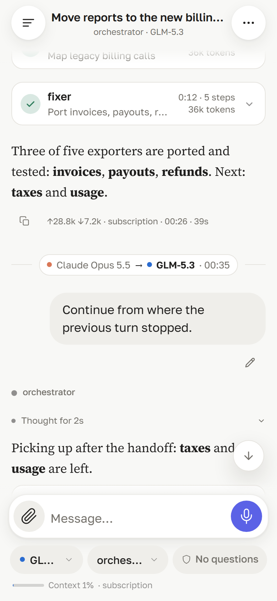
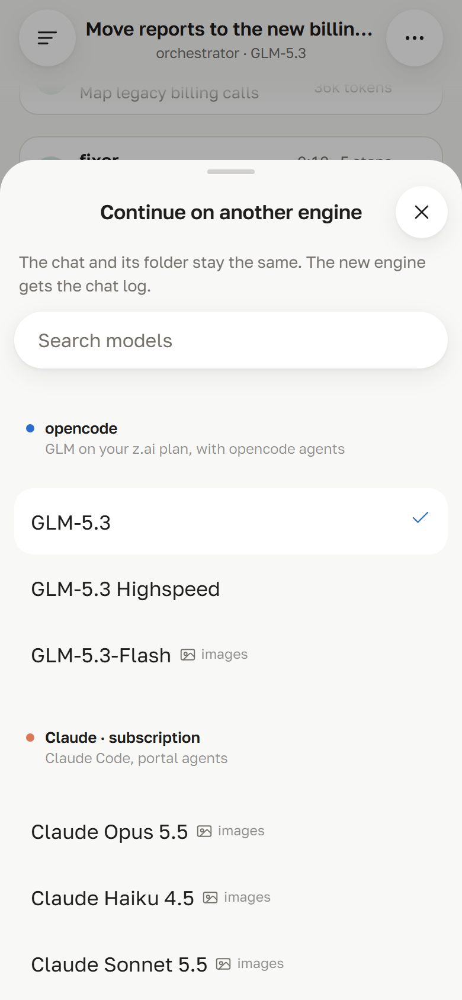

# Switch AI coding CLIs in one chat (Relay)

Teleharness runs real agent CLIs — **Claude Code** and **opencode** — behind one web chat.
**Relay** lets you move a conversation from one CLI to the other, or to another model, without starting over:
the chat keeps its history, its project folder and one continuous feed.

[Русская версия ниже](#переключение-cli-в-одном-чате-relay)

  
  

## What you can do

| You want to… | How |
|---|---|
| Switch between Claude Code and opencode in the same chat | Chat menu → **Continue in…** → pick an engine and model. |
| Keep coding after a Claude Code (or other) usage limit | The limit notice under the failed turn offers **Continue in &lt;model&gt;** — one tap. |
| Get warned before a subscription runs out | When the remaining quota of the chat's provider is low and the provider reports it, a bar above the composer suggests switching. |
| Change only the model inside opencode (e.g. GLM → another provider) | The same menu: a model of the same engine. The agent stays unless you pick another. |
| Go back to the first CLI later | Relay again. The returning CLI is told which turns were done by the other one. |
| Use it from a phone | The whole UI is built for phones first; desktop works too. |

## What is carried over

- **The project folder.** Both CLIs work in the same chat folder, so files changed before the handoff are there.
- **The conversation.** The turns the new CLI has not seen are sent to it, verbatim, as a hidden part of the first
  prompt after the handoff. Very long gaps are cut to a size limit; the prompt then says how many messages were left
  out.
- **The chat journal** (when a knowledge-base folder is configured, `TELEHARNESS_KB_ROOT`). Every chat is written to a
  Markdown journal — requests, agent steps, answers. The new CLI is told where it is and reads it when it needs the
  full history.
- **One feed.** You see the turns of the previous model, a handoff mark (“Claude Opus 5.5 → GLM-5.3”), then the turns
  of the new one.

## What is not carried over

- **The internal state of the previous CLI**: its session cache, tool permissions it was granted in that session,
  running background tasks. The new CLI starts its own session and catches up from the conversation and the journal.
- **The agent.** Agents differ between CLIs, so after switching the engine the chat runs on the new engine's default
  agent unless you pick one.

## Limits

- Three CLIs are supported natively: **Claude Code**, **opencode** and **Codex CLI** (Codex is admin-only for now).
  Through opencode you can use any provider it supports (Z.ai GLM, OpenAI, Google Gemini, Anthropic, OpenRouter,
  local models…). Gemini CLI is not integrated as a separate engine.
- Switching after a usage limit takes one tap, or happens automatically if you turn on *Continue automatically on a
  usage limit* (Settings → Model & agents) and list backup models.
- A chat cannot be switched while a turn is running, and an empty chat has nothing to hand over.
- Users other than the admin can switch only to engines and models they are allowed to use.
- Remaining quota is shown only for providers with an official usage API (z.ai Coding Plan, OpenRouter, DeepSeek,
  Moonshot, SiliconFlow; OpenAI and Anthropic API spend with an organization admin key). Claude subscription limits
  are known only when a turn hits them.

## FAQ

**Is this a model router?** No. Each message goes through a real agent CLI with its own agents, skills, MCP servers
and hooks. Relay switches which CLI (or model) handles the chat from now on.

**Do I lose context when I switch?** The new CLI gets the missed turns in its first prompt and can read the full
journal. It does not inherit the previous CLI's private session state.

**Can it switch automatically when I hit a limit?** Yes, if you opt in: Settings → Model & agents → *Continue
automatically on a usage limit*, with up to three backup models in your order. The server hands the chat over and asks
the new engine to continue, even with your phone closed. It is off by default — then you confirm with one tap.

**Does it work with Codex CLI or Gemini CLI?** Codex CLI is a native engine since 1.21 (admin-only until it has its own
sandbox). Gemini CLI is not; Gemini models are available through opencode.

**Where does my code run?** On your machine. Providers receive only the prompts and tool results needed for inference.

---

# Переключение CLI в одном чате (Relay)

Teleharness запускает настоящие агентные CLI — **Claude Code** и **opencode** — за одним веб-чатом.
**Relay** переводит разговор с одного CLI на другой или на другую модель без начала заново: у чата остаются история,
папка проекта и одна общая лента.

## Что можно сделать

| Задача | Как |
|---|---|
| Переключиться между Claude Code и opencode в том же чате | Меню чата → **Продолжить в…** → движок и модель. |
| Продолжить работу после лимита подписки | Плашка лимита под упавшим ходом предлагает **Продолжить в &lt;модель&gt;** — одно нажатие. |
| Узнать заранее, что подписка заканчивается | Если провайдер сообщает остаток и он мал, над полем ввода появляется полоска с предложением перейти. |
| Сменить только модель внутри opencode | То же меню: модель того же движка. Агент остаётся, если не выбрать другой. |
| Вернуться на первый CLI | Ещё раз Relay. Вернувшийся CLI узнаёт, какие ходы сделал другой. |
| Работать с телефона | Интерфейс сделан в первую очередь под телефон, десктоп тоже работает. |

## Что переносится

- **Папка проекта.** Оба CLI работают в одной папке чата — файлы, изменённые до передачи, на месте.
- **Разговор.** Ходы, которых новый CLI не видел, уходят ему дословно скрытой частью первого запроса после передачи.
  Слишком длинный разрыв обрезается по объёму, и в запросе сказано, сколько сообщений не поместилось.
- **Журнал чата** (если задана папка базы знаний, `TELEHARNESS_KB_ROOT`). Каждый чат пишется в Markdown-журнал: запросы,
  шаги агента, ответы. Новый CLI знает, где он лежит, и читает его, когда нужна полная история.
- **Одна лента.** Сначала ходы прежней модели, затем отметка передачи («Claude Opus 5.5 → GLM-5.3»), затем ходы новой.

## Что не переносится

- **Внутреннее состояние прежнего CLI:** его кэш сессии, выданные в ней разрешения на инструменты, работающие фоновые
  задачи. Новый CLI начинает свою сессию и догоняет по разговору и журналу.
- **Агент.** У разных CLI разные агенты, поэтому после смены движка чат идёт на агенте нового движка по умолчанию,
  если не выбрать другого.

## Ограничения

- Поддерживаются три CLI: **Claude Code**, **opencode** и **Codex CLI** (Codex пока только для администратора). Через
  opencode доступны все его провайдеры (Z.ai GLM, OpenAI, Google Gemini, Anthropic, OpenRouter, локальные модели…).
  Gemini CLI отдельным движком не подключён.
- После лимита переключение требует одного нажатия — или происходит автоматически, если включить *Продолжать
  автоматически при лимите* (Настройки → Модель и агенты) и задать запасные модели.
- Во время хода переключить чат нельзя; пустой чат передавать нечему.
- Пользователи, кроме администратора, переключаются только на разрешённые им движки и модели.
- Остаток подписки виден только у провайдеров с официальным API (z.ai Coding Plan, OpenRouter, DeepSeek, Moonshot,
  SiliconFlow; траты OpenAI и Anthropic API — с ключом администратора организации). Лимиты подписки Claude известны
  только когда ход в них упирается.

## FAQ

**Это роутер моделей?** Нет. Каждое сообщение идёт через настоящий агентный CLI с его агентами, скиллами, MCP и хуками.
Relay меняет, какой CLI (или модель) ведёт чат дальше.

**Теряется ли контекст при переключении?** Новый CLI получает пропущенные ходы в первом запросе и может прочитать весь
журнал. Внутреннее состояние сессии прежнего CLI не наследуется.

**Переключается ли он сам при лимите?** Да, если включить: Настройки → Модель и агенты → *Продолжать автоматически при
лимите*, до трёх запасных моделей в вашем порядке. Сервер передаст чат и попросит новый движок продолжить, даже при
закрытом телефоне. По умолчанию выключено — тогда вы подтверждаете одним нажатием.

**Работает ли с Codex CLI или Gemini CLI?** Codex CLI — отдельный движок с версии 1.21 (только для администратора, пока у
него нет своей песочницы). Gemini CLI — нет; модели Gemini доступны через opencode.

**Где выполняется код?** На вашей машине. Провайдеры получают только запросы и результаты инструментов, нужные для ответа.
