# Teleharness Visual Tour & Full Feature Guide

[← Back to README](../README.md) · [По-русски](tour.ru.md) · [Installation Guide](installation.md)

Every screenshot below is captured directly from the live demo (`npx teleharness --demo` / `npm run demo`) — what you see is what you get.

<p align="center">
  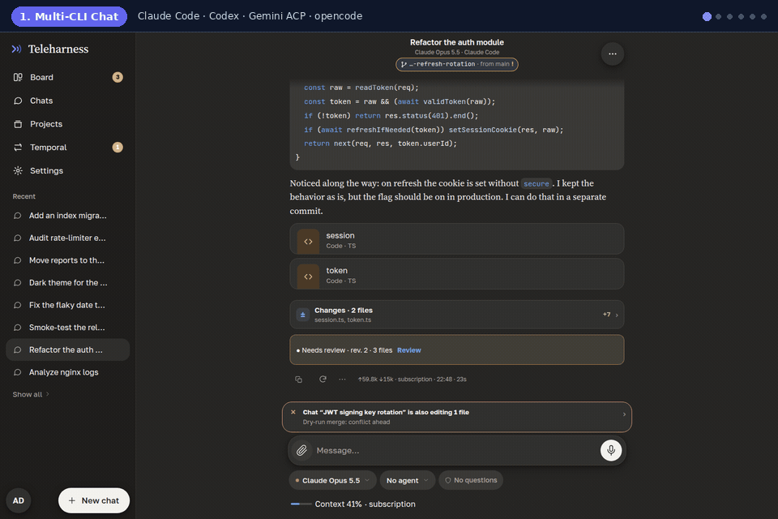
</p>

## Board, diff review, worktrees and costs

Run several coding agents at once without juggling ten terminal tabs:

- **Attention Board (`#/board`)** — one feed across every chat and Temporal run (*Waiting for you*, *Working*, *Done*,
  *Failed*) with a *While you were away* summary, a desktop side preview pane (≥ 768 px), quick actions and per-category
  push notifications with quiet hours.
- **Diff Review & Plan-First (`#/board/review`)** — two-pane desktop diff viewer (and touch-friendly single-column view
  on mobile) to select any line or range, leave inline draft comments, send structured feedback back to the agent, or
  accept and commit. Turn on *Plan first* so Claude, Codex, opencode or Gemini writes a read-only plan and waits for
  your approval before touching a single file.
- **Isolated Git Worktrees (`#/worktrees`)** — put each chat or pipeline run on its own branch and worktree, spot file
  overlaps and dry-run merge conflicts early, and merge back (squash / merge / fast-forward) after running your test command.
- **API-Equivalent Costs (`#/settings/costs`)** — every turn is logged in SQLite and priced against an editable model table,
  compared against your real subscriptions (Claude Max, ChatGPT Plus, Google Antigravity, GitHub Copilot CLI) to show
  actual savings, payback multiplier, soft monthly budgets and CSV export.
- **ACP Agents (`#/settings/acp`)** — install and sign in to **Google Antigravity** (`Gemini 4 Neon`, `Gemini 3.8 Flash`)
  and **GitHub Copilot CLI** right from Settings, with roles, vision, Plan-First, Auto-Relay, and automatic stale-session recovery after interrupted turns.

<p align="center">
  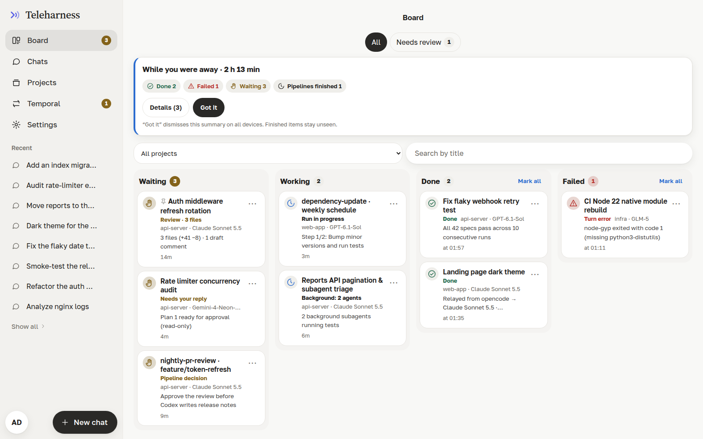
</p>
<p align="center"><sub>Attention Board on desktop: review queues, waiting plans, running pipelines, and a right-hand preview pane (≥ 768 px) without auto-marking items seen.</sub></p>

<p align="center">
  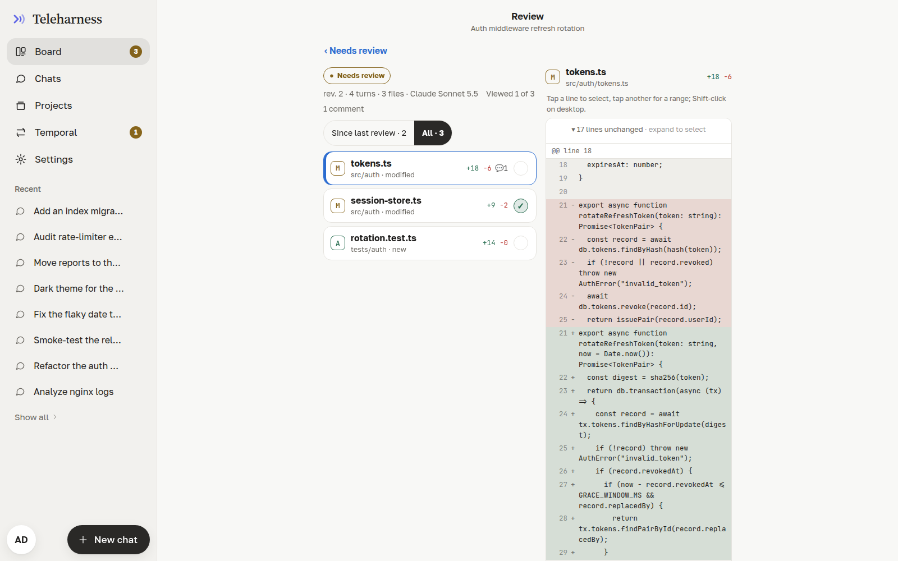
</p>
<p align="center"><sub>Diff review on desktop: file tree, inline line-range comments, return-to-agent feedback and commit actions.</sub></p>

<p align="center">
  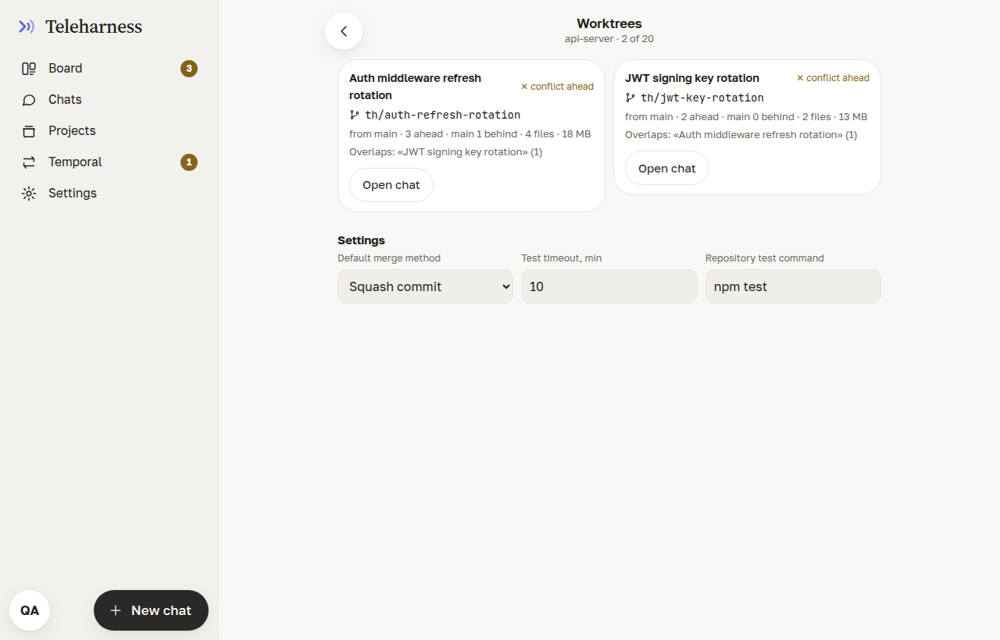
</p>
<p align="center"><sub>Isolated Git Worktrees: every chat or pipeline run on its own branch with live overlap and dry-run conflict checks.</sub></p>

<p align="center">
  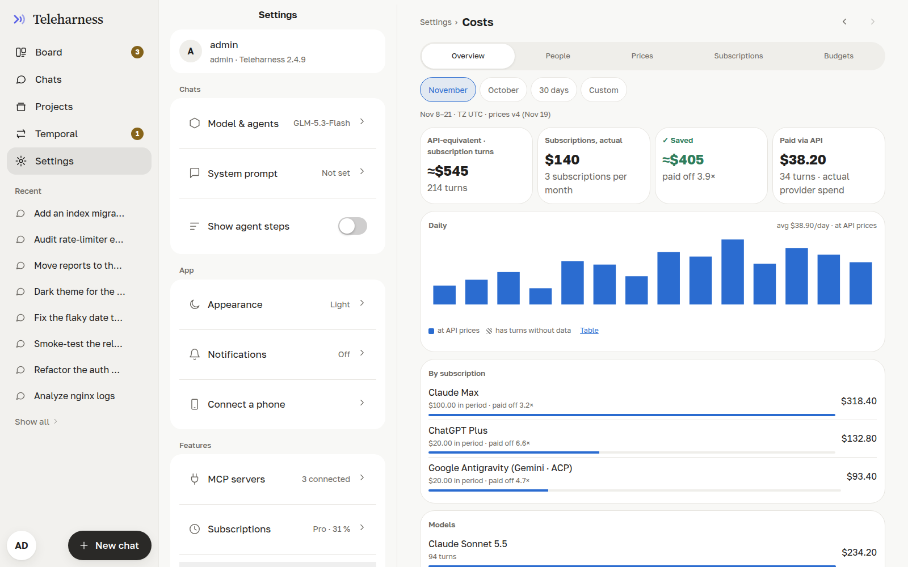
</p>
<p align="center"><sub>API-equivalent cost breakdown against fixed monthly subscriptions, daily chart and per-model spend.</sub></p>

<details>
<summary>Optional mobile web / PWA view (Board, Diff Review, Plan-First, Worktrees)</summary>

<p align="center">
  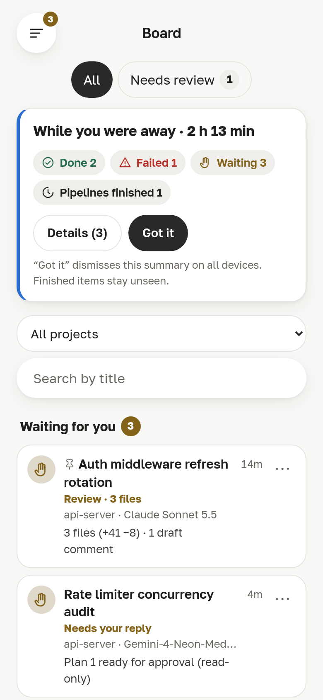
  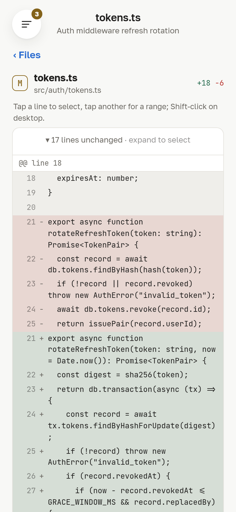
  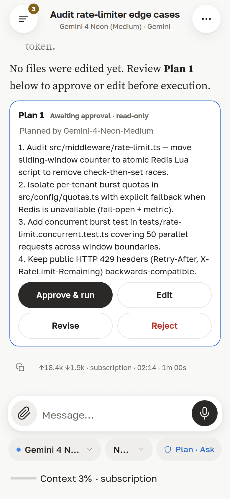
  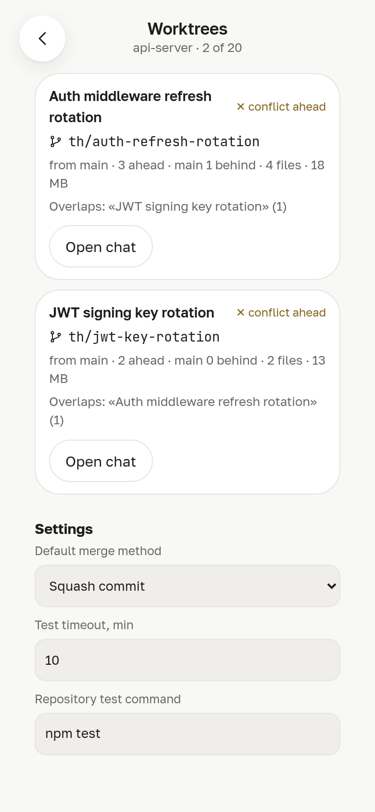
</p>

</details>

## Switch CLI mid-conversation

Start a task with Claude Code, then continue it with Gemini (ACP), Codex, or opencode on GLM or any other model —
in any direction.

- **From the chat menu, at any time:** *Continue in…* → engine and model.
- **When a subscription runs out:** the usage-limit notice offers *Continue in &lt;model&gt;* — one click.
- **What carries over:** the project folder, one shared feed with a handoff mark, the turns the new CLI missed
  (sent with its first prompt) and, if a knowledge-base folder is set, the full chat journal.
- **Automatically, if you want:** turn on *Continue automatically on a usage limit* in Settings → Model & agents and
  list up to three backup models; the server hands the chat over and asks the new CLI to go on, even unattended.
  Off by default.
- **What doesn't:** the previous CLI's private session state.

<p align="center">
  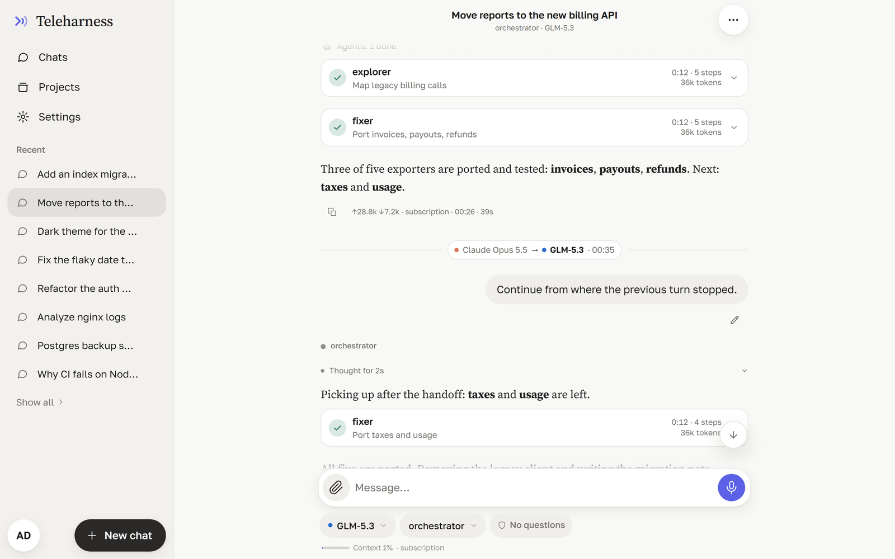
</p>
<p align="center"><sub>Cross-CLI handoff on desktop: Claude Opus did the first half, GLM-5.3 picked the task up in the same feed and project folder.</sub></p>

<details>
<summary>Optional mobile web / PWA view (handoff mark, model picker, Auto-Relay settings)</summary>

<p align="center">
  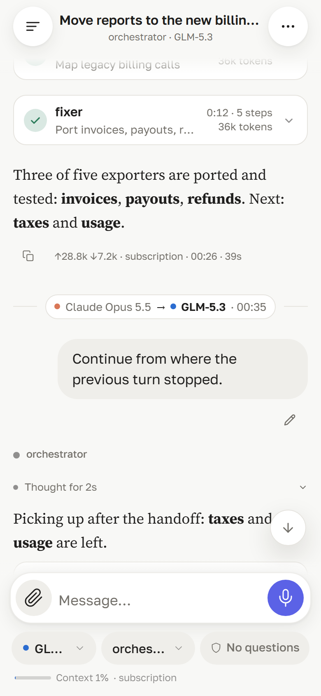
  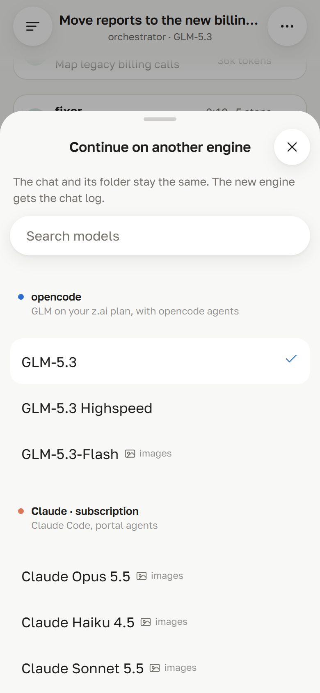
  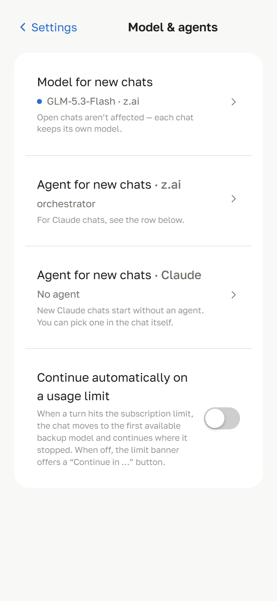
</p>

</details>

Details, limits and FAQ: [cross-cli-handoff.md](cross-cli-handoff.md).

## Pipelines that survive restarts (Temporal)

Turn a routine into a pipe: Claude reviews the diff, you approve it in the browser (or optionally from your phone),
Codex writes the release notes and the file lands in the run folder. Each step runs on your CLI subscription as a turn
of your own chat, so you can open its conversation later. Runs keep going while the browser is closed or the server
restarts.

Why Temporal: every step is a durable activity, model calls are recorded exactly once in a ledger (or run locally
without PostgreSQL via `TELEHARNESS_TEMPORAL_LEDGER=none`), a *Human decision* step can wait for days without holding
a process, and concurrency slots per engine and per user keep your subscriptions within their limits.

A run that failed or was stopped doesn't start from zero: **Resume from step** continues it from the last successful
step — or any step you pick — on the same or the latest published version of the pipe. Completed steps are carried
over as-is (with their results and step chats), only the rest re-runs, the run folder and its files are inherited, and
the run screen shows a badge with a link back to the original run.

<p align="center">
  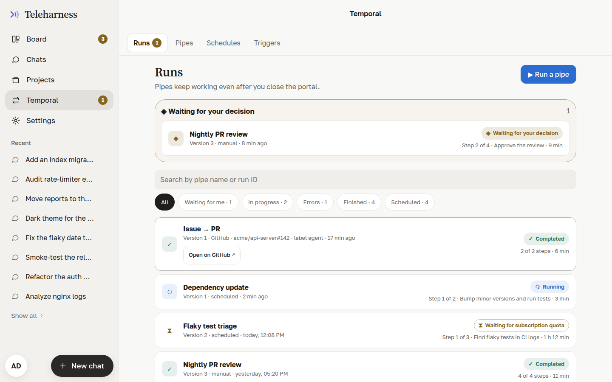
</p>
<p align="center"><sub>Runs list on desktop: when a subscription (including OpenCode) hits its quota, the step parks in <i>Waiting for subscription quota</i> — the run stays resumable instead of failing.</sub></p>

<p align="center">
  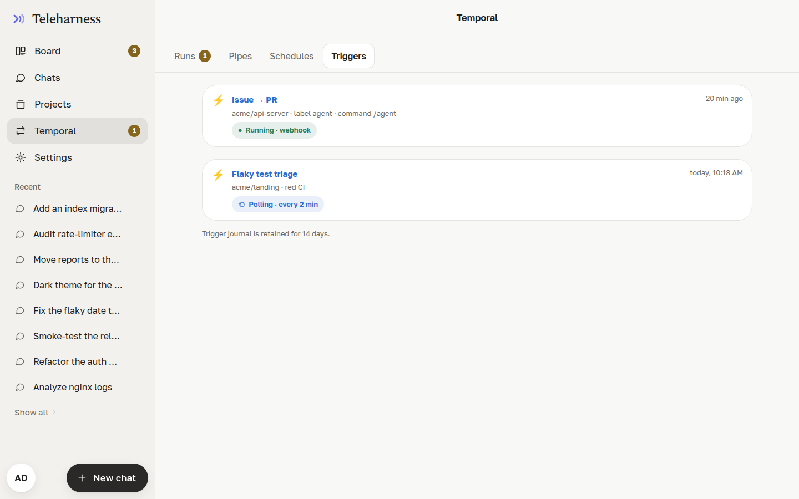
</p>
<p align="center"><sub>GitHub Background Agents: trigger pipelines on issue labels, comment commands or red CI and open draft PRs automatically.</sub></p>

<p align="center">
  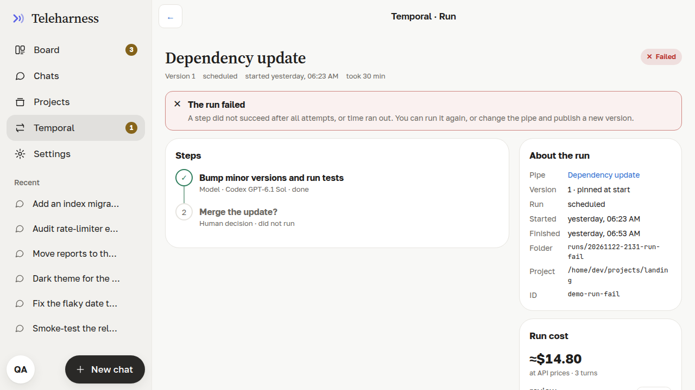
</p>
<p align="center"><sub>Resume from step: inspect step outputs and resume from the last successful step or any chosen point.</sub></p>

<p align="center">
  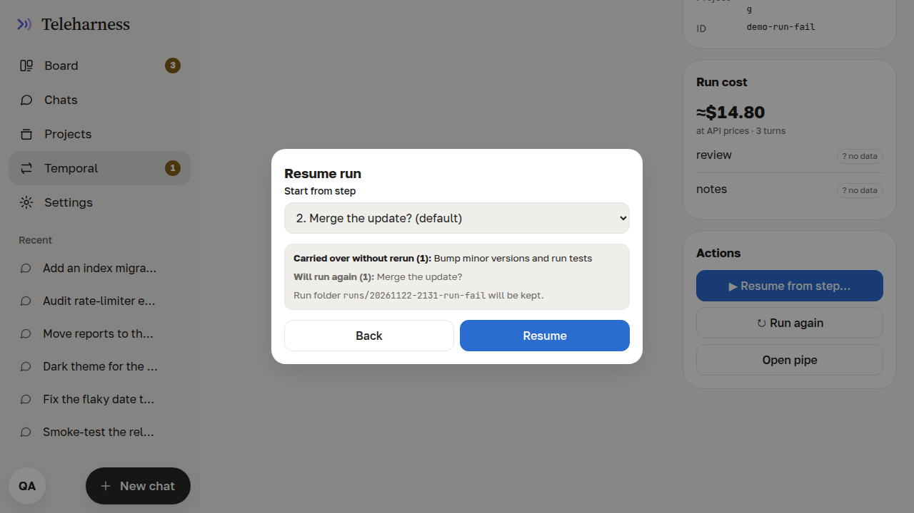
  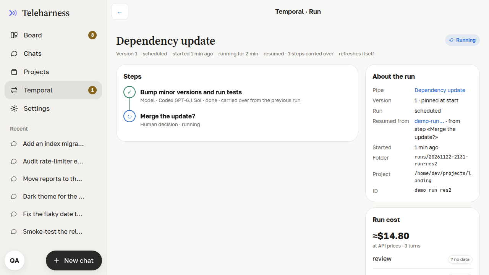
</p>

<p align="center">
  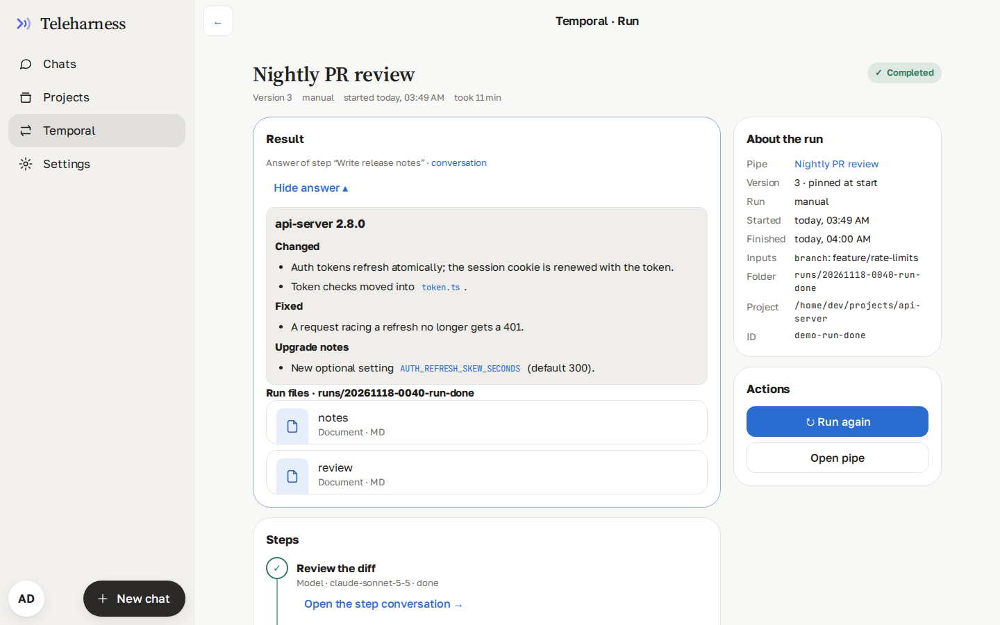
</p>

Steps: *Model* (Claude, Codex, Gemini ACP or OpenCode — GLM models are loaded from your connected OpenCode
providers), **Command** (allowlisted local scripts executed without a shell, or external Temporal workflows/schedules),
*Human decision* (with up to 3 rework cycles back to a model step), *Open PR* (isolated worktree → draft PR or
same-branch CI fix, with approval gate for `.github/workflows`), *Timer*, *Join*, *Condition*, *Artifact*; run inputs
as `{{input.name}}`, earlier answers as `{{steps.id}}`; schedules with a preview of the next runs; an admin
**External** tab to inspect and control any Temporal workflow (Start, Signal, Query, Reset, Cancel, Terminate); and
**GitHub Background Agents** (webhooks or 2-min polling on issue labels, `/agent` commands and red CI, with trusted
authors, 14-day event journal and admin kill-switch). Optional, Linux and macOS — see [temporal.md](temporal.md).
Try it without any setup in `npm run demo`.

<details>
<summary>Optional mobile web / PWA view (Temporal walkthrough GIF &amp; mobile screens)</summary>

<p align="center">
  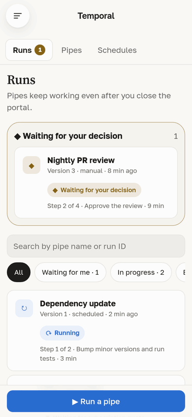
</p>

<p align="center">
  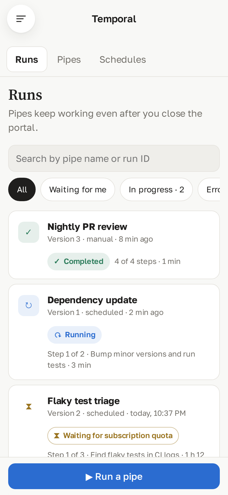
  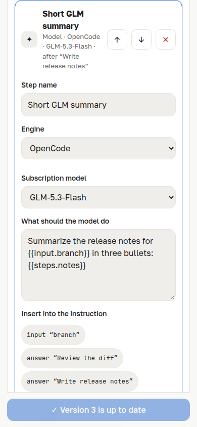
  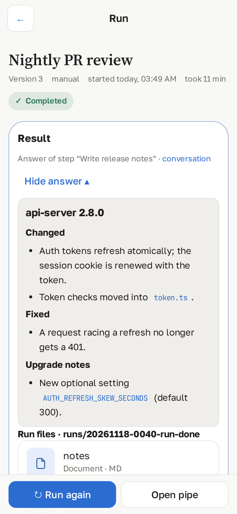
  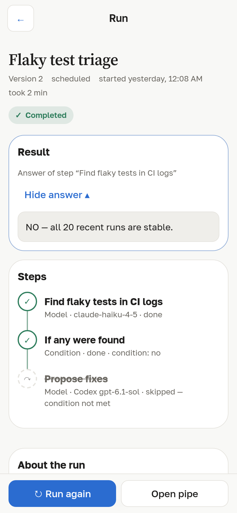
</p>

<p align="center">
  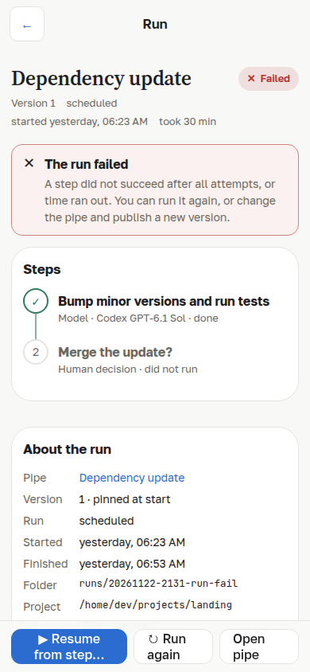
  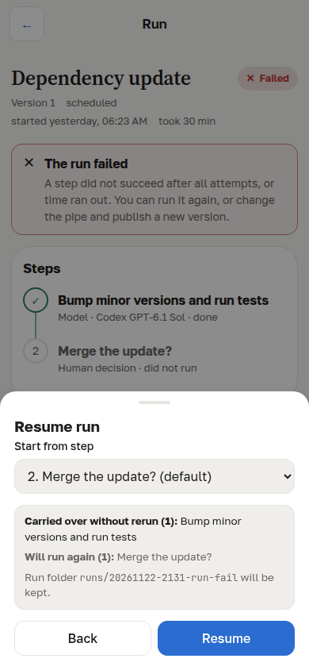
  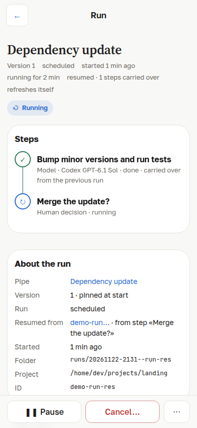
</p>

</details>

## Why Teleharness

Chat apps give you a model. Agent CLIs give you much more — tools, file access, subagents, skills,
MCP servers, hooks, project memory — but managing parallel agents across raw terminal tabs quickly falls apart.

Teleharness puts a unified desktop web control room in front of those CLIs (with an optional mobile web / PWA view if
you ever want to check in from your phone) — and lets you chain them into durable pipelines:

- **CLIs, not models.** Each chat runs through `opencode serve`, the `claude` CLI, the `codex` CLI or ACP agents.
  Whatever you have configured there — agents, skills, plugins, MCP — works right in the browser.
- **Many providers through one portal.** opencode talks to Z.ai GLM, OpenAI, Google Gemini, Anthropic,
  OpenRouter, local models and more; Claude Code brings your Claude subscription, Codex your ChatGPT
  subscription. Pick the engine and model per chat — the picker auto-loads each OpenCode provider's model list and
  refreshes it on demand.
- **Agents that work in the background.** Pipelines on Temporal run multi-step jobs across Claude, Codex, Gemini ACP,
  opencode and allowlisted commands, pause for your approval and resume after restarts — on your subscriptions, never
  a paid API.
- **A task survives a usage limit.** When a subscription runs out mid-task, hand the chat over to another
  engine or model: same folder, one feed, and the new engine receives the turns it missed.
- **Memory that outlives a chat.** An Obsidian vault works as an active cache: agents get a snapshot
  of your notes at the start of a chat and leave a digest after each turn.
- **Your machine, your data.** Files, tools and history stay on your server. Providers only see the
  prompts and tool results needed for inference.
- **You stay in control.** Per chat, choose whether the agent asks before edits and commands; approve or deny
  right in the chat or via optional Web Push notifications.
- **Desktop-first, mobile when you want it.** Full desktop workspace with adaptive sidebar, MCP/Skills/Plan right panel
  and two-pane diff review; optionally pair a phone via QR code to monitor runs or approve plans on the go.
- **Share it safely.** Multiple users with their own folders, quotas and system prompts; on Windows
  their commands run in an AppContainer sandbox, on Linux through an optional per-user runner.

## Try it in 30 seconds

No engines, no API keys — the UI on synthetic chats:

```bash
git clone https://github.com/al3x4kov/teleharness.git
cd teleharness
npm ci
npm run demo     # → http://127.0.0.1:4171/teleharness/
```

## A quick tour

All screenshots are taken from `npm run demo` — what you see is what you get.

### Desktop web workspace

<p align="center">
  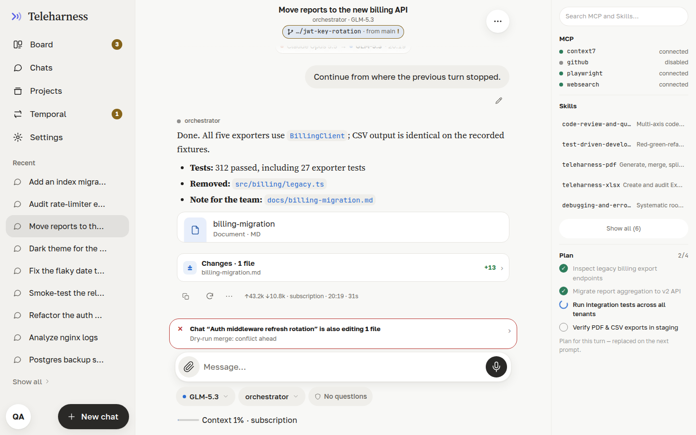
</p>
<p align="center"><sub>Desktop right panel (&ge; 1024 px): live MCP statuses, searchable Skills with full SKILL.md modal preview, and the current turn plan.</sub></p>

<p align="center">
  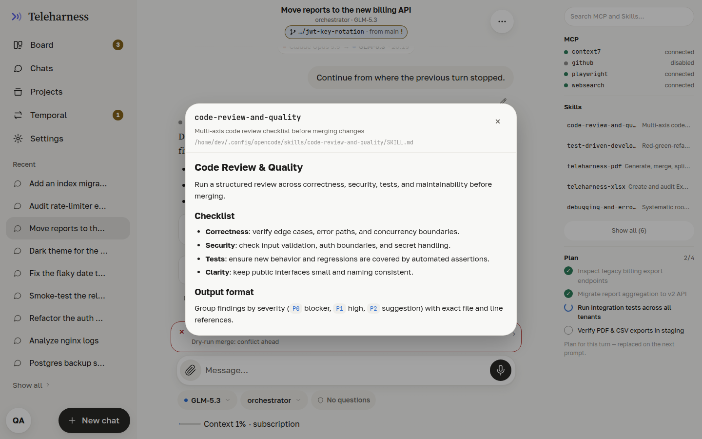
</p>
<p align="center"><sub>Skill viewer modal: inspect full rendered SKILL.md documentation without leaving the chat.</sub></p>

<p align="center">
  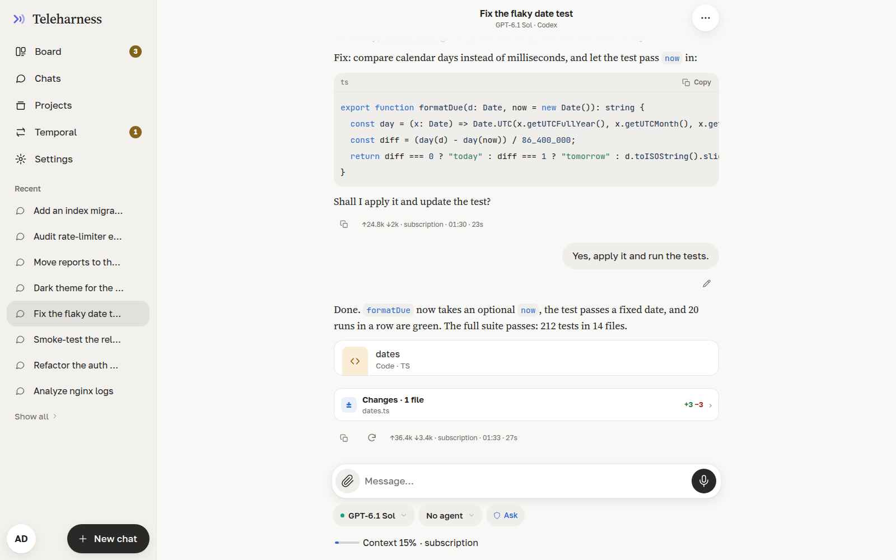
</p>
<p align="center"><sub>Codex CLI on desktop: file edits, passing tests, permission modes and live context meter.</sub></p>

<p align="center">
  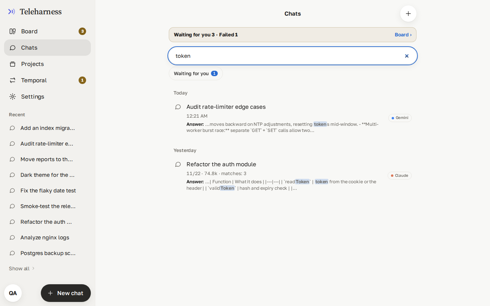
</p>
<p align="center"><sub>Full-text SQLite FTS5 message search across all chats with highlighted snippets and deep links into history.</sub></p>

<p align="center">
  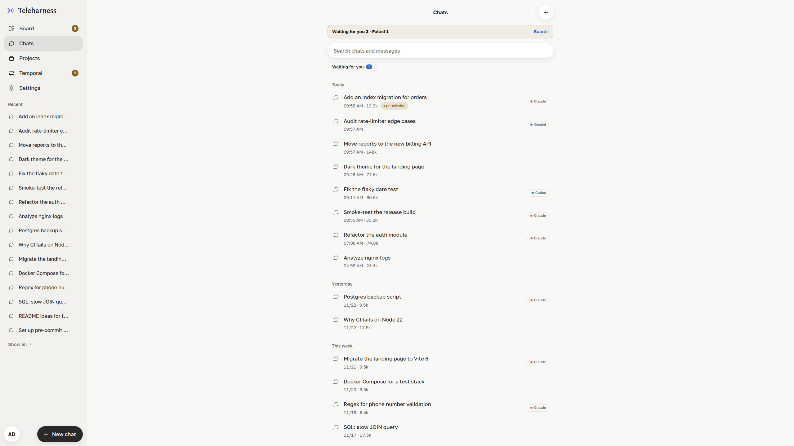
  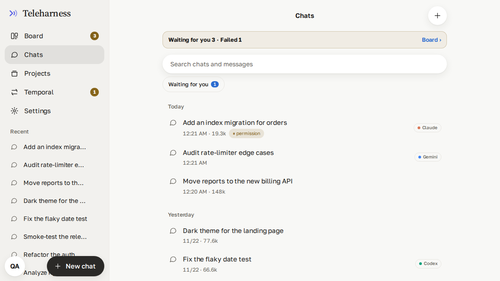
</p>
<p align="center"><sub>Adaptive desktop sidebar (&ge; 900 px): fills available height with Recent chats while keeping the user footer cleanly pinned at the bottom.</sub></p>

<p align="center">
  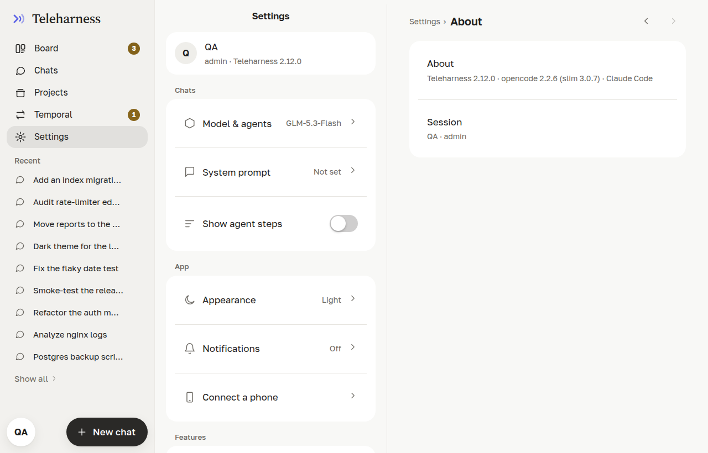
  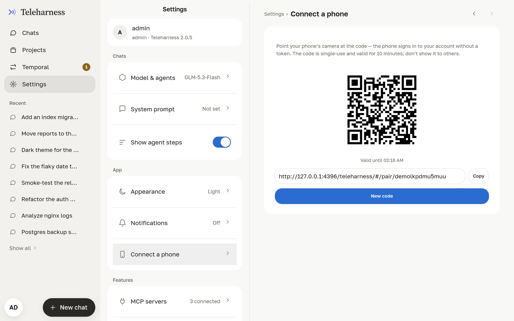
</p>
<p align="center"><sub>Settings → About (exact portal and engine versions) and optional QR phone pairing when you want mobile access.</sub></p>

### Optional mobile web / PWA

If you choose to expose the portal over HTTPS, the exact same web app adapts to iOS Safari and Android Chrome as an
installable standalone PWA — completely optional.

<details>
<summary>Show mobile web / PWA gallery &amp; animated walkthrough</summary>

<p align="center">
  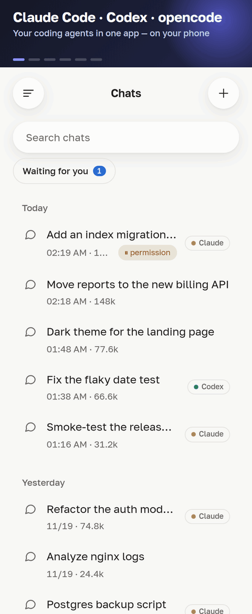
</p>

<table>
<tr>
<td width="25%">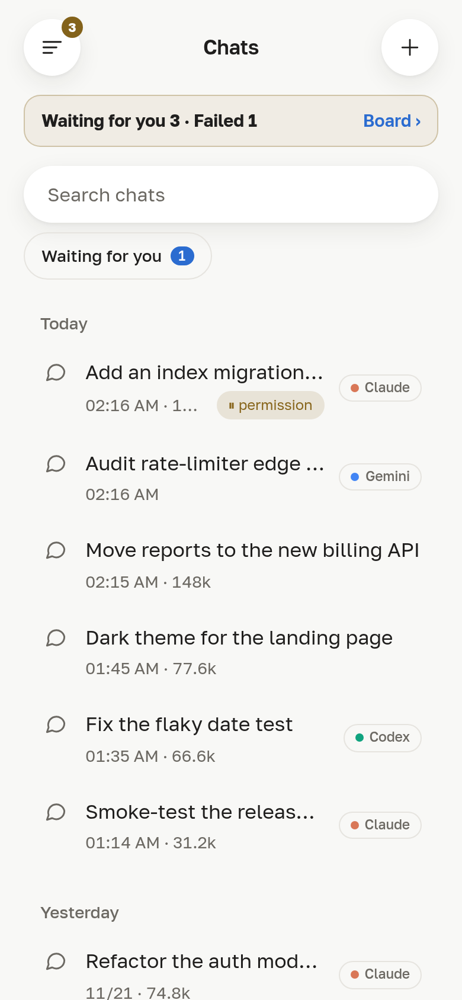</td>
<td width="25%">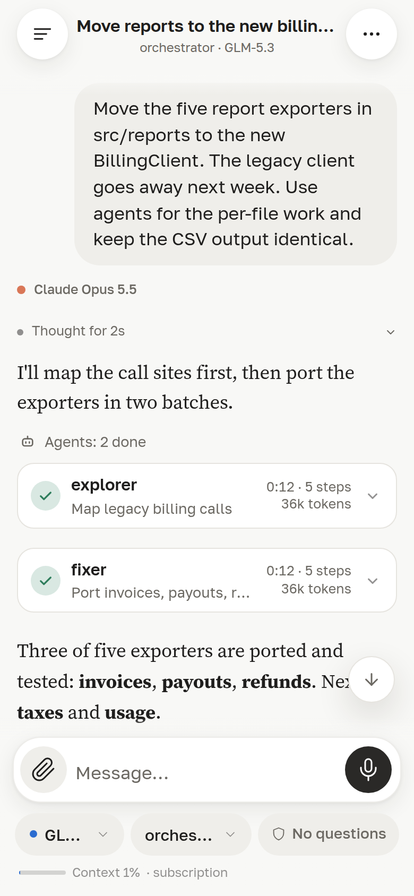</td>
<td width="25%">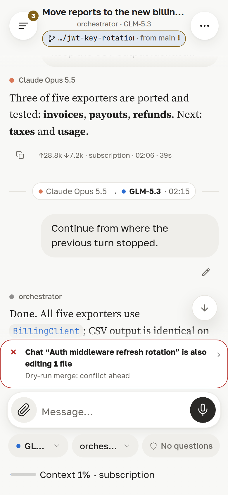</td>
<td width="25%"></td>
</tr>
<tr>
<td valign="top"><b>Chats</b><br>Every chat is bound to an engine, a model and an agent. Claude Code chats are marked.</td>
<td valign="top"><b>Subagents</b><br>When an agent delegates, each run is a card: who, what for, how long, how many steps and tokens.</td>
<td valign="top"><b>Inside a run</b><br>Open a card to see the subagent's steps and its answer, or jump to its own chat.</td>
<td valign="top"><b>Relay</b><br>Hit a usage limit? The same chat continues on another engine — one feed, with a handoff mark.</td>
</tr>
<tr>
<td width="25%"></td>
<td width="25%">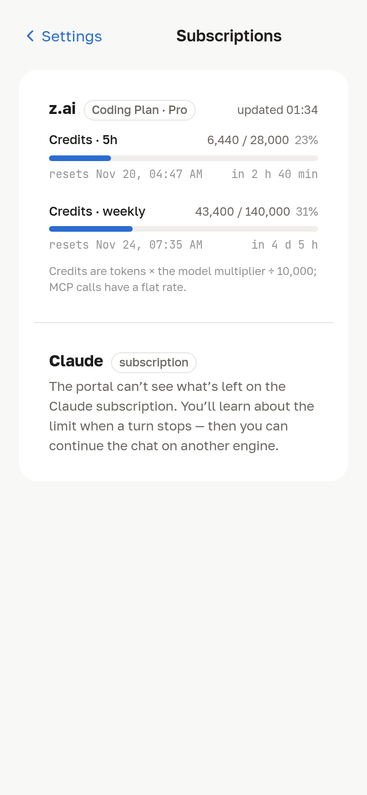</td>
<td width="25%">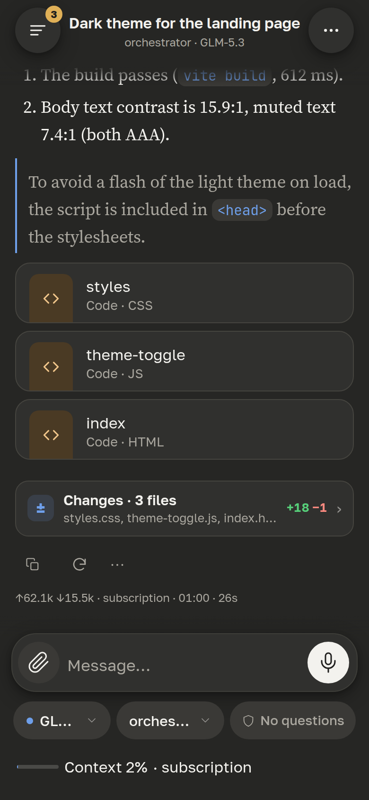</td>
<td width="25%">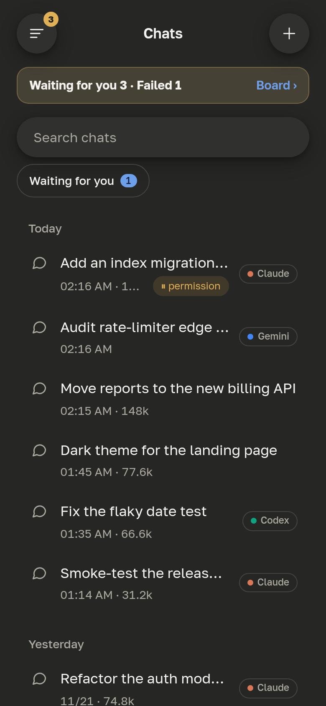</td>
</tr>
<tr>
<td valign="top"><b>Pick where to continue</b><br>From the chat menu at any time, or straight from the limit notice. The folder stays the same.</td>
<td valign="top"><b>Subscriptions</b><br>Usage and remaining quota per connected provider, where it reports them through an official API.</td>
<td valign="top"><b>Steps and files</b><br>Reasoning, tool calls with output, and result files as cards with preview and download.</td>
<td valign="top"><b>Light and dark</b><br>Follows the system theme or your choice; touch-friendly when used on a phone.</td>
</tr>
</table>

</details>

## Features

| | |
|---|---|
| **Four engine families, one UI** | opencode (any provider), Claude Code, Codex CLI and ACP agents (Google Antigravity / Gemini & GitHub Copilot CLI) side by side; each chat sticks to its engine, model and agent. The picker groups models by connected opencode provider (subscription, free, API) with a "Refresh list" button; paid per-token opencode models stay hidden from non-admin users. Admins can grant Claude, Codex and Gemini (ACP) access per user in Settings → Users (scoped to their own folders, no shell).<br>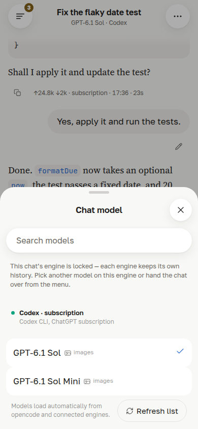 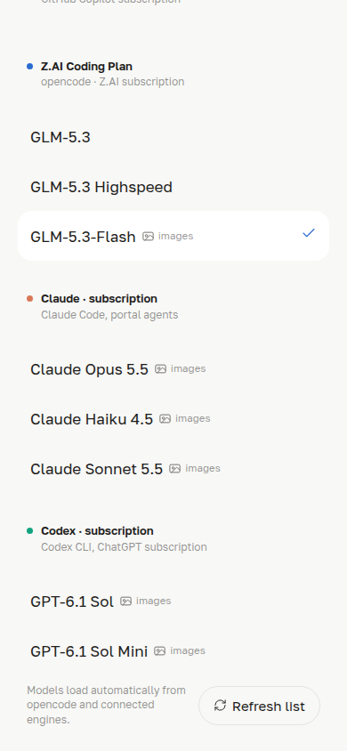 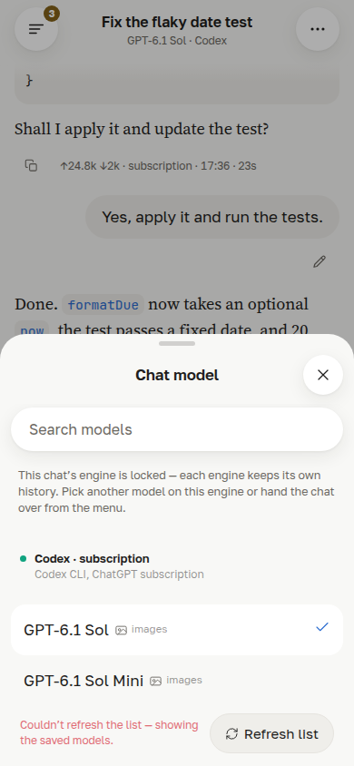 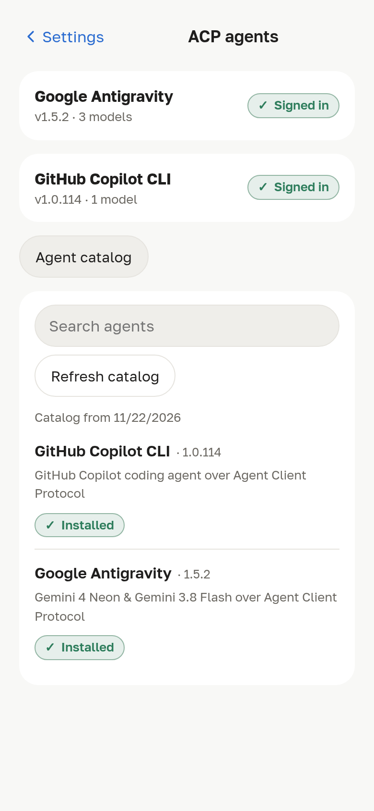 |
| **Attention Board** | One inbox for every chat and Temporal run: *Waiting for you*, *Working*, *Done* and *Failed*, a *While you were away* summary, desktop side preview pane (≥ 768 px), quick actions and per-category push with quiet hours.<br> |
| **Message search** | Full-text search across every user message and reply in all chats: highlighted snippets with "You:" / "Reply:" roles and match counts, jumping straight to the message (loading older history first, then highlighting), backed by a derived local SQLite FTS5 (trigram) index with tenant isolation and graceful title-search fallback while the index builds.<br> |
| **Adaptive Recent list** | On desktop (≥ 900 px) the sidebar's Recent list fills the viewport height instead of stopping at eight rows — up to 100 chats within reach (minimum 8; compact 40 px rows on desktop so the footer stays cleanly below the list even on 1280×720/800 screens).<br>  |
| **Desktop right panel: MCP, Skills & turn plan** | On desktop (≥ 1024 px) an open chat gets a fixed 300 px right panel showing connected **MCP** servers, available **Skills** and the live **Plan** of the current turn (ACP, Claude Code and opencode). A live search bar filters both MCP and Skills with match counts, and clicking any skill opens a modal with the rendered `SKILL.md` (tenants see only allowed `teleharness-*` skills without file paths).<br>  |
| **Diff Review & Plan-First** | Review queue across chats and runs, two-pane desktop diff (and single-column mobile view) with line selection and persistent inline draft comments, return-to-agent and accept/commit. *Plan first* makes the agent propose a read-only plan and wait for approval before editing files.<br>  |
| **Isolated Git Worktrees** | Give each chat or pipeline run its own git worktree and branch, detect cross-chat file overlaps and dry-run merge conflicts, merge with squash/merge/ff after running tests, and prune orphaned branches.<br> |
| **API-equivalent costs** | SQLite turn cost log priced against an editable table, real subscriptions (Claude Max, ChatGPT Plus, Google Antigravity, Copilot CLI) with savings and payback multiplier, soft monthly budgets, per-chat / per-project / per-run totals and CSV export.<br> |
| **Permission mode per chat** | *Ask* — the agent asks before file edits and commands, you approve or deny in the chat (Claude through a permission bridge, Codex natively); *Edits without asking*; *No questions* (admin only).<br>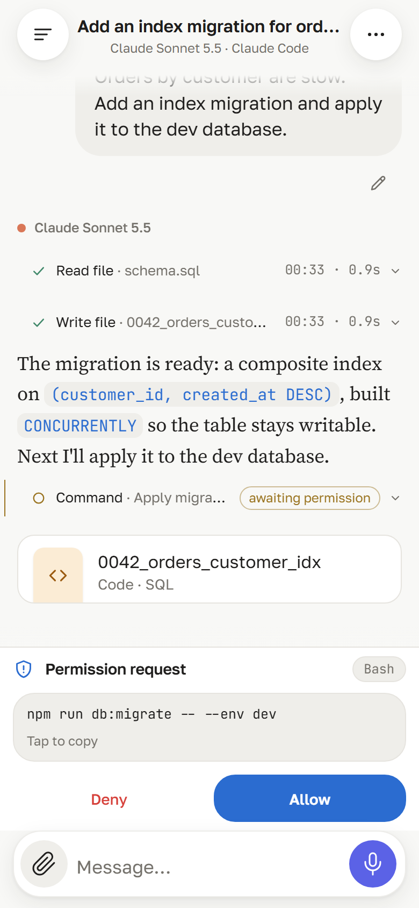 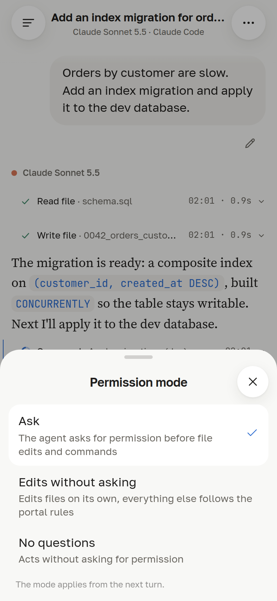 |
| **Waiting for you** | A chat list filter with a count of chats where an agent waits for your decision, plus a push notification when it starts waiting.<br>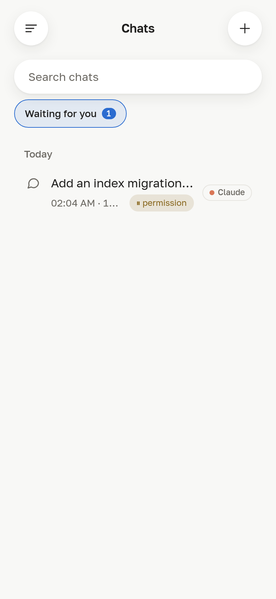 |
| **Context and cost** | A meter above the composer: how full the model's context window is (with a warning past 80 %) and what the chat has cost — or that it runs on a subscription.<br>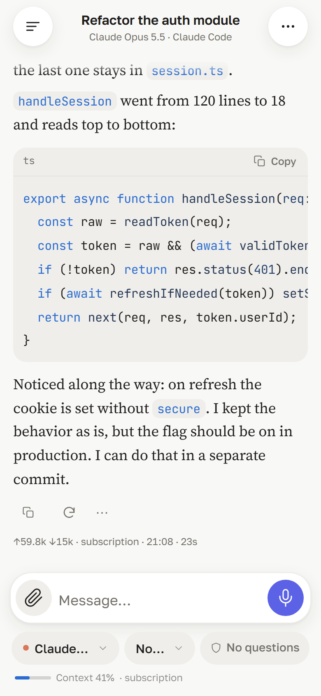  |
| **Agent steps** | Live turn progress: reasoning, tool calls with output, background tasks. Each subagent run is a card with its duration, step count and tokens; open it to see every step — runs of the same tool fold into one line that expands on click, and *Show all steps (N)* lists them one by one. Undo a turn and its file edits.<br> |
| **Turn changes and Git** | An answer that edited files gets a *Changes · N files* row: open it for a per-file diff — what this turn changed, or the file now against the last commit (two panes on desktop, one column on narrow screens). The Git screen of the chat folder shows the branch, ahead/behind and changed files: tick the files to commit, let the chat's own model suggest the message in a separate short request (it never lands in the chat history), commit, and push — push is for the admin only. Other users work with git in their own folders, without push or branch switching. Settings → Git holds the commit author, the message language and the default selection. |
| **Background subagents keep working** | Claude Code answers right away while subagents it started in the background keep running after the answer. A band above the composer shows who is still working; a new message waits in the queue, and Claude picks up their results and answers again when they finish. |
| **Temporal pipelines & GitHub Background Agents** *(optional)* | Multi-step scenarios that survive restarts: Claude, Codex, Gemini (ACP) or OpenCode (GLM) steps, allowlisted **Command** steps (local scripts without a shell or external Temporal workflows/schedules), human approvals with rework loops (up to 3 cycles), *Open PR* steps in isolated worktrees, timers, conditions and saved artifacts. Also runs locally without PostgreSQL (`TELEHARNESS_TEMPORAL_LEDGER=none`) and includes an admin **External** tab to inspect and control any Temporal workflow (Start, Signal, Query, Reset, Cancel, Terminate). A finished or failed run resumes from its last successful step — or any step you choose — carrying over the completed steps, the run folder and step chats. Connect a fine-grained GitHub PAT in Settings → GitHub to trigger pipes automatically via webhook or polling (*Issue → PR*, *Fix CI*, *Nightly dependency update*) with trusted authors, event journal and an admin kill-switch. Runs on your CLI subscriptions, never a paid API. Linux and macOS; off by default — see [temporal.md](temporal.md).<br>   |
| **Relay between engines** | Hit a usage limit mid-task? Continue the same chat on another engine or model: same folder, one feed, and the new engine gets the turns it missed. Optionally automatic, with your own order of backup models. |
| **Subscriptions** | Usage and remaining quota per connected provider, where the provider reports it through an official API. |
| **Reliable streaming** | One SSE hub for every engine with replay, stall detection and loop protection — survives disconnects and tab sleep without losing output. |
| **Files & Office preview** | Attach files and images with the paperclip, paste them (Ctrl/⌘+V — a screenshot gets a dated name, a long pasted text becomes a .txt file) or drag them onto the chat. Result files come back as cards with built-in browser preview for **PowerPoint (`.pptx`)** (slides, bullet lists, tables, embedded images, speaker notes), `.docx`, `.xlsx`, `.csv`, `.pdf`, `.md`, `.html`, code, and media — plus authenticated downloads that also work in iOS/Android standalone PWA (Web Share API + Blob fallback). Browse allowed folders; a folder per chat.<br>   |
| **Obsidian as active cache** | Vault snapshot in context, turn digests and a per-chat journal written back, an isolated zone per user. |
| **Voice** | Local speech-to-text and text-to-speech (Python worker, CPU only) and a hands-free voice mode. |
| **Push notifications** | Get notified when a long turn is done or an agent needs your decision (Web Push, VAPID). |
| **Optional phone pairing by QR** | Settings → Connect a phone shows a one-time QR code (valid 10 minutes); scan it if you want to sign in from a phone without typing a token. Needs `TELEHARNESS_PUBLIC_URL`.<br> |
| **Multi-user** | Admin and users with own folders, system prompts, MCP sets, upload and voice quotas, rate limits. |
| **Settings → About** | The exact version of the portal and every engine in one place — handy when filing an issue.<br> |
| **Desktop-first + optional mobile PWA** | Built for desktop browsers (light & dark themes, adaptive sidebar, right panel, keyboard navigation, English and Russian UI) and responsive down to iOS Safari / Android Chrome standalone PWA if you choose to use it on mobile (native touch text selection, one-tap Copy, safe areas). |
| **Zero runtime dependencies** | The backend is plain Node.js stdlib. |

---

## Architecture diagrams

<p align="center"></p>

<p align="center"></p>
<p align="center"><sub>Messages are cleaned and fed into a local SQLite FTS5 (trigram) index, queried through a tenant-isolated API, and rendered as snippets with deep links into the chat.</sub></p>
